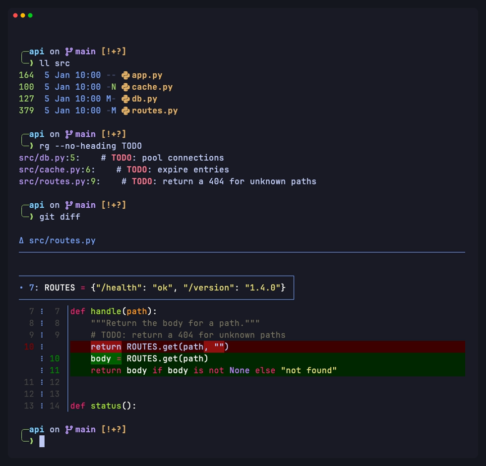
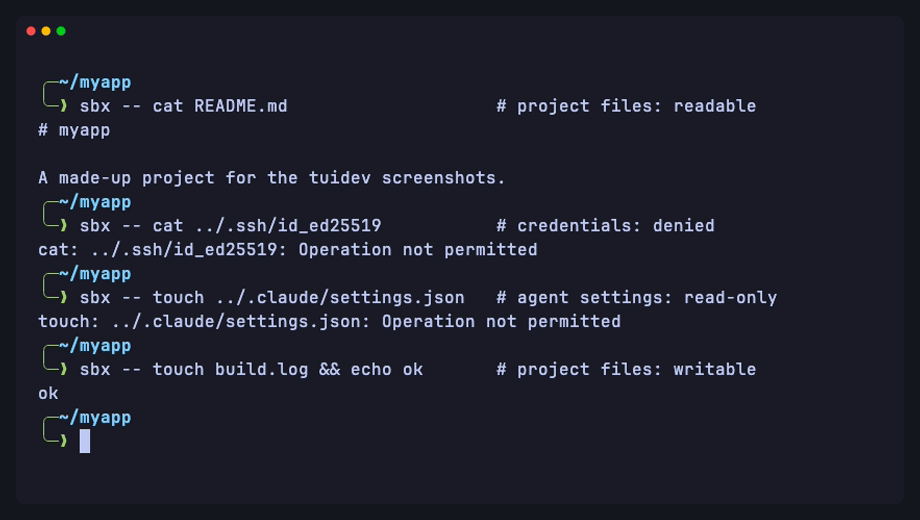
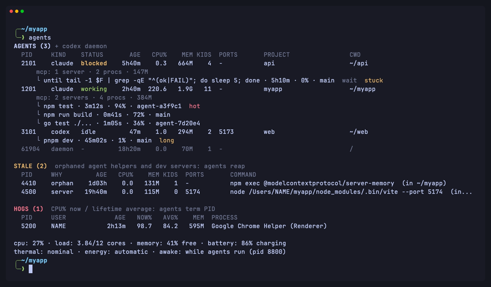

# tuidev

**The terminal dev environment for AI coding agents: modern CLI tools, Claude Code and Codex sandboxed and orchestrated, sessions that outlive your laptop, and an install you can undo.**

[](https://github.com/spfr/tuidev/actions/workflows/ci.yml)
[](https://github.com/spfr/tuidev/releases/latest)


[](LICENSE)


<sub>The shell, `agents` and `sbx` in a demo home with made-up data, rendered with `make screenshots`.</sub>

tuidev is shell scripts and configs for coding with AI agents from the terminal on macOS and Linux. Claude Code is the primary CLI and Codex the second: run them in a Ghostty tab and review the diff in VS Code or Cursor. It installs a small core, and everything else is an opt-in pack.

## What you get

### A modern terminal in one command

`./install.sh` sets up Ghostty, zsh with autosuggestions, syntax highlighting and completions, a Starship prompt, and the tools below, with aliases wired in: `cat` runs `bat`, `ls` and `ll` run `eza`, `cd` runs `zoxide`, `lg` runs `lazygit` and `top` runs `btm` once those are installed. One `palette.toml` colors Ghostty, tmux and Starship, and `make theme NAME=catppuccin-mocha` switches all three. [Profiles](docs/profiles.md) · [Cheatsheet](docs/CHEATSHEET.md) · [Theming](docs/theming.md)



| Category | Tools |
|----------|-------|
| Terminal and shell | Ghostty, zsh plugins, Starship, zoxide; atuin (extras) |
| Search and files | ripgrep, fd, fzf, bat, eza; broot, dust, duf, procs, sd (extras) |
| Git and review | git, git-delta, gh; lazygit (extras); `hunk`, a review-first diff viewer (`--pack hunk`) |
| Data and HTTP | jq, yq; xh (extras) |
| Quality and speed | shellcheck; hyperfine, tokei, tealdeer, glow (extras) |
| Python | uv (extras) |
| Monitoring | bottom, lazydocker (`--pack monitoring`) |

Unlabeled tools are in core. The extras (`--extras`) are optional, and whatever your package manager lacks is skipped.

### Agents sandboxed by default

`--pack ai-clis` turns on Claude Code's and Codex's own sandboxes, so plain `claude` and `codex` run confined without a wrapper, and gates git and gh writes behind a prompt. Claude Code's Bash and `Read` tools are denied `~/.ssh`, `~/.aws` and the other 21 paths on one [credential list](configs/sandbox/credential-paths.txt). Codex's sandbox limits writes and network but not reads, so for anything else `sbx` runs a command under a macOS Seatbelt profile that denies the same list. A contract test keeps every copy of the list in step. [Sandboxing](docs/sandboxing.md)



<sub>Without a sandbox, any command an agent runs can read your keys. Under `sbx` (strict profile), the same read is refused, so are the other credentials and writes outside the project, and the project's own work still runs. Demo home with made-up files.</sub>

### Subagents on the cheapest tier that works

`--pack orchestration` pins Claude Code's subagents to tiers: Haiku for `Explore` and `executor` (search and command runs), Sonnet for `implementor-standard`, Opus for `implementor-complex` and `reviewer`. Codex gets the same roles in `~/.codex/agents`, without `Explore`. A `delegation` skill runs implementors in parallel git worktrees and brings their work back. It installs on its own, without the rest of tuidev. [Orchestration](docs/orchestration.md)

### Agent workflow support

- **Parallel work:** `claude -w NAME` starts a session in its own worktree, and subagents can too.
- **Know when you're needed:** Claude Code hooks call `notify.sh`, which shows a Herdr toast, a tmux message, a macOS banner or a Linux desktop notification, and pushes to your phone through [ntfy](https://ntfy.sh) when you set `NTFY_URL`.
- **Herdr** (`--pack herdr`) is an agent-aware multiplexer that marks each pane `working`, `blocked`, `done` or `idle`.
- **Review first:** `hunk` for review-first diffs, and a starter [`AGENTS.md`](templates/AGENTS_TEMPLATE.md) for your own projects.

[Agent workflows](docs/agent-workflows.md)

### See and stop what agents run

`agents` (`--pack monitoring`) lists each session with its MCP servers, ports and the commands its subagents run in their worktrees, and flags the MCP and dev servers a crashed session left running. It kills a tree, descendants first, re-checking each process's start time before every signal. With Herdr, sessions waiting for you come first. On macOS its SwiftBar menu shows the same, keeps the Mac awake while agents run, and shows CPU, memory, battery and thermal pressure. [Agent workflows](docs/agent-workflows.md#local-processes-agents---pack-monitoring)



### Sessions that outlive your laptop

On an always-on machine you reach over Tailscale, SSH or mosh, tmux or Herdr keeps an agent running while you're away, and `t NAME` re-attaches. Blink Shell and Moshi on iOS are covered too. [Remote](docs/remote.md)

### An install you can preview and undo

Pick a profile or compose packs, and `--dry-run` shows every change first. Config goes into managed blocks, so your own lines survive, and a config file you edited keeps your changes through updates. Every install is recorded, `./uninstall.sh` removes only what tuidev put there, and one-shot migrations clean up after older releases. `minimal` and `remote` also install on Linux with `apt-get`, `dnf` or `pacman` when there's no Homebrew. [Updating](docs/updating.md)

## Who it's for

**For you if** you run Claude Code or Codex from a terminal next to a GUI editor, mostly on a Mac, maybe with a Linux box that stays on, and you want agents confined by default and a setup you can read in an afternoon and remove cleanly.

**Not for you if** you want:

- a terminal IDE: there are no prebuilt tmux layouts, and Neovim is an optional pack;
- a personal dotfiles dump, a kitchen-sink Homebrew installer, or a showcase of every modern CLI;
- AI agents running unsandboxed on the host by default: `--pack ai-clis`, part of the quick start, turns on Claude Code's and Codex's sandboxes;
- in-editor ACP agents shipped for you;
- Docker Desktop or OrbStack (never installed), or `curl | sh` installers (the installer prints the official command instead).

The reasoning is in [VISION.md](VISION.md).

## Quick start

tuidev configures Claude Code and Codex but doesn't install them, since they update themselves. Install them first with their official instructions: [Claude Code](https://code.claude.com/docs/en/setup), [Codex](https://github.com/openai/codex). Then:

```bash
git clone https://github.com/spfr/tuidev.git
cd tuidev
./install.sh --profile desktop --pack ai-clis --dry-run   # preview every change
./install.sh --profile desktop --pack ai-clis             # or: --profile minimal | remote
exec zsh -l

claude                             # Claude Code, sandboxed by its own settings
codex                              # Codex, sandboxed by its own settings
```

Add `--pack monitoring` for `agents` and the menu bar, and `--pack orchestration` for tiered subagents. The first-run walkthrough is [docs/QUICK_START_GUIDE.md](docs/QUICK_START_GUIDE.md).

**Only want the agent setup?** The `orchestration` pack installs on its own, without the shell, theme or packages: `bash scripts/install/packs/orchestration.sh` from a clone. `git pull` and re-run to update, and `./uninstall.sh` to remove it. See [docs/orchestration.md](docs/orchestration.md).

## Profiles and packs

| Profile   | Packs                                   | For                                     |
|-----------|-----------------------------------------|-----------------------------------------|
| `minimal` | core                                    | Servers, VMs, CI runners                |
| `desktop` | core + ui + sandbox                     | **Default on macOS**: laptop or desktop |
| `remote`  | core + remote + sandbox + `--pack tmux` | Headless machines, Tailscale nodes      |

Compose your own with `--core`, `--remote`, `--sandbox`, `--ui` and `--extras`, and add optional packs with `--pack NAME`:

```bash
./install.sh --core --sandbox --pack ai-clis --pack herdr
```

| Optional pack | Adds |
|---------------|------|
| `ai-clis` | Claude Code and Codex settings with their native sandboxes on, and git and gh write gates |
| `orchestration` | Tiered subagents and the delegation skill for Claude Code and Codex |
| `monitoring` | `agents`, its SwiftBar menu (macOS), `lazydocker` and `bottom` |
| `tmux`, `herdr` | Durable sessions; Herdr's agent-aware runtime |
| `nvim`, `vim` | LazyVim, or a zero-plugin vimrc for servers |
| `sandbox-container` | Tier 2 sandboxing in a container runtime (Apple `container`, Podman or Docker) |
| `fnm`, `hunk` | Node via fnm; a review-first diff viewer |

What each profile and pack installs is in [docs/profiles.md](docs/profiles.md). macOS needs Homebrew. On Linux, `minimal` and `remote` also install without it, and anything the distro lacks is skipped with a link to its upstream installer. `sbx` and the `ui` pack are macOS only.

## Everyday commands

```bash
claude | codex                           # AI CLIs, sandboxed by their own native settings
claude -w NAME                           # Claude Code in its own git worktree, for parallel agents
agents                                   # sessions, stale processes, hogs (--pack monitoring)
sbx -- CMD                               # any command under the strict Seatbelt profile (macOS)
t [NAME]                                 # attach-or-create a tmux session (--pack tmux)
make check                               # health check for the installed profile
make update                              # profile-aware, drift-detecting update
make theme NAME=catppuccin-mocha         # re-theme tmux, Ghostty and Starship
make help                                # every target
```

Every key binding and command is listed in [docs/CHEATSHEET.md](docs/CHEATSHEET.md).

## What it changes on your machine

- `~/.zshrc`, `~/.config/starship.toml` and `~/.ssh/config` get `# >>> tuidev managed (...) >>>` blocks. Everything outside the markers is yours. `~/.config/tmux/tmux.conf` gets the same with `--pack tmux`.
- AI CLI settings (`~/.claude/settings.json`, `~/.codex/config.toml`) are placed only where absent or unmodified. An edited `~/.claude/settings.json` gets new shipped settings merged in, and your values win ([docs/updating.md](docs/updating.md#shipped-configs-you-may-have-edited)).
- Anything tuidev replaces is backed up to `~/.config/tuidev/backups/` first.
- `~/.config/tuidev/manifest` records what was installed. `./uninstall.sh` removes only those records: a `ripgrep` you already had survives, and so do CLI logins and session state.
- tuidev sends no telemetry.

## Documentation

| Doc | Covers |
|-----|--------|
| [Quick start](docs/QUICK_START_GUIDE.md) | Install to first sandboxed agent session |
| [Cheatsheet](docs/CHEATSHEET.md) | Session commands, tmux keys, aliases, Makefile |
| [FAQ](docs/FAQ.md) | Troubleshooting |
| [Profiles and packs](docs/profiles.md) | What each profile and pack installs |
| [Sandboxing](docs/sandboxing.md) | Native CLI sandboxes, `sbx`, Seatbelt profiles, credential deny list |
| [Agent workflows](docs/agent-workflows.md) | AI CLIs, editor integration, agent teams, worktrees, Herdr, `agents` and the menu bar, notifications |
| [Orchestration](docs/orchestration.md) | The `orchestration` pack: subagent tiers, skills, git gates, CI runners |
| [Remote and mobile](docs/remote.md) | Tailscale, SSH, mosh, always-on nodes, iOS clients |
| [Neovim](docs/nvim.md) | The `nvim` pack: LazyVim essentials |
| [Vim](docs/vim.md) | The `vim` pack: a zero-plugin vimrc for servers |
| [Theming](docs/theming.md) | Palette contract and `theme.sh` |
| [Updating](docs/updating.md) | Updates, migrations, the install manifest, uninstall |
| [Engineering](docs/engineering.md) | Architecture, shared libs, pack contract, verification, screenshots |
| [Roadmap](docs/roadmap.md) | Watch-list and adopt/hold criteria |
| [VISION.md](VISION.md) | Principles and non-goals |
| [AGENTS.md](AGENTS.md) / [CLAUDE.md](CLAUDE.md) | Instructions for AI agents working on this repo |
| [AGENTS template](templates/AGENTS_TEMPLATE.md) | Starter `AGENTS.md` for your own projects |
| [Migrations](scripts/migrations/README.md) | Script-level contract for one-shot migrations |
| [Screenshot tapes](docs/assets/tapes/README.md) | Demo fixtures and VHS tapes behind the README images |
| [CONTRIBUTING.md](CONTRIBUTING.md) / [SECURITY.md](SECURITY.md) / [Code of Conduct](CODE_OF_CONDUCT.md) | Contributing and reporting |
| [CHANGELOG.md](CHANGELOG.md) | Release history |

## Contributing

Issues and PRs are welcome. Read [CONTRIBUTING.md](CONTRIBUTING.md) and [VISION.md](VISION.md) first, and run `make ci-test` before you push.

## License

[MIT](LICENSE). Sponsored by [SpiceFactory](https://spfr.co).
