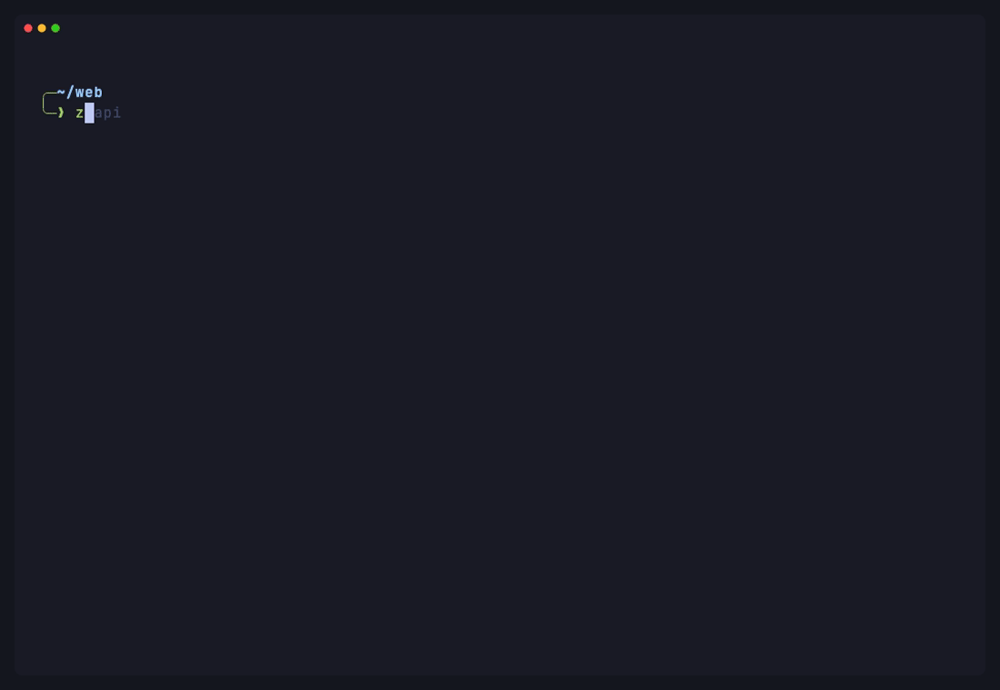

# tuidev

**The terminal dev environment for AI coding agents: every agent on every machine in one view, cleanup with evidence when they leave a mess, Claude Code and Codex sandboxed by default, a modern shell, and an install you can undo.**

[](https://github.com/spfr/tuidev/actions/workflows/ci.yml)
[](https://github.com/spfr/tuidev/releases/latest)


[](LICENSE)


<sub>The shell, `agents` and `sbx` in a demo home with made-up data, rendered with `make screenshots`.</sub>

## The problem

You run Claude Code in one tab, Codex in another, and a long job on a Linux box that stays on. One of them has been waiting for your approval for twenty minutes, and you don't know which. A subagent that finished hours ago left a loop polling a file for a line that will never come. A crashed session left its MCP servers and a dev server running. The fan is on, and nothing says which project is burning the CPU. And any command an agent runs can read `~/.ssh`.

## What tuidev does about it

tuidev is shell scripts and configs for coding with AI agents from the terminal on macOS and Linux. Claude Code is the primary CLI and Codex the second: run them in a Ghostty tab and review the diff in VS Code or Cursor. It installs a small core, and everything else is an opt-in pack.

- **[Every agent, on every machine, in one sidebar](#every-agent-on-every-machine-in-one-sidebar):** Herdr shows which agent needs you, here or on your always-on box.
- **[Cleanup with evidence](#cleanup-with-evidence):** `agents` finds what sessions left behind, says whether it is safe to stop and why, and shows where the CPU went.
- **[In your menu bar](#in-your-menu-bar):** the same on macOS, one click away, with keep-awake and a system view.
- **[Sandboxed by default](#sandboxed-by-default):** Claude Code's and Codex's own sandboxes on, and `sbx` for everything else.
- **[A modern shell in one command](#a-modern-shell-in-one-command):** Ghostty, zsh and the CLI tools you and your agents both reach for.
- **[Subagents on the cheapest tier that works](#subagents-on-the-cheapest-tier-that-works)** and **[an install you can preview and undo](#an-install-you-can-preview-and-undo)**.

## Every agent, on every machine, in one sidebar

`--pack herdr` installs [Herdr](https://herdr.dev/), an agent runtime: a server owns the panes, so agents keep running when you detach, and its sidebar marks each one `working`, `blocked`, `done` or `idle`. Save an always-on box once with `herdr machine add workbox`, and its agents join the same sidebar, so you see which agent needs you, on which machine, and jump straight to it. The box is a Raspberry Pi, a NUC or a VM set up with `--profile remote` (Tailscale, SSH, mosh and tmux, on macOS or Linux), and its agents keep working while your laptop sleeps. [Fleet attention](docs/agent-workflows.md#fleet-attention--herdr---pack-herdr) · [Remote and mobile](docs/remote.md)


<sub>Herdr with this Mac and two Linux containers saved as SSH machines, `devbox` and `workbox`. The agents are scripted stand-ins that report their state through Herdr's hook API, not live Claude Code or Codex sessions. Rendered with `make screenshots`.</sub>

## Cleanup with evidence

Every `claude` session starts its own MCP servers, and its subagents start test runs, dev servers and polling loops. When a session crashes, or a subagent hands back its report, some of that keeps running. `agents` (`--pack monitoring`) lists each session with what it runs, flags what was left behind, and gives every flagged process a verdict with its evidence, so you stop the right thing and leave the rest.


<sub>The demo fixtures and a made-up week of history, rendered with `make screenshots`.</sub>

- **Verdicts, not guesses.** `agents why PID` prints the evidence and a verdict for every stale process and every command flagged stuck, long or duplicated: "safe to stop: what it waits for already finished", "check first: dev server on :5173, its session is still active". `agents reap --stuck` stops the stuck loops. Kills go descendants first and re-check each process's start time before every signal.
- **Fixed at the source.** Claude Code hooks stop the background commands a subagent left running once it hands back its report, and a rule in the orchestration pack tells agents not to poll in sleep loops and to stop what they start. Opt-in `AGENTS_AUTO_REAP=1` cleans up only the high-trust cases.
- **Where the CPU goes.** CPU by job type (tests, builds, dev servers, browsers, MCP, agents, polling loops) per project and session, in the menu and in `agents json`. `agents report` adds CPU-hours over time and which projects leave processes behind, from a local history of names only, never command lines (`AGENTS_HISTORY=0` turns it off).

[Local processes: `agents`](docs/agent-workflows.md#local-processes-agents---pack-monitoring)

## In your menu bar

On macOS, the same pack adds a [SwiftBar](https://swiftbar.app) menu. Sessions waiting for you come first (with Herdr), then each flagged command with its verdict, and Stop, Copy details and Show session in its submenu. Below them: every session, the CPU by job with today's CPU-hours, stale processes and hogs, and CPU, memory, battery and thermal pressure. It keeps the Mac awake while agents run, and with the lid closed too: each time it asks for your password, it is always time-boxed, and a guard turns lid sleep back on at timeout, on low battery or when the Mac runs hot.

<picture>
  <source media="(prefers-color-scheme: dark)" srcset="docs/assets/menu-dark.webp">
  
</picture>

<sub>The plugin's actual output over the demo fixtures, drawn as a macOS menu by `scripts/render_menu.sh`; it is not a screenshot of a real menu bar. [More submenus, animated](docs/assets/menu.gif).</sub>

## Sandboxed by default

`--pack ai-clis` turns on Claude Code's and Codex's own sandboxes, so plain `claude` and `codex` run confined without a wrapper, and gates git and gh writes behind a prompt. Claude Code's Bash and `Read` tools are denied `~/.ssh`, `~/.aws` and the other 21 paths on one [credential list](configs/sandbox/credential-paths.txt). Codex's sandbox limits writes and network but not reads, so for anything else `sbx` runs a command under a macOS Seatbelt profile that denies the same list. A contract test keeps every copy of the list in step. [Sandboxing](docs/sandboxing.md)


<sub>Without a sandbox, any command an agent runs can read your keys. Under `sbx` (strict profile), the same read is refused, so are the other credentials and writes outside the project, and the project's own work still runs. Demo home with made-up files.</sub>

## A modern shell in one command

`./install.sh` sets up Ghostty, zsh with autosuggestions, syntax highlighting and completions, a Starship prompt, and the tools below, with aliases wired in: `cat` runs `bat`, `ls` and `ll` run `eza`, `cd` runs `zoxide`, `lg` runs `lazygit` and `top` runs `btm` once those are installed. Ctrl-T finds a file with fzf and a preview, and with the extras, Ctrl-R searches your history with atuin. One `palette.toml` colors Ghostty, tmux and Starship, and `make theme NAME=catppuccin-mocha` switches all three. [Profiles](docs/profiles.md) · [Cheatsheet](docs/CHEATSHEET.md) · [Theming](docs/theming.md)



| Category | Tools |
|----------|-------|
| Terminal and shell | Ghostty, zsh plugins, Starship, zoxide; atuin (extras) |
| Search and files | ripgrep, fd, fzf, bat, eza; broot, dust, duf, procs, sd (extras) |
| Git and review | git, git-delta, gh; lazygit (extras); `hunk`, a review-first diff viewer (`--pack hunk`) |
| Data and HTTP | jq, yq; xh (extras) |
| Quality and speed | shellcheck; hyperfine, tokei, tealdeer, glow (extras) |
| Python | uv (extras) |
| Monitoring | bottom, lazydocker (`--pack monitoring`) |

Unlabeled tools are in core. The extras (`--extras`) are optional, and whatever your package manager lacks is skipped.

## Subagents on the cheapest tier that works

`--pack orchestration` pins Claude Code's subagents to tiers: Haiku for `Explore` and `executor` (search and command runs), Sonnet for `implementor-standard`, Opus for `implementor-complex` and `reviewer`. Codex gets the same roles in `~/.codex/agents`, without `Explore`. A `delegation` skill runs implementors in parallel git worktrees and brings their work back. It installs on its own, without the rest of tuidev. [Orchestration](docs/orchestration.md)

More for agent work:

- **Parallel work:** `claude -w NAME` starts a session in its own worktree, and subagents can too.
- **Know when you're needed:** Claude Code hooks call `notify.sh`, which shows the first of a Herdr toast, a tmux message, a macOS banner or a Linux desktop notification that works, and falls back to a push through [ntfy](https://ntfy.sh) when nothing local can show it (set `NTFY_URL`).
- **Sessions that outlive your laptop:** on an always-on machine you reach over Tailscale, SSH or mosh, tmux or Herdr keeps an agent running while you're away, and `t NAME` re-attaches. Blink Shell and Moshi on iOS are covered too.
- **Review first:** `hunk` for review-first diffs, and a starter [`AGENTS.md`](templates/AGENTS_TEMPLATE.md) for your own projects.

[Agent workflows](docs/agent-workflows.md)

## An install you can preview and undo

Pick a profile or compose packs, and `--dry-run` shows every change first. Config goes into managed blocks, so your own lines survive, and a config file you edited keeps your changes through updates. Every install is recorded, `./uninstall.sh` removes only what tuidev put there, and one-shot migrations clean up after older releases. `minimal` and `remote` also install on Linux with `apt-get`, `dnf` or `pacman` when there's no Homebrew. [Updating](docs/updating.md)

## Quick start

tuidev configures Claude Code and Codex but doesn't install them, since they update themselves. Install them first with their official instructions: [Claude Code](https://code.claude.com/docs/en/setup), [Codex](https://github.com/openai/codex). Then:

```bash
git clone https://github.com/spfr/tuidev.git
cd tuidev
./install.sh --profile desktop --pack ai-clis --dry-run   # preview every change
./install.sh --profile desktop --pack ai-clis             # or: --profile minimal | remote
exec zsh -l

claude                             # Claude Code, sandboxed by its own settings
codex                              # Codex, sandboxed by its own settings
```

Add `--pack monitoring` for `agents` and the menu bar, `--pack herdr` for the sidebar across machines, and `--pack orchestration` for tiered subagents. The first-run walkthrough is [docs/QUICK_START_GUIDE.md](docs/QUICK_START_GUIDE.md).

**Only want the agent setup?** The `orchestration` pack installs on its own, without the shell, theme or packages: `bash scripts/install/packs/orchestration.sh` from a clone. `git pull` and re-run to update, and `./uninstall.sh` to remove it. See [docs/orchestration.md](docs/orchestration.md).

## Who it's for

**For you if** you run Claude Code or Codex from a terminal next to a GUI editor, mostly on a Mac, maybe with a Linux box that stays on, and you want agents confined by default and a setup you can read in an afternoon and remove cleanly.

**Not for you if** you want:

- a terminal IDE: there are no prebuilt tmux layouts, and Neovim is an optional pack;
- a personal dotfiles dump, a kitchen-sink Homebrew installer, or a showcase of every modern CLI;
- AI agents running unsandboxed on the host by default: `--pack ai-clis`, part of the quick start, turns on Claude Code's and Codex's sandboxes;
- in-editor ACP agents shipped for you;
- Docker Desktop or OrbStack (never installed), or `curl | sh` installers (the installer prints the official command instead).

The reasoning is in [VISION.md](VISION.md).

## Profiles and packs

| Profile   | Packs                                   | For                                     |
|-----------|-----------------------------------------|-----------------------------------------|
| `minimal` | core                                    | Servers, VMs, CI runners                |
| `desktop` | core + ui + sandbox                     | **Default on macOS**: laptop or desktop |
| `remote`  | core + remote + sandbox + `--pack tmux` | Headless machines, Tailscale nodes      |

Compose your own with `--core`, `--remote`, `--sandbox`, `--ui` and `--extras`, and add optional packs with `--pack NAME`:

```bash
./install.sh --core --sandbox --pack ai-clis --pack herdr
```

| Optional pack | Adds |
|---------------|------|
| `ai-clis` | Claude Code and Codex settings with their native sandboxes on, and git and gh write gates |
| `orchestration` | Tiered subagents and the delegation skill for Claude Code and Codex |
| `monitoring` | `agents` (cleanup verdicts, CPU by job), its SwiftBar menu (macOS), `lazydocker` and `bottom` |
| `tmux`, `herdr` | Durable sessions; Herdr's agent-aware runtime |
| `nvim`, `vim` | LazyVim, or a zero-plugin vimrc for servers |
| `sandbox-container` | Tier 2 sandboxing in a container runtime (Apple `container`, Podman or Docker) |
| `fnm`, `hunk` | Node via fnm; a review-first diff viewer |

What each profile and pack installs is in [docs/profiles.md](docs/profiles.md). macOS needs Homebrew. On Linux, `minimal` and `remote` also install without it, and anything the distro lacks is skipped with a link to its upstream installer. `sbx` and the `ui` pack are macOS only.

## Everyday commands

```bash
claude | codex                           # AI CLIs, sandboxed by their own native settings
claude -w NAME                           # Claude Code in its own git worktree, for parallel agents
agents [why PID | report]                # sessions, what's safe to stop, CPU by job (--pack monitoring)
herdr                                    # every agent on this machine and saved ones (--pack herdr)
sbx -- CMD                               # any command under the strict Seatbelt profile (macOS)
t [NAME]                                 # attach-or-create a tmux session (--pack tmux)
make check                               # health check for the installed profile
make update                              # profile-aware, drift-detecting update
make theme NAME=catppuccin-mocha         # re-theme tmux, Ghostty and Starship
make help                                # every target
```

Every key binding and command is listed in [docs/CHEATSHEET.md](docs/CHEATSHEET.md).

## What it changes on your machine

- `~/.zshrc`, `~/.config/starship.toml` and `~/.ssh/config` get `# >>> tuidev managed (...) >>>` blocks. Everything outside the markers is yours. `~/.config/tmux/tmux.conf` gets the same with `--pack tmux`.
- AI CLI settings (`~/.claude/settings.json`, `~/.codex/config.toml`) are placed only where absent or unmodified. An edited `~/.claude/settings.json` gets new shipped settings merged in, and your values win ([docs/updating.md](docs/updating.md#shipped-configs-you-may-have-edited)).
- Anything tuidev replaces is backed up to `~/.config/tuidev/backups/` first.
- `~/.config/tuidev/manifest` records what was installed. `./uninstall.sh` removes only those records: a `ripgrep` you already had survives, and so do CLI logins and session state.
- tuidev sends no telemetry.

## Documentation

| Doc | Covers |
|-----|--------|
| [Quick start](docs/QUICK_START_GUIDE.md) | Install to first sandboxed agent session |
| [Cheatsheet](docs/CHEATSHEET.md) | Session commands, tmux keys, aliases, Makefile |
| [FAQ](docs/FAQ.md) | Troubleshooting |
| [Profiles and packs](docs/profiles.md) | What each profile and pack installs |
| [Sandboxing](docs/sandboxing.md) | Native CLI sandboxes, `sbx`, Seatbelt profiles, credential deny list |
| [Agent workflows](docs/agent-workflows.md) | AI CLIs, editor integration, agent teams, worktrees, Herdr, `agents` and the menu bar, notifications |
| [Orchestration](docs/orchestration.md) | The `orchestration` pack: subagent tiers, skills, git gates, CI runners |
| [Remote and mobile](docs/remote.md) | Tailscale, SSH, mosh, always-on nodes, iOS clients |
| [Neovim](docs/nvim.md) | The `nvim` pack: LazyVim essentials |
| [Vim](docs/vim.md) | The `vim` pack: a zero-plugin vimrc for servers |
| [Theming](docs/theming.md) | Palette contract and `theme.sh` |
| [Updating](docs/updating.md) | Updates, migrations, the install manifest, uninstall |
| [Engineering](docs/engineering.md) | Architecture, shared libs, pack contract, verification, screenshots |
| [Roadmap](docs/roadmap.md) | Watch-list and adopt/hold criteria |
| [VISION.md](VISION.md) | Principles and non-goals |
| [AGENTS.md](AGENTS.md) / [CLAUDE.md](CLAUDE.md) | Instructions for AI agents working on this repo |
| [AGENTS template](templates/AGENTS_TEMPLATE.md) | Starter `AGENTS.md` for your own projects |
| [Migrations](scripts/migrations/README.md) | Script-level contract for one-shot migrations |
| [Screenshot tapes](docs/assets/tapes/README.md) | Demo fixtures, VHS tapes, the Herdr fleet and the menu renderer behind the README images |
| [CONTRIBUTING.md](CONTRIBUTING.md) / [SECURITY.md](SECURITY.md) / [Code of Conduct](CODE_OF_CONDUCT.md) | Contributing and reporting |
| [CHANGELOG.md](CHANGELOG.md) | Release history |

## Contributing

Issues and PRs are welcome. Read [CONTRIBUTING.md](CONTRIBUTING.md) and [VISION.md](VISION.md) first, and run `make ci-test` before you push.

## License

[MIT](LICENSE). Sponsored by [SpiceFactory](https://spfr.co).
