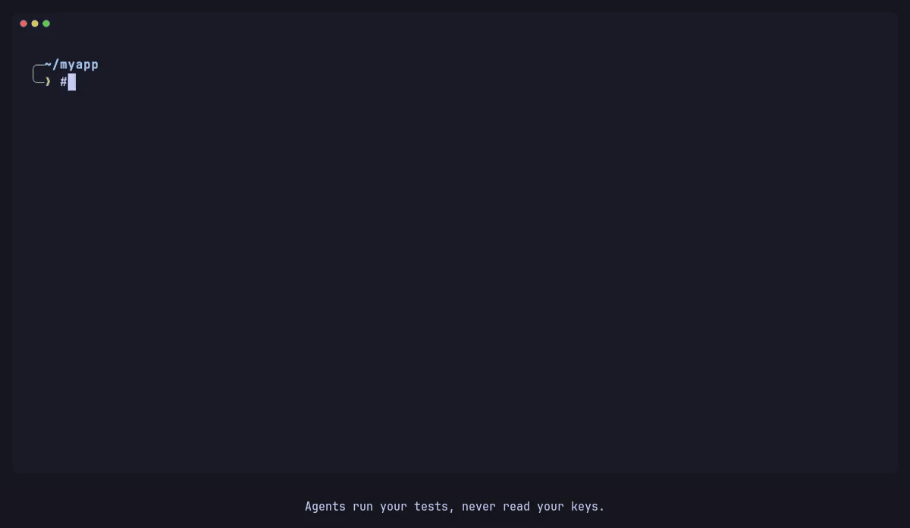

# tuidev

**Run your agents anywhere. See everything they do.**

Run Claude Code and Codex on your laptop, on a VM or an always-on box, and pick them up from your phone. tuidev shows which agent needs you and what each one runs, costs and leaves behind, and keeps them away from your keys. It is the setup one team works in every day, shared in the open. It is built on open tools and names them below; it adds to them and replaces none.

```bash
curl -fsSL https://github.com/spfr/tuidev/releases/latest/download/get.sh | bash
```

It asks what this machine should get, then asks once more before it changes anything; answer `p` to see every change first. `tuidev uninstall` removes it.

[](https://github.com/spfr/tuidev/actions/workflows/ci.yml)
[](https://github.com/spfr/tuidev/releases/latest)


[](LICENSE)

![A short terminal tour in three scenes. First, the Starship prompt in a repo, ll listing files with a git status column, and git diff through delta. Second, the agents command: a blocked Claude Code session first, a finished Codex session to review, a working one, a polling loop flagged stuck, and a line each for stale processes and hogs. Third, cat reading an SSH key without a sandbox, then sbx refusing the same read and a write to ~/.zshrc with "Operation not permitted" while make test still runs and passes.](docs/assets/tour.gif)

<sub>What to look at: the shell shows the repo's state, `agents` puts the blocked session first, and `sbx` refuses a read of an SSH key.</sub>

## What you get

### Work from any machine and from your phone

An agent on another machine prints `http://localhost:5173`, which is that machine's localhost. With tuidev on both, **Ctrl-click** the link in its Herdr pane and it opens in your browser, through an ssh tunnel made on the spot. **prefix+m** opens a map of what runs where; Enter opens a preview, and **ctrl-k** stops what is under the cursor on the machine that runs it, after asking. It is plain ssh: nothing listens anywhere. [Remote feels local](docs/remote.md#remote-feels-local-ports-links-and-files)


Herdr has a free phone app with an inbox of the agents that need you. An agent started with `agents hc run` (`--pack herdr-core`) shows up there and keeps running when the pane closes. Showing the agents you already run in Herdr panes (`AGENTS_HC_MIRROR=1`) is experimental and off by default. Tested so far on one Mac with one phone. [Herdr's phone app](docs/remote.md#herdrs-phone-app-agents-hc)

### Know which agent needs you

One sidebar lists every agent on every machine, the blocked one first, and tabs carry the task's name instead of `1 2 3`. [Herdr](https://herdr.dev/) (`--pack herdr`) owns the panes, so agents keep running when you detach; `--pack monitoring` adds the marks and names. `agents board` (Herdr: **prefix+space**) puts every session on one screen, grouped as Needs you, To review and Working, with the last lines of the selected session's output. On macOS a SwiftBar menu counts what needs you, and alerts know which pane you are looking at. Notifications reach you by a Herdr toast, a tmux message, a macOS banner or an [ntfy](https://ntfy.sh) push. [Fleet attention](docs/agent-workflows.md#fleet-attention--herdr---pack-herdr) · [The board](docs/agent-workflows.md#the-board-every-session-one-screen) · [Menu bar](docs/agent-workflows.md#menu-bar-swiftbar-macos)


<picture>
  <source media="(prefers-color-scheme: dark)" srcset="docs/assets/menu-dark.webp">
  
</picture>

### See what agents run and what it costs

`agents` (`--pack monitoring`) lists each session with what it runs, its ports and what was left behind. Every flagged process gets a verdict with its evidence (`agents why PID`), so you stop the right thing: "safe to stop: what it waits for already finished", or "check first: dev server on :5173, its session is still active". `agents reap` stops only what is safe to stop; `--all` takes the rest. A memory guard, on macOS and Linux, warns about a runaway process and stops one in an agent tree at half the RAM, and hogs are named in the menu bar while they last. `agents limits` shows each CLI's usage limits, and `agents report` shows CPU by project and job and the tokens, with what they would cost at API list prices. A sampler keeps that history once a minute, with or without the menu bar, and `agents doctor` says whether it, the guard and the hooks are working. It all reads local files; nothing is sent anywhere. Stale-process detection is best on macOS: on Linux, orphans rarely look stale. In Claude Code's auto mode, hooks also stop the background commands a subagent left behind. [Local processes](docs/agent-workflows.md#local-processes-agents---pack-monitoring) · [Memory guard](docs/agent-workflows.md#memory-guard-agents-mem) · [Tokens](docs/agent-workflows.md#tokens-and-denials) · [Is it running](docs/agent-workflows.md#is-it-running-agents-doctor)


### Keep agents away from your keys

`--pack ai-clis` turns on Claude Code's and Codex's own sandbox settings and gates git and gh writes behind a prompt. Claude Code's commands and `Read` tool are denied `~/.ssh`, `~/.aws` and the rest of one [credential list](configs/sandbox/credential-paths.txt): CLI tokens, shell history and browser profiles. Publish, cloud and model-provider tokens exported in your shell (`GITHUB_TOKEN`, `AWS_SECRET_ACCESS_KEY`, `ANTHROPIC_API_KEY` and others) are unset in Claude Code's sandboxed commands and in every command Codex runs; the CLIs keep their own login. Plain Codex's `workspace-write` limits writes and network but not reads, so it can still read those paths; run it under `sbx` (macOS Seatbelt) for the same protection. `secret` keeps API tokens in your OS keychain, out of every agent's environment, and hands one to one command with `secret run -n NAME -- CMD`. [Sandboxing](docs/sandboxing.md) · [Secrets](docs/secrets.md#what-an-agent-can-reach)



### Install, update and remove cleanly

Every install is recorded, and `tuidev uninstall` removes only what it recorded. `tuidev update` fetches the latest release and keeps your edits; `tuidev update --rollback` goes back to the release before. `tuidev check` probes the install and what should be running (background jobs, hooks, versions), and `tuidev check --fix` repairs what it safely can. Nothing updates itself, and tuidev sends no telemetry: its only request of its own is a daily check for the latest release tag, which `tuidev latest off` stops. [Updating](docs/updating.md)


More short clips, each one outcome in about 16 seconds, are in [docs/assets/clips](docs/assets/clips): the agent that needs you, leftovers, cost, the menu bar, a memory hog and a remote preview.

## Built on

tuidev is shell scripts and configs over tools other people make. It installs and configures them; it does not replace them.

- [Claude Code](https://code.claude.com/docs/en/setup) and [Codex](https://github.com/openai/codex): the agents. tuidev configures them but does not install them.
- [Herdr](https://herdr.dev/): the multi-machine sidebar and the phone app. tuidev adds tab names, the board, the map and the link that opens another machine's preview here.
- [tmux](https://github.com/tmux/tmux): durable sessions on a box that stays on, as an optional pack.
- [Ghostty](https://ghostty.org), zsh and Starship: the terminal and shell, in one palette.
- [SwiftBar](https://swiftbar.app) (macOS): the menu bar.

On top, tuidev adds the process verdicts and reports, the sandbox settings and credential list, `secret`, and an installer that records what it did.

## Install and profiles

Pick what this machine gets, or skip the question by ending the install line with flags:

| You pick | You get | Flags after `bash -s --` |
|----------|---------|--------------------------|
| Everything for agent work | Sandboxed agents, `agents` and the menu bar, Herdr, tiered subagents, the shell, and fan control on Apple Silicon, on a Mac | `--profile full` |
| Shell and sandboxed agents | The shell and Ghostty, with Claude Code and Codex sandboxed | `--profile desktop --pack ai-clis` |
| A headless box that stays on | The shell, tmux, Tailscale and mosh, with sandboxed agents | `--profile remote --pack ai-clis` |
| Just the shell | zsh, the prompt and the CLI tools | `--profile minimal` |

macOS needs [Homebrew](https://brew.sh). Afterwards, restart your shell with `exec zsh -l`. In CI or a container build there is nobody to ask, so name the flags and add `--yes`. No git and no clone: `get.sh` downloads the latest release and checks it against the release's sha256. Rather read it first? Download it with `curl -fsSLO https://github.com/spfr/tuidev/releases/latest/download/get.sh`, read it (about 230 lines), then `bash get.sh`. Or clone the repo and run `./install.sh` with the same flags.

Add packs later with `tuidev install --pack NAME` (`--dry-run` previews). `tuidev` alone opens a searchable list of everything you can do. What each profile and pack installs is in [Profiles and packs](docs/profiles.md); the first ten minutes, from install to a waiting agent, are in the [Quick start](docs/QUICK_START_GUIDE.md).

<details>
<summary>Or hand it to your agent</summary>

Paste this into Claude Code or Codex. It drives the same installer, shows you the plan and waits for your yes:

```text
Set up tuidev (https://github.com/spfr/tuidev) on this machine.

1. Download https://github.com/spfr/tuidev/releases/latest/download/get.sh and run
   `bash get.sh --fetch`. It prints the directory the release is in. Read README.md and AGENTS.md there.
2. Tell me the OS, and which fits: `--profile full` for everything on a Mac I sit at,
   `--profile desktop --pack ai-clis` for less, `--profile remote` on a headless box,
   `--profile minimal` on Linux without Homebrew. Recommend one and ask me once.
3. Run `<that directory>/install.sh <my choice> --dry-run < /dev/null` and summarise what it
   would install and which files in my home it would change. Wait for my yes.
4. Run the same command without `--dry-run`. Use only install.sh: no edits to my dotfiles by
   hand. If it needs sudo, a password, or a path your sandbox denies, stop and give me the
   exact command to run myself.
5. Run `tuidev check` and `tuidev perf`, and report what failed or warned, with the fix each
   one prints. Change nothing else. Remind me to run `exec zsh -l`, and that `tuidev uninstall` undoes it.
```

</details>

## Also included

- **A modern shell.** Ghostty, zsh with autosuggestions, a Starship prompt, and `rg`, `fd`, `bat`, `eza`, `zoxide`, `fzf`, `delta`, `gh` and `jq`. An agent's `cat`, `ls` and `top` stay the real commands. [Toolbox](docs/toolbox.md) · [Theming](docs/theming.md)
- **Cheaper subagents.** `--pack orchestration` pins Claude Code's subagents to tiers: Haiku for search and command runs, Sonnet for routine implementation, Fable for hard changes, Opus for review. Codex gets the same roles on OpenAI's current models: GPT-6 Luna, GPT-6.2 Sol and GPT-6.2 Astra (a paid plan). [Orchestration](docs/orchestration.md)
- **A MacBook that stays cool.** `--pack cooling` adds a fan curve through a small Swift daemon you build from [one readable file](lib/fan/tuidev-fan.swift). It only adds air and hands the fans back on any error. [Fans](docs/agent-workflows.md#fans---pack-cooling)
- **New package versions wait 3 days.** `--pack release-age` makes npm, bun and uv outside projects wait until a version is 3 days old. Lockfiles still install as pinned.
- **Two audits.** `tuidev perf` checks what the OS does behind your agents; `tuidev disk` shows what tools and agents left on disk. [Performance](docs/performance.md)


## What it changes on your machine

- `~/.zshrc`, `~/.config/starship.toml` and `~/.ssh/config` get `# >>> tuidev managed (...) >>>` blocks. Everything outside the markers is yours.
- AI CLI settings (`~/.claude/settings.json`, `~/.codex/config.toml`) are placed only where absent or unmodified. An edited `~/.claude/settings.json` gets new shipped settings merged in, and your values win ([docs/updating.md](docs/updating.md#shipped-configs-you-may-have-edited)).
- Anything tuidev replaces is backed up to `~/.config/tuidev/backups/` first.
- `~/.config/tuidev/manifest` records what was installed. `tuidev uninstall` removes only those records: a `ripgrep` you already had survives, and so do CLI logins and session state.
- What runs in the background is listed with its trigger and its off switch in [docs/performance.md](docs/performance.md#what-tuidev-runs-in-the-background).

## Who it's for

**For you if** you run Claude Code or Codex from a terminal, on a Mac, a Linux box that stays on or both, and you want to reach them from anywhere, see what they run, cost and leave behind, keep them confined by default, and have a setup you can preview, read and remove cleanly.

**Not for you if** you want a terminal IDE, a personal dotfiles dump or a showcase of every modern CLI, agents running unsandboxed by default, Docker Desktop or OrbStack (never installed), or third-party installers piped into a shell for you. The reasoning is in [VISION.md](VISION.md).

## Everyday commands

```bash
tuidev                                   # the palette: everything, searchable (Herdr: prefix+a)
agents [why PID | report | board | map]  # sessions, verdicts, CPU and tokens (--pack monitoring)
agents forward open workbox 5173         # another machine's port, here, in your browser
agents hc run claude                     # an agent you can pick up in Herdr's phone app (--pack herdr-core)
secret run -n NAME -- CMD                # a token from the OS store, in one command's environment
sbx -- CMD                               # any command under the strict Seatbelt profile (macOS)
tuidev check | update | uninstall        # health check; the latest release; remove what was installed
```

Every key binding and command is in [docs/CHEATSHEET.md](docs/CHEATSHEET.md).

## Documentation

| Doc | Covers |
|-----|--------|
| [Quick start](docs/QUICK_START_GUIDE.md) | One path, about ten minutes: install, two agents, the one that needs you, what they left behind, the sandbox |
| [Cheatsheet](docs/CHEATSHEET.md) | Every command and key binding: `tuidev`, `agents`, other machines, the phone, Herdr, tmux, the shell, `sbx`, `secret` |
| [FAQ](docs/FAQ.md) | How it differs from Herdr, Rex and the CLIs' own features, then troubleshooting |
| [Profiles and packs](docs/profiles.md) | What each profile and pack installs |
| [Toolbox](docs/toolbox.md) | Every tool: what it replaces, why, who uses it, and how agents come to use the right one |
| [Performance](docs/performance.md) | What macOS and Linux do behind your agents, measured, and what to change; the disk audit; what tuidev runs in the background |
| [Sandboxing](docs/sandboxing.md) | Native CLI sandboxes, `sbx`, Seatbelt profiles, credential deny list |
| [Secrets](docs/secrets.md) | API tokens in the Keychain, libsecret or `pass` with `secret`, not in dotfiles; what agents can reach |
| [Agent workflows](docs/agent-workflows.md) | Which agent needs you (Herdr, the board, the menu bar), what runs, cleanup, the memory guard, history and reports, hooks, notifications, settings |
| [Orchestration](docs/orchestration.md) | The `orchestration` pack: subagent tiers, skills, git gates, CI runners |
| [Remote and mobile](docs/remote.md) | Tailscale, SSH, mosh, always-on nodes, another machine's ports and links here, Herdr's phone app, iOS clients |
| [Neovim](docs/nvim.md) | The `nvim` pack: LazyVim essentials |
| [Vim](docs/vim.md) | The `vim` pack: a zero-plugin vimrc for servers |
| [Theming](docs/theming.md) | Palette contract and `theme.sh` |
| [Updating](docs/updating.md) | Updates, migrations, the install manifest, uninstall |
| [Engineering](docs/engineering.md) | Architecture, shared libs, pack contract, verification, screenshots |
| [Roadmap](docs/roadmap.md) | What is done, what is next, what is not planned, and the watch-list |
| [VISION.md](VISION.md) | Why tuidev exists, its principles, and what it will not become |
| [AGENTS.md](AGENTS.md) / [CLAUDE.md](CLAUDE.md) | Instructions for AI agents working on this repo |
| [AGENTS template](templates/AGENTS_TEMPLATE.md) | Starter `AGENTS.md` for your own projects |
| [Migrations](scripts/migrations/README.md) | Script-level contract for one-shot migrations |
| [Screenshot tapes](docs/assets/tapes/README.md) | Demo fixtures, VHS tapes, the Herdr fleet and the menu renderer behind the README images |
| [CONTRIBUTING.md](CONTRIBUTING.md) / [SECURITY.md](SECURITY.md) / [Code of Conduct](CODE_OF_CONDUCT.md) | Contributing and reporting |
| [CHANGELOG.md](CHANGELOG.md) | Release history |

## Contributing

Issues and PRs are welcome. Read [CONTRIBUTING.md](CONTRIBUTING.md) and [VISION.md](VISION.md) first, and run `make ci-test` before you push.

## License

[MIT](LICENSE). Sponsored by [SpiceFactory](https://spfr.co).

