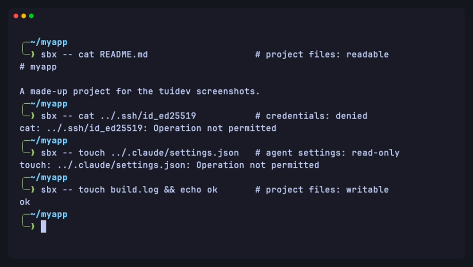
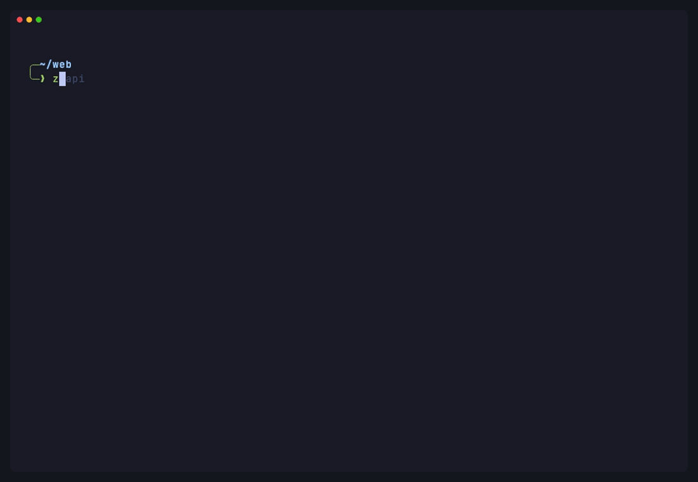

# tuidev

**The terminal dev environment for AI coding agents: every machine you run agents on feels like one, you see what runs where at a glance, cleanup comes with evidence, and your tokens stay out of the agents' reach. Claude Code and Codex sandboxed by default, a modern shell, and an install you can undo.**

[](https://github.com/spfr/tuidev/actions/workflows/ci.yml)
[](https://github.com/spfr/tuidev/releases/latest)


[](LICENSE)

![A short terminal tour in three scenes. First, the Starship prompt in a repo, ll listing files with a git status column, and git diff through delta. Second, the agents command: a blocked Claude Code session first, a finished Codex session to review, a working one, a polling loop flagged stuck, and a line each for stale processes and hogs. Third, cat reading a demo SSH key without a sandbox, then sbx refusing the same read and a write to ~/.zshrc with "Operation not permitted" while make test still runs and passes.](docs/assets/tour.gif)

<sub>The shell, `agents` and `sbx` in a demo home with made-up data, rendered with `make screenshots`.</sub>

## The problem

You run Claude Code in one tab, Codex in another, and a long job on a Linux box that stays on. One of them has been waiting for your approval for twenty minutes, and you don't know which: the tabs read `1 2 3 4`. The agent on the other machine says its preview is at `localhost:5173`, and that is its localhost, not yours. A subagent that finished hours ago left a loop polling a file for a line that will never come. A crashed session left its MCP servers and a dev server running. The fan is on, and nothing says which project is burning the CPU. Any command an agent runs can read `~/.ssh`, and the API token you exported in `.zshrc` is in the environment of every agent you start.

## What tuidev does about it

tuidev is shell scripts and configs for coding with AI agents from the terminal on macOS and Linux. Claude Code is the primary CLI and Codex the second: run them in a Ghostty tab and review the diff in VS Code or Cursor. It installs a small core, and everything else is an opt-in pack.

- **[See what runs where](#see-what-runs-where):** Herdr's sidebar shows which agent needs you, here or on your always-on box, and every tab is named after what runs in it.
- **[Remote feels local](#remote-feels-local):** Ctrl-click another machine's `localhost` and it opens in your browser; one map of what runs where, with one key to stop it there.
- **[Cleanup with evidence](#cleanup-with-evidence):** `agents` finds what sessions left behind, says whether it is safe to stop and why, and shows where the CPU and the tokens went.
- **[In your menu bar](#in-your-menu-bar):** on macOS, who needs you in about ten rows, with the rest one hover away.
- **[Secrets agents don't inherit](#secrets-agents-dont-inherit):** `secret` keeps API tokens in the OS store and hands one to one command, instead of to everything your shell starts.
- **[Sandboxed by default](#sandboxed-by-default):** Claude Code's and Codex's own sandboxes on, and `sbx` for everything else.
- **[Quiet when nothing happens](#quiet-when-nothing-happens):** what tuidev runs in the background runs on events, not on a stopwatch.
- **[Cool to the touch](#cool-to-the-touch):** on Apple Silicon MacBooks, fans that follow what your palms feel, not just what the chip can survive.
- **[A modern shell in one command](#a-modern-shell-in-one-command):** Ghostty, zsh and the CLI tools you and your agents both reach for.
- **[Subagents on the cheapest tier that works](#subagents-on-the-cheapest-tier-that-works)** and **[an install you can preview and undo](#an-install-you-can-preview-and-undo)**.

## See what runs where

`--pack herdr` installs [Herdr](https://herdr.dev/), an agent runtime: a server owns the panes, so agents keep running when you detach, and its sidebar marks each one `working`, `blocked`, `done` or `idle`. Save an always-on box once with `herdr machine add workbox`, and its agents join the same sidebar, so you see which agent needs you, on which machine, and jump straight to it. The box is a Raspberry Pi, a NUC or a VM set up with `--profile remote`, and its agents keep working while your laptop sleeps.

With `--pack monitoring` beside it, the labels say what runs where. A tab bar of `1 2 3` reads `✳ API docs`, `✳ Fix login redirect`, `❯ api`: one mark per kind of session (`✳` Claude Code, `⬡` Codex, `❯` a shell), the same in Herdr, the map and the menu bar, then the session's own task title. In the sidebar, a workspace says in red how many of its agents wait on you (`api · 2 blocked`) and what runs there (`✳2 ❯1`); an agent row leads with what the session is doing and when it started waiting. A name you typed yourself is never touched. [Fleet attention](docs/agent-workflows.md#fleet-attention--herdr---pack-herdr) · [Tab names and sidebar rows](docs/agent-workflows.md#tabs-named-after-what-runs-in-them)


<sub>Herdr with this Mac and two Linux containers saved as SSH machines, `devbox` and `workbox`, and tuidev on all three. The agents are scripted stand-ins that set a task title and report their state through Herdr's hook API, not live Claude Code or Codex sessions; the names, roll-ups and times are what `agents herdr sync` wrote. Rendered with `make screenshots`.</sub>

## Remote feels local

The dev server an agent started on another machine prints `http://localhost:5173`, and that is the other machine's localhost. With tuidev on both, **Ctrl-click the URL** in its Herdr pane and it opens in your own browser, through an ssh tunnel made on the spot.

Press **prefix+m** for the map: one list of what runs where, on every machine, with previews and dev servers first, then the files sessions just wrote and what was left behind. Enter opens it here, and **ctrl-k stops what is under the cursor on the machine that runs it**, asked first. **Drag a file onto a session on another machine** and it gets there: your Mac asks you once, and nothing leaves without that click. It is plain ssh underneath: nothing listens anywhere, and what another machine may ask for is decided on yours. [Remote feels local](docs/remote.md#remote-feels-local-ports-links-and-files)


<sub>This Mac and two Linux containers saved as SSH machines, `atlas` and `kepler`. The sessions are scripted stand-ins; the tunnel, the browser page, the stop and the fetched file are real. Recorded with `docs/assets/tapes/remote.tape` on the fleet `remote-demo.sh` starts ([how](docs/assets/tapes/README.md#the-remote-screencasts-fleet)).</sub>

## Cleanup with evidence

Every `claude` session starts its own MCP servers, and its subagents start test runs, dev servers and polling loops. When a session crashes, or a subagent hands back its report, some of that keeps running. `agents` (`--pack monitoring`) lists each session with what it runs, flags what was left behind, and gives every flagged process a verdict with its evidence, so you stop the right thing and leave the rest.


<sub>The demo fixtures and a made-up week of history, rendered with `make screenshots`.</sub>

- **Verdicts, not guesses.** `agents why PID` prints the evidence and a verdict for every stale process and every command flagged stuck, long or duplicated: "safe to stop: what it waits for already finished", "check first: dev server on :5173, its session is still active". `agents reap --stuck` stops the stuck loops. Kills go descendants first and re-check each process's start time before every signal.
- **Fixed at the source.** Claude Code hooks stop the background commands a subagent left running once it hands back its report, and a rule in the orchestration pack tells agents not to poll in sleep loops and to stop what they start. Opt-in `AGENTS_AUTO_REAP=1` cleans up only the high-trust cases.
- **A runaway can't take the Mac.** A test an agent started once grew to 16 GB in under a minute, and macOS's out-of-memory dialog blamed Chrome. Now a memory guard (a LaunchAgent from the same pack) warns past 8 GB with the process, its script, project and session, and stops a runaway in an agent tree at half the RAM, before macOS starts killing its own daemons. Agents get a 4 GB Node heap cap, so the common case fails fast inside the test. `agents mem` shows who holds the memory by real footprint, and what the guard did.
- **Where the tokens go.** `agents report --view tokens` reads the Claude Code and Codex transcripts already on disk: tokens by model, CLI, subagent type, project, session and who drove them (you, a headless run, a subagent), the cache hit rate, what polling cost, context compactions and the Codex plan's headroom, and what it all would cost at API list prices. `--view context` shows which MCP servers, skills and plugins your sessions load but never use, and `--view denials` which commands you or auto mode keep denying, each with what to change. All local; nothing is sent anywhere.

Also: `agents show`, `jump` and `pick` for one process and the pane it runs in; [MCP servers started on their first tool call](docs/agent-workflows.md#start-a-server-on-its-first-tool-call-agents-mcp-lazy); [CPU by job](docs/agent-workflows.md#where-the-cpu-goes-job-types) and [insights with what to change](docs/agent-workflows.md#reading-the-insights); [how long agents wait on you](docs/agent-workflows.md#waits-how-long-agents-wait-on-you); every CLI's [usage limits](docs/agent-workflows.md#usage-limits-agents-limits) on a gauge. [Local processes: `agents`](docs/agent-workflows.md#local-processes-agents---pack-monitoring)

## In your menu bar

On macOS, the same pack adds a [SwiftBar](https://swiftbar.app) menu that answers one question first: who needs you? The title counts only the sessions that are blocked and the ones to review, and shows a plain icon when nothing needs you.

Open it and you can read it in two seconds. What needs an action is flat and first, one row each, with what it waits for and how long (`✳ api · permission · 6m`); a flagged command reads as its verdict (`wait-loop stuck 5h10m · safe to stop`), and every session's submenu starts with Jump to session. Everything else is one row that sums it up, its detail in the submenu: the usage limit closest to its cap as a gauge with a marker for the time gone, Today's CPU and tokens, what was left behind, your other machines, keep-awake and the system.

The Machines row asks your other machines what runs there only when you open the menu, and a click on a dev server there opens it in your browser, through a forward. Alerts know which Herdr pane you are looking at, so you are not pinged for the agent in front of you. The menu keeps the Mac awake while agents run, with the lid closed too if you ask, always time-boxed. [Menu bar](docs/agent-workflows.md#menu-bar-swiftbar-macos)

<picture>
  <source media="(prefers-color-scheme: dark)" srcset="docs/assets/menu-dark.webp">
  
</picture>

<sub>The plugin's actual output over the demo fixtures, drawn as a macOS menu by `scripts/render_menu.sh`; it is not a screenshot of a real menu bar. [More submenus, animated](docs/assets/menu.gif).</sub>

## Secrets agents don't inherit

A token you export in `.zshrc` is in the environment of every program your shell starts: every agent you launch, every command it runs, every MCP server and install script. One `env` in a tool call and it is in a transcript.

`secret` (in the core pack, one file, no packages) keeps tokens in the store your OS already has: the login Keychain on macOS, libsecret or `pass` on Linux. A token reaches one command, only when you ask:

```bash
secret scan                                 # tokens in your shell startup files, by name and line, never the value
secret import --dry-run --remove ~/.zshrc   # what moving them into the store would change; drop --dry-run to do it
secret set GITHUB_TOKEN                     # or add one at a hidden prompt
secret run -n GITHUB_TOKEN -- ./release.sh  # in that command's environment, and nowhere else
```

The stores are on the sandbox's credential list, so a command under `sbx` can't read them, and Claude Code's shipped settings refuse `secret get`, `export` and `run` and the Keychain's own read commands. Codex's sandbox does not limit reads, so near tokens that matter, run it under `sbx`. It is not a team secret manager: for shared or deployed secrets, use the tool your team already has. What each sandbox stops, store by store, and how to check it on your machine: [Secrets](docs/secrets.md#what-an-agent-can-reach)

## Sandboxed by default

`--pack ai-clis` turns on Claude Code's and Codex's own sandboxes, so plain `claude` and `codex` run confined without a wrapper, and gates git and gh writes behind a prompt. Claude Code's Bash and `Read` tools are denied `~/.ssh`, `~/.aws` and the other 31 paths on one [credential list](configs/sandbox/credential-paths.txt). Codex's sandbox limits writes and network but not reads, so for anything else `sbx` runs a command under a macOS Seatbelt profile that denies the same list. A contract test keeps every copy of the list in step, and the secret stores are on it. And `--pack release-age` (in `--profile full`) keeps hijacked releases off the machine in the first place: npm, bun and uv wait 3 days before installing a new version, long enough for a compromised one like LiteLLM 1.107.0 to be pulled, while lockfiles still install as pinned. [Sandboxing](docs/sandboxing.md)



<sub>Without a sandbox, any command an agent runs can read your keys. Under `sbx` (strict profile), the same read is refused, so are the other credentials and writes outside the project, and the project's own work still runs. Demo home with made-up files.</sub>

## Quiet when nothing happens

Something that watches your agents should not be what heats your laptop. Everything tuidev runs without being asked now runs when something happens:

| What | Before | Now |
|------|--------|-----|
| Menu bar refresh, nothing going on | 360 an hour | 12 an hour, about 0.4 s each; a session's hooks and Herdr's events refresh it at once |
| Memory guard | looks every 5 s | every 20 s, and every 5 s only while a process grows or memory is tight |
| A new shell | `brew shellenv` on every start | cached, about 25 ms less |
| tmux status line | redrawn every 5 s | every 15 s, and at once on an event |

Your other machines are asked what runs there only when you open the menu or the map. Every background job, its trigger and its off switch: [what tuidev runs in the background](docs/performance.md#what-tuidev-runs-in-the-background)

## Cool to the touch

Agents keep a MacBook's chip at 75–85 °C for hours while macOS keeps the fans near their minimum, so the palm rest takes the heat. `--pack cooling` adds the fan curve macOS leaves out: a small Swift daemon you build from the repo ([`lib/fan/tuidev-fan.swift`](lib/fan/tuidev-fan.swift), one readable file, no network) follows the chip's temperature averaged over minutes, only ever adds air to what macOS runs, and hands the fans back on any error, exit or sleep. Pick Cool, Balanced or Quiet in the menu or with `agents cool`. [Fans](docs/agent-workflows.md#fans---pack-cooling)

## A modern shell in one command

`./install.sh` sets up Ghostty, zsh with autosuggestions, syntax highlighting and completions, a Starship prompt, and the tools below, wired in for you at the terminal: `cat` runs `bat`, `ls` and `ll` run `eza`, `cd` runs `zoxide`, `lg` runs `lazygit` and `top` runs `btm` once those are installed. An agent's `cat`, `ls` and `top` stay the real commands, so the flags it already knows keep working. Ctrl-T finds a file with fzf and a preview, and with the extras, Ctrl-R searches your history with atuin. One `palette.toml` colors Ghostty, tmux and Starship, and `make theme NAME=catppuccin-mocha` switches all three. [Toolbox](docs/toolbox.md) · [Profiles](docs/profiles.md) · [Cheatsheet](docs/CHEATSHEET.md) · [Theming](docs/theming.md)



| Instead of | You get | Why |
|------------|---------|-----|
| `grep -r`, `find` | `rg`, `fd` | Recursive, and they skip what `.gitignore` lists, hidden files and binaries |
| `cat`, `ls`, `tree` | `bat`, `eza` | Syntax highlighting and git change marks; a git status column, icons and a tree |
| `cd` with long paths, scrolling | `zoxide`, `fzf` | `z api` jumps to the directory you use most; Ctrl-T picks a file with a preview |
| git's pager and defaults | `delta`, better git defaults | Diffs with the changed words marked; histogram diffs, `zdiff3` conflicts, `rerere` |
| the GitHub website | `gh` | PRs, reviews and CI logs from the terminal |
| `grep` over JSON and YAML | `jq`, `yq` | A query reads the structure |
| bugs found at run time | `shellcheck` | Shell script mistakes caught before they run |
| nothing: workflows and secrets went unchecked | `actionlint`, `zizmor`, `betterleaks` (`--pack ci`) | CI workflows linted and audited, and a secret scan, before a commit |

These are in core, apart from the `ci` pack. The extras (`--extras`) add `lazygit`, `xh`, `hyperfine`, `procs`, `dust`, `tealdeer`, `tokei`, `uv` and `atuin`, and whatever your package manager lacks is skipped. Every tool, what it replaces, why, and how an agent comes to use it is in [the toolbox](docs/toolbox.md); `make perf` checks what the OS does behind your agents (package stores in the Spotlight index or in backups, file limits, Low Power Mode, inotify on Linux), fixes what is safe and names the rest. `make disk` shows what your tools and agents have left on disk (caches, old runtimes, stale build trees and worktrees), explains each one, and only ever runs a tool's own cleanup command, one yes at a time: [performance](docs/performance.md).

## Subagents on the cheapest tier that works

`--pack orchestration` pins Claude Code's subagents to tiers: Haiku for `Explore` and `executor` (search and command runs), Sonnet for `implementor-standard`, Opus for `implementor-complex` and `reviewer`. Codex gets the same roles in `~/.codex/agents`, without `Explore`. A `delegation` skill runs implementors in parallel git worktrees and brings their work back. It installs on its own, without the rest of tuidev. [Orchestration](docs/orchestration.md)

More for agent work:

- **Parallel work:** `claude -w NAME` starts a session in its own worktree, and subagents can too.
- **Know when you're needed:** Claude Code hooks call `notify.sh`, which shows a Herdr toast or a tmux message in your terminal, a macOS banner or a Linux desktop notification, and falls back to a push through [ntfy](https://ntfy.sh) when nothing local can show it (set `NTFY_URL`). In Herdr at your desk, with its terminal in front, you get one alert: the toast, not a toast plus a banner. With the `monitoring` pack on a Mac, clicking the banner takes you straight to the session that asked: its Herdr or tmux pane, or its Ghostty tab.
- **Sessions that outlive your laptop:** on an always-on machine you reach over Tailscale, SSH or mosh, tmux or Herdr keeps an agent running while you're away, and `t NAME` re-attaches. Blink Shell and Moshi on iOS are covered too.
- **Review first:** `hunk` for review-first diffs, and a starter [`AGENTS.md`](templates/AGENTS_TEMPLATE.md) for your own projects.

[Agent workflows](docs/agent-workflows.md)

## An install you can preview and undo

Pick a profile or compose packs, and `--dry-run` shows every change first. Config goes into managed blocks, so your own lines survive, and a config file you edited keeps your changes through updates. Every install is recorded, `./uninstall.sh` removes only what tuidev put there, and one-shot migrations clean up after older releases. `minimal` and `remote` also install on Linux with `apt-get`, `dnf` or `pacman` when there's no Homebrew. `make update-packages` also patches what Homebrew can't: each Node major fnm installed, a standalone uv and the Pythons it manages. [Updating](docs/updating.md)

## Quick start

tuidev configures Claude Code and Codex but doesn't install them, since they update themselves. Install them first with their official instructions: [Claude Code](https://code.claude.com/docs/en/setup), [Codex](https://github.com/openai/codex). Then:

```bash
git clone https://github.com/spfr/tuidev.git
cd tuidev
./install.sh --profile desktop --pack ai-clis --dry-run   # preview every change
./install.sh --profile desktop --pack ai-clis             # or: --profile minimal | remote
exec zsh -l

claude                             # Claude Code, sandboxed by its own settings
codex                              # Codex, sandboxed by its own settings
```

**Or hand it to your agent.** Paste this into Claude Code or Codex. It drives the same installer, shows you the plan and waits for your yes:

```text
Set up tuidev (https://github.com/spfr/tuidev) on this machine.

1. Clone it to ~/workspace/tuidev (or `git pull --ff-only` if it is already there) and read its README.md and AGENTS.md.
2. Tell me the OS, and which fits: `--profile desktop --pack ai-clis` on a Mac I sit at,
   `--profile remote` on a headless box, `--profile minimal` on Linux without Homebrew,
   `--profile full` for everything on a Mac. Recommend one and ask me once.
3. Run `./install.sh <my choice> --dry-run < /dev/null` and summarise what it would install
   and which files in my home it would change. Wait for my yes.
4. Run the same command without `--dry-run`. Use only install.sh: no `curl | sh`, no edits to my
   dotfiles by hand. If it needs sudo, a password, or a path your sandbox denies, stop and give
   me the exact command to run myself.
5. Run `make check` and `make perf`, and report what failed or warned, with the fix each one
   prints. Change nothing else. Remind me to run `exec zsh -l`, and that `./uninstall.sh` undoes it.
```

**The whole lab on a Mac, in one command:** sandboxed agents, tiered subagents, `agents` and the menu bar, fans that keep an Apple Silicon MacBook cool to the touch, Herdr's sidebar across machines, tmux and the extra CLI tools. Add `--dry-run` to see every change first; `cooling` asks for your password once.

```bash
./install.sh --profile full
```

Or add packs one at a time: `--pack monitoring` for `agents` and the menu bar, `--pack cooling` for the fans, `--pack herdr` for the sidebar across machines, `--pack orchestration` for tiered subagents. Installs are additive, so re-running with more packs is safe. The first-run walkthrough is [docs/QUICK_START_GUIDE.md](docs/QUICK_START_GUIDE.md).

**Only want the agent setup?** The `orchestration` pack installs on its own, without the shell, theme or packages: `bash scripts/install/packs/orchestration.sh` from a clone. `git pull` and re-run to update, and `./uninstall.sh` to remove it. See [docs/orchestration.md](docs/orchestration.md).

## Who it's for

**For you if** you run Claude Code or Codex from a terminal next to a GUI editor, mostly on a Mac, maybe with a Linux box that stays on, and you want agents confined by default and a setup you can read in an afternoon and remove cleanly.

**Not for you if** you want:

- a terminal IDE: there are no prebuilt tmux layouts, and Neovim is an optional pack;
- a personal dotfiles dump, a kitchen-sink Homebrew installer, or a showcase of every modern CLI;
- AI agents running unsandboxed on the host by default: `--pack ai-clis`, part of the quick start, turns on Claude Code's and Codex's sandboxes;
- in-editor ACP agents shipped for you;
- Docker Desktop or OrbStack (never installed), or `curl | sh` installers (the installer prints the official command instead).

The reasoning is in [VISION.md](VISION.md).

## Profiles and packs

| Profile   | Packs                                   | For                                     |
|-----------|-----------------------------------------|-----------------------------------------|
| `minimal` | core (the shell, the CLI tools, `secret`) | Servers, VMs, CI runners                |
| `desktop` | core + ui + sandbox                     | **Default on macOS**: laptop or desktop |
| `remote`  | core + remote + sandbox + `--pack tmux` | Headless machines, Tailscale nodes      |

Compose your own with `--core`, `--remote`, `--sandbox`, `--ui` and `--extras`, and add optional packs with `--pack NAME`:

```bash
./install.sh --core --sandbox --pack ai-clis --pack herdr
```

| Optional pack | Adds |
|---------------|------|
| `ai-clis` | Claude Code and Codex settings with their native sandboxes on, and git and gh write gates |
| `orchestration` | Tiered subagents and the delegation skill for Claude Code and Codex |
| `monitoring` | `agents` (cleanup verdicts, the map of what runs where, port forwards, CPU by job, tokens by model and agent), its SwiftBar menu (macOS) and `bottom` |
| `tmux`, `herdr` | Durable sessions; Herdr's agent-aware runtime, with tabs named after what runs in them and the Ctrl-click that opens another machine's link here |
| `nvim`, `vim` | LazyVim, or a zero-plugin vimrc for servers |
| `sandbox-container` | Tier 2 sandboxing in a container runtime (Apple `container`, Podman or Docker) |
| `fnm`, `hunk` | Node via fnm; a review-first diff viewer |
| `ci` | `actionlint` and `zizmor` for GitHub Actions workflows, `betterleaks` for secrets: what agents run before a commit |
| `cooling` | Fans that follow the chip's temperature on Apple Silicon MacBooks, so the palm rest stays cool; Cool, Balanced and Quiet in the menu |

What each profile and pack installs is in [docs/profiles.md](docs/profiles.md). macOS needs Homebrew. On Linux, `minimal` and `remote` also install without it, and anything the distro lacks is skipped with a link to its upstream installer. `sbx` and the `ui` pack are macOS only.

## Everyday commands

```bash
claude | codex                           # AI CLIs, sandboxed by their own native settings
claude -w NAME                           # Claude Code in its own git worktree, for parallel agents
agents [why PID | report]                # sessions, what's safe to stop, CPU by job (--pack monitoring)
herdr                                    # every agent on this machine and saved ones (--pack herdr)
agents map                               # what runs where on every machine; enter opens, ctrl-k stops (Herdr: prefix+m)
agents forward open workbox 5173         # another machine's port, here, in your browser
secret run -n NAME -- CMD                # a token from the OS store, in one command's environment
sbx -- CMD                               # any command under the strict Seatbelt profile (macOS)
t [NAME]                                 # attach-or-create a tmux session (--pack tmux)
make check                               # health check for the installed profile
make perf                                # what the OS does behind your agents, and what to change
make disk                                # what tools and agents left on disk, explained (deletes nothing)
make update                              # profile-aware, drift-detecting update
make theme NAME=catppuccin-mocha         # re-theme tmux, Ghostty and Starship
make help                                # every target
```

Every key binding and command is listed in [docs/CHEATSHEET.md](docs/CHEATSHEET.md).

## What it changes on your machine

- `~/.zshrc`, `~/.config/starship.toml` and `~/.ssh/config` get `# >>> tuidev managed (...) >>>` blocks. Everything outside the markers is yours. `~/.config/tmux/tmux.conf` gets the same with `--pack tmux`.
- AI CLI settings (`~/.claude/settings.json`, `~/.codex/config.toml`) are placed only where absent or unmodified. An edited `~/.claude/settings.json` gets new shipped settings merged in, and your values win ([docs/updating.md](docs/updating.md#shipped-configs-you-may-have-edited)).
- Anything tuidev replaces is backed up to `~/.config/tuidev/backups/` first.
- `~/.config/tuidev/manifest` records what was installed. `./uninstall.sh` removes only those records: a `ripgrep` you already had survives, and so do CLI logins and session state.
- What runs in the background (a memory guard and the menu's refresh with `--pack monitoring`, Claude Code hooks with `--pack ai-clis`, a fan daemon with `--pack cooling`) is listed with its trigger and its off switch in [docs/performance.md](docs/performance.md#what-tuidev-runs-in-the-background).
- tuidev sends no telemetry.

## Documentation

| Doc | Covers |
|-----|--------|
| [Quick start](docs/QUICK_START_GUIDE.md) | Install to first sandboxed agent session |
| [Cheatsheet](docs/CHEATSHEET.md) | Session commands, tmux keys, aliases, Makefile |
| [FAQ](docs/FAQ.md) | Troubleshooting |
| [Profiles and packs](docs/profiles.md) | What each profile and pack installs |
| [Toolbox](docs/toolbox.md) | Every tool: what it replaces, why, who uses it, and how agents come to use the right one |
| [Performance](docs/performance.md) | What macOS and Linux do in the background that competes with agents, measured, and what to change |
| [Sandboxing](docs/sandboxing.md) | Native CLI sandboxes, `sbx`, Seatbelt profiles, credential deny list |
| [Secrets](docs/secrets.md) | API tokens in the Keychain, libsecret or `pass` with `secret`, not in dotfiles; what agents can reach |
| [Agent workflows](docs/agent-workflows.md) | AI CLIs, editor integration, agent teams, worktrees, Herdr, `agents` and the menu bar, notifications |
| [Orchestration](docs/orchestration.md) | The `orchestration` pack: subagent tiers, skills, git gates, CI runners |
| [Remote and mobile](docs/remote.md) | Tailscale, SSH, mosh, always-on nodes, iOS clients |
| [Neovim](docs/nvim.md) | The `nvim` pack: LazyVim essentials |
| [Vim](docs/vim.md) | The `vim` pack: a zero-plugin vimrc for servers |
| [Theming](docs/theming.md) | Palette contract and `theme.sh` |
| [Updating](docs/updating.md) | Updates, migrations, the install manifest, uninstall |
| [Engineering](docs/engineering.md) | Architecture, shared libs, pack contract, verification, screenshots |
| [Roadmap](docs/roadmap.md) | Watch-list and adopt/hold criteria |
| [VISION.md](VISION.md) | Principles and non-goals |
| [AGENTS.md](AGENTS.md) / [CLAUDE.md](CLAUDE.md) | Instructions for AI agents working on this repo |
| [AGENTS template](templates/AGENTS_TEMPLATE.md) | Starter `AGENTS.md` for your own projects |
| [Migrations](scripts/migrations/README.md) | Script-level contract for one-shot migrations |
| [Screenshot tapes](docs/assets/tapes/README.md) | Demo fixtures, VHS tapes, the Herdr fleet and the menu renderer behind the README images |
| [CONTRIBUTING.md](CONTRIBUTING.md) / [SECURITY.md](SECURITY.md) / [Code of Conduct](CODE_OF_CONDUCT.md) | Contributing and reporting |
| [CHANGELOG.md](CHANGELOG.md) | Release history |

## Contributing

Issues and PRs are welcome. Read [CONTRIBUTING.md](CONTRIBUTING.md) and [VISION.md](VISION.md) first, and run `make ci-test` before you push.

## License

[MIT](LICENSE). Sponsored by [SpiceFactory](https://spfr.co).
