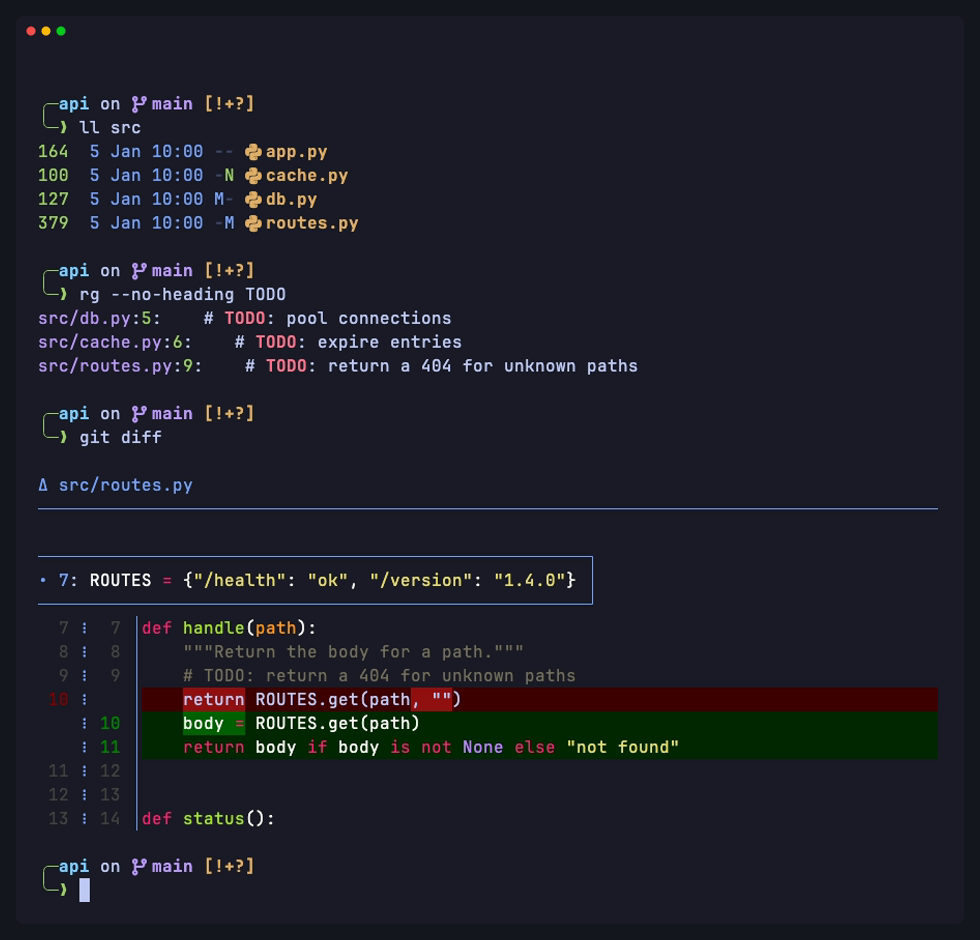

# Cheatsheet

Keys and commands, one line each. Run `tuidev` for the searchable palette and `<command> --help` for any command; in a clone, `make help` lists the Makefile targets. What each one does in depth: [agent-workflows.md](agent-workflows.md) and [remote.md](remote.md).

## tuidev

```bash
tuidev                             # the palette: everything here, searchable (Herdr: prefix+a)
tuidev install --pack NAME         # add a pack; --dry-run previews
tuidev update                      # the latest release, its migrations and configs (Herdr: prefix+u asks first)
tuidev update --check | --packages | --all | --rollback
tuidev latest [on|off]             # the latest release known; the daily check on or off
tuidev whatsnew [FROM]             # this release's changelog, or all since FROM
tuidev md [FILE]                   # read Markdown in the pager (rendered with glow from --extras)
tuidev check | perf | disk         # health check and the two audits
tuidev check --fix [--dry-run]     # repair what runs (jobs, tuidev's files, the manifest), then check again
tuidev theme [NAME]                # list themes, or apply one
tuidev uninstall                   # remove what the manifest records
```

## Agents: who needs you, what runs (`--pack monitoring`)

```bash
agents                             # who needs you: blocked, to review, running; parked and the system on a line each
agents watch                       # the same, redrawn every 2 s
agents board                       # every session on every machine; ? lists its keys (Herdr: prefix+space)
agents ls                          # the full table: PIDs, ports, MCP servers, commands, stale processes, hogs
agents ps PID                      # everything one session runs
agents why [PID]                   # every flagged item's verdict, or one item's evidence and verdict
agents show PID                    # one process in detail; --watch redraws
agents jump PID                    # go to its Herdr or tmux pane and terminal tab
agents peek PID [LINES]            # the last lines of its pane
agents pick                        # browse everything in fzf
agents mcp                         # configured MCP servers and the copies running
agents mcp lazy NAME               # start that server on its first tool call; eager NAME undoes it
```

## Agents: clean up, memory, history

```bash
agents reap -n                     # what reap would stop: stale trees that are safe to stop
agents reap [--stuck] [--all]      # stop them (asks first); --stuck adds stuck loops, --all the "check first" ones
agents kill PID                    # one tree, descendants first; term PID: one process
agents mem                         # memory and swap, the memory guard, the biggest processes
agents mem check -n                # what the memory guard would do right now
agents awake on 2h                 # keep the Mac awake for 2 h; awake agents: while agents run; awake off
agents awake lid 3h                # macOS: awake with the lid closed too (asks for your password)
agents cool [cool|auto|quiet|max|off]   # fan modes (--pack cooling)
agents report [--view VIEW]        # CPU, tokens, waste, trends, denials, waits, context
agents runs                        # finished commands, newest first
agents limits                      # each CLI's usage limits
agents doctor [--fix]              # are the sampler, the memory guard and the hooks working
agents config [--edit]             # the settings in effect (~/.config/agents.conf)
```

## Other machines (`--pack monitoring` on both)

```bash
agents map                         # what runs where on every machine; enter go, ctrl-k stop, ctrl-s sweep (Herdr: prefix+m)
agents ports [--pick]              # what listens where, here and on your machines (Herdr: prefix+shift+o)
agents forward open workbox 5173   # that port, here, in your browser
agents forward                     # the forwards; close --all | --dead | PORT
agents push -m workbox FILE        # into its drop folder; the path is copied
agents open workbox /PATH/report.html   # fetch one file and open it here
agents link                        # the watcher behind Ctrl-click on another machine's localhost link
```

## Phone: Herdr's app through herdr-core (`--pack herdr-core`)

```bash
agents hc                          # is herdr-core running, in your desktop login, and a phone connected
agents hc run claude               # in a Herdr pane: the agent, hosted in herdr-core, listed on the phone
agents hc attach NAME              # come back to one; ctrl+\ detaches and leaves it running
agents hc ls                       # what the phone lists from here, and the agent panes it can't reach
agents hc mirror                   # experimental (AGENTS_HC_MIRROR=1): each agent pane and its mirror
agents hc mirror fit               # the focused pane takes its size back from the phone
agents hc mirror off | on          # in a Herdr pane: no mirror for this one, or back
agents hc mirror end               # end every mirror; the agents stay in their panes
agents hc up --restart             # at the Mac: replace a core running outside the desktop login (ends its terminals)
```

With `AGENTS_HC_AUTO=1`, a `claude` typed in a Herdr pane is hosted in herdr-core by itself.

## Herdr (`--pack herdr`)

Prefix `Ctrl+b`.

| Keys | Action |
|------|--------|
| `prefix+space` / `prefix+shift+space` | The board as a popup / as a tab |
| `prefix+a` | The palette (Ghostty: `Cmd+P`) |
| `prefix+u` | Updates |
| `prefix+m` | The map: what runs where, on every machine |
| `prefix+shift+o` | Ports |
| `prefix+q` | Detach (agents keep running) |
| Ctrl-click | Open a link; on another machine's pane, opens here |
| Shift-Cmd-click | Let Ghostty open a link or a file path |

```bash
herdr                                   # attach locally (starts the server)
herdr machine add workbox               # save an SSH machine; pick its session (once)
herdr machine status                    # saved machines reachable? (no prompts)
herdr --machine workbox agent list      # agents on a saved machine: working / blocked / done
herdr --remote workbox --session NAME   # one-off thin client over SSH
herdr session list | attach NAME | stop NAME   # sessions on this machine; stop kills its panes
herdr update --handoff                  # upgrade from outside Herdr; the server keeps its panes
herdr status                            # versions; server_binary_stale is fine until the next restart
herdr integration status                # after every upgrade: reinstall anything outdated
agents herdr                            # tab names and sidebar roll-ups: each tab's label and whose it is
agents herdr reset [TAB_ID]             # tabs a sync named get their number back, or one tab back to auto-naming
```

A server a systemd unit runs upgrades with `tuidev update --packages`, never `--handoff` ([agent-workflows.md](agent-workflows.md#herdr-which-agent-needs-you---pack-herdr)).

## tmux (`--pack tmux`)

| Command | Effect |
|---------|--------|
| `t [NAME]` | Attach to session NAME (default `main`), creating it; inside tmux, switch to it |
| `tls` | List sessions |

Prefix `Ctrl+a`: press it, release, then the key. `Ctrl+a Ctrl+a` sends a literal `Ctrl+a`.

| Keys | Action |
|------|--------|
| `\|` / `-` | Split right / split below (in the current directory) |
| `h` `j` `k` `l` | Focus left / down / up / right |
| `H` `J` `K` `L` | Resize by 5 cells |
| `o` / `z` / `x` | Next pane / zoom toggle / kill pane |
| `Space` | Cycle pane layouts |
| `c` / `n` / `p` / `1`–`9` | New window / next / previous / window N (windows start at 1) |
| `,` / `$` | Rename window / session |
| `s` / `w` | Session tree / window tree |
| `d` | Detach (the session keeps running) |
| `g` | lazygit in a 90% popup, in the pane's directory |
| `r` | Reload `~/.config/tmux/tmux.conf` |
| `Ctrl+s` / `Ctrl+r` | Save / restore sessions (continuum also saves every 15 min) |
| `I` | Install TPM plugins |
| `?` | List every binding |
| `[` | Copy mode: `v` select, `Ctrl+v` rectangle, `y` copy to the clipboard (OSC 52 over SSH), `/` `?` search, `q` exit |

tmux turns `.` and `:` in session names into `_`. A window whose agent rings the bell is flagged in the status bar.

## Shell



| Keys | Action |
|------|--------|
| `Up` / `Down` | History entries that start with what you have typed |
| `Ctrl+r` | atuin history search (zsh's own if atuin is absent) |
| `Ctrl+t` / `Alt+c` | fzf: insert a file / cd into a directory |
| `Ctrl+a`* / `Ctrl+e` | Start / end of line (*press `Ctrl+a` twice inside tmux) |
| `Ctrl+u` / `Ctrl+k` / `Ctrl+w` | Delete to start / to end / previous word |
| `Alt+b` / `Alt+f` | Word back / forward (Option acts as Alt in Ghostty) |

Emacs keymap; put `bindkey -v` in `~/.zshrc.local` for vi mode.

| Command | Runs |
|---------|------|
| `ls`, `cat`, `top`, `cd` | `eza`, `bat`, `btm` (`--pack monitoring`) and zoxide's `z` at a terminal; the real commands in pipes, scripts and agents |
| `ll`, `la`, `lt`, `tree` | `eza` long, all, tree (with git status) |
| `zi` | zoxide's interactive pick |
| `v`, `vi`, `vim` | `nvim` (`--pack nvim`) |
| `gs` `ga` `gc` `gp` `gl` `gd` `gco` `gb` | `git status` / `add` / `commit` / `push` / `pull` / `diff` / `checkout` / `branch` |
| `lg` | `lazygit` (`--extras`) |
| `hunk diff`, `hunk show` | Review the working tree or a commit (`--pack hunk`); `--watch` reloads |
| `fcd`, `fif TEXT`, `fshow` | fzf: cd into a directory / grep files / browse commits |
| `mkcd DIR` | mkdir and cd |
| `md`, `mdp FILE`, `help CMD`, `loc`, `bench CMD` | glow, tldr, tokei, hyperfine (`--extras`) |
| `ts-status`, `ts-ip`, `remote-status` | Tailscale and SSH status |
| `tui-update`, `tui-check` | `tuidev update` / `tuidev update --check` |
| `reload`, `zshconfig` | Re-source / edit `~/.zshrc` |

`procs` and `dust` keep their own names. Personal aliases go in `~/.zshrc.local`.

## AI CLIs

```bash
claude                                          # Claude Code, sandboxed by its own settings
claude -w NAME                                  # in its own worktree (.claude/worktrees/NAME)
claude --bg "TASK"                              # a background session; claude agents lists them
codex                                           # Codex, sandboxed by its own settings
CLAUDE_CODE_EXPERIMENTAL_AGENT_TEAMS=1 claude   # agent teams, off by default
```

Setup, instruction files and agent teams: [agent-workflows.md](agent-workflows.md#ai-clis). Sandboxes: [sandboxing.md](sandboxing.md).

## Sandbox (`sbx`, macOS)

| Invocation | Effect |
|------------|--------|
| `sbx -- CMD` | Run a binary under `strict`: TCP 443, DNS and loopback only |
| `sbx --profile standard -- CMD` | Also TCP 80, 22 and 9418 (package mirrors, git over ssh) |
| `sbx --profile off -- CMD` | No sandbox |
| `sbx --project DIR -- CMD` | Writable project directory (default: `$PWD`) |
| `sbx --allow-herdr -- CMD` | `strict`, plus the Herdr socket |
| `sbx --dry-run -- CMD` | Print the `sandbox-exec` command without running it |
| `sbx -- claude --settings '{"sandbox":{"enabled":false}}'` | Claude Code under `sbx` instead of its own sandbox (Seatbelt doesn't nest) |
| `make sbx-test` (in a clone) | Check that the project is readable and `~/.ssh` is denied |

`sbx` runs binaries, not shell functions or aliases. Details: [sandboxing.md](sandboxing.md).

## Secrets (`secret`)

| Command | Effect |
|---------|--------|
| `secret set NAME` | Store a value (hidden prompt; `pbpaste \| secret set NAME` works too) |
| `secret run -n NAME -- CMD` | Run CMD with NAME in its environment only (repeat `-n`; `--all` for every secret) |
| `secret get NAME` | Print it, for `$(...)` |
| `eval "$(secret export A B)"` | Export into this shell and everything it starts, agents included |
| `secret ls` / `secret rm NAME` | List names / delete one |
| `secret scan` | Token-looking `export` lines in your shell files (name and line, never the value) |
| `secret import --dry-run --remove FILE` | What `import --remove` would move out of FILE; drop `--dry-run` to do it |

Details: [secrets.md](secrets.md).

## macOS hotkeys (desktop profile)

| Keys | Action |
|------|--------|
| `Ctrl+Alt+←` / `→` / `↑` / `↓` | Snap window to a half (Rectangle) |
| `Ctrl+Alt+Return` | Maximize (Rectangle) |
| ``Ctrl+` `` | Ghostty quick terminal (global) |
| `Cmd+P` | tuidev palette in Herdr (sends `ctrl+b a`; `keybind = cmd+p=unbind` turns it off) |
| `Ctrl+Shift+T` / `W` / `D` / `N` / `C` / `V` | Ghostty: new tab / close / split / new window / copy / paste (beside its macOS defaults) |

## Neovim (`--pack nvim`)

| Keys | Action |
|------|--------|
| `Space Space` / `Space f f` | Find files |
| `Space /` | Grep the project |
| `Space ,` / `Space f r` | Buffers / recent files |
| `Space e` | File explorer |
| `Space g g` | lazygit |
| `g d` / `g r` / `K` | Definition / references / hover |
| `Space c a` / `Space c r` / `Space c f` | Code action / rename / format |
| `Ctrl+/` | Floating terminal |

The full guide: [nvim.md](nvim.md).

## Vim (`--pack vim`)

| Keys | Action |
|------|--------|
| `Space Space` | Find files (fzf) |
| `Space /` / `Space *` | Grep the project / the word under the cursor (ripgrep, into quickfix) |
| `Space b` / `Space r` | Buffers / recent files |
| `Space e` | netrw file explorer |
| `gcc` / `gc{motion}` | Toggle comment |
| `]q` / `[q`, `]b` / `[b` | Next/previous quickfix entry, buffer |

The full guide: [vim.md](vim.md).

## Theming

```bash
tuidev theme                   # themes; * marks the active one
tuidev theme catppuccin-mocha  # apply (the default is tokyo-night)
tuidev theme show tokyo-night  # palette swatches
tuidev theme apply tokyo-night --dry-run
```

Written to Ghostty, Starship, Herdr (once its config exists) and tmux (with `--pack tmux`). Details: [theming.md](theming.md).

## Makefile

In a clone. The first rows have a `tuidev` twin above.

```bash
make install-dry PROFILE=desktop   # preview an install
make check                         # health check for the installed profile
make test                          # tests for the installed profile (test-core / test-ui / test-all)
make update-check / make update    # preview / apply updates (update-all is non-interactive)
make update-migrations             # pending one-shot migrations only
make update-security               # Tailscale, SSH permissions, Seatbelt drift
make perf | perf-fix               # performance audit; then the fixes that need no root
make disk | disk-fix | disk-agent  # what dev tools left on disk; a plan with one question each; an agent's plan
make lint                          # shellcheck every shell script
make validate-configs              # JSON / TOML / Lua / shell syntax
make test-lib                      # unit harnesses
make check-links                   # relative links in every tracked .md
make check-paths                   # no hardcoded user paths or personal hosts
make ci-test                       # lint, validate, links, paths and unit tests
make container-test                # core-tag tests in an Alpine container
make sandbox-up / sandbox-down     # the container runtime
```

Updates and migrations: [updating.md](updating.md).
