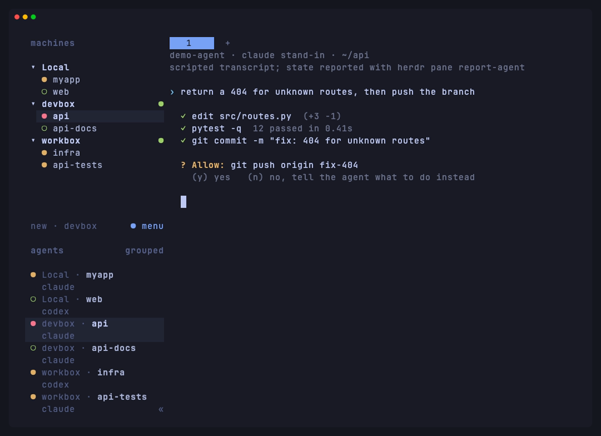
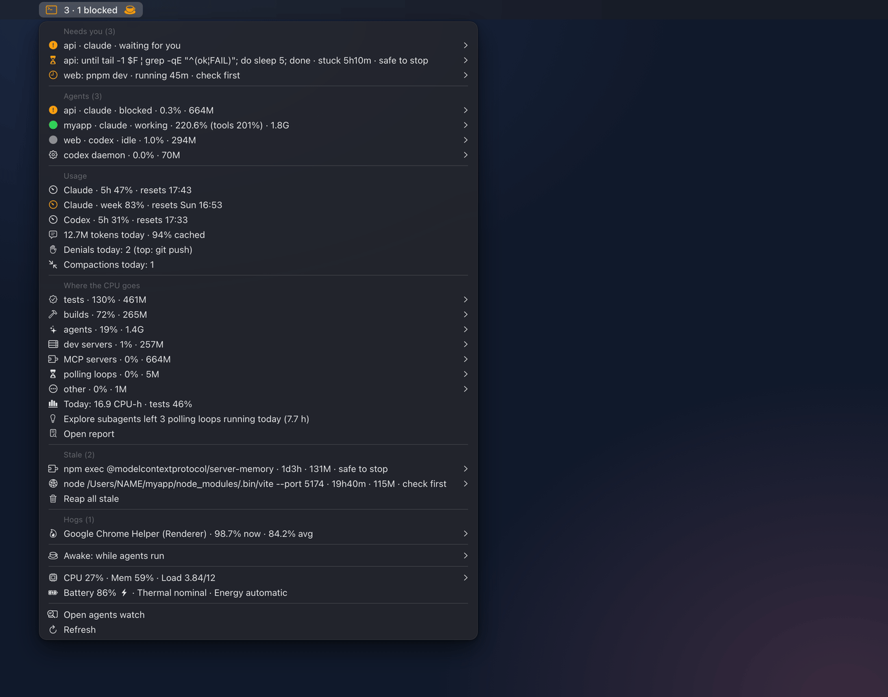

# Agent Workflows

How to run AI coding agents with tuidev: one at a time, in parallel, across machines, and from your phone. The core install is CLI-agnostic. The CLI integrations are opt-in packs.

**Your editor is a GUI; the terminal runs agents.** Open a Ghostty tab, run `claude` or `codex` in it, and review the diff in VS Code or Cursor. tmux and Herdr are for sessions that must survive on an always-on node, not required for everyday work on your laptop.

## Control plane

A fleet of agents is an **attention queue**, not a wall of panes. Look at an agent only when it needs you.

| Need | Tool |
|------|------|
| A quick local session | A Ghostty tab: `claude` or `codex` |
| One durable task over SSH/mosh | **tmux** (`--pack tmux`): `t [NAME]` (prefix `Ctrl+a`) |
| Parallel agents on one repo | **Worktrees**: `claude -w NAME`, or a subagent with `isolation: worktree` |
| Sessions that keep running with the terminal closed | **Background sessions**: `claude --bg`, `claude agents` (see [below](#background-sessions)) |
| Many agents: which one is blocked? | **Herdr** (`--pack herdr`, prefix `Ctrl+b`) |
| Steer one agent from your phone | The CLI's native **remote control** |
| What is running, what leaked, what keeps the Mac awake? | **`agents`** (`--pack monitoring`), plus a SwiftBar menu on macOS (see [below](#local-processes-agents---pack-monitoring)) |

These tools don't replace each other. tmux doesn't know agent state, and Herdr doesn't replace a Ghostty tab. Work that must survive a laptop lid belongs on an always-on node (see [remote.md](remote.md)).

## Editor integration

Run the agent in a terminal tab next to your editor, not inside it:

- **Claude Code's `/ide` command** connects a running session to VS Code or Cursor: diffs and file selections show in the editor instead of the terminal. Run it from inside a `claude` session.
- **Codex's `file_opener` setting** (`configs/codex/config.toml`, shipped as `vscode`) controls which editor Codex links to when it prints a file reference. Alternatives are commented in the shipped config: `cursor`, `vscode-insiders`, `windsurf`, `none`.

## AI CLIs

| CLI | Pack | Shipped config (adopted, never overwritten) |
|-----|------|----------------------------------------------|
| Claude Code (primary) | `ai-clis` | `configs/claude/settings.json` (Linux: `settings.linux.json`) → `~/.claude/settings.json` |
| Codex (secondary) | `ai-clis` | `configs/codex/config.toml` → `~/.codex/config.toml` |

The packs install configs, not the CLIs. The CLIs update themselves. Claude Code and Codex run as plain `claude` and `codex`, sandboxed by the native settings each CLI ships with — see [sandboxing.md](sandboxing.md). Gemini CLI is deprecated upstream (its successor is Antigravity, `agy`) and isn't shipped. To use it, add your own wrapper in `~/.zshrc.local`.

**Shipped Claude Code policy:**

- Permissions: read-only commands are allowed (`gh pr view/list`, `gh run view/list`, `rg`, `jq`, `shellcheck`). `git add`, `commit`, `push`, `merge` and `tag`, and `gh pr create`, `gh pr merge`, `gh release` and `gh api` always ask. Credential paths and `.env*` are denied.
- `sandbox.enabled` is `true`: Claude Code's native sandbox confines the Bash tool and its children by default. See [sandboxing.md](sandboxing.md) for what it confines and how to adjust it.
- `attribution` is empty (no `Co-Authored-By`). Agent teams are off (see [Agent teams](#agent-teams)).
- Notification hooks cover permission prompts, idle prompts, idle teammates and auto-mode denials. There is no `Stop` hook.
- Cleanup hooks: `SubagentStop`, and `SessionEnd` on `/clear` and `/resume`, run `agents hook` to stop the background commands a finished subagent or a cleared session left running. They need the `monitoring` pack and do nothing without it. See [Cleanup hooks](#cleanup-hooks-claude-code).

**Shipped Codex policy:** `sandbox_mode = "workspace-write"`, `approval_policy = "on-request"`, network off by default, `file_opener = "vscode"`, an unpinned model, and `~/.codex/rules/tuidev.rules`, which makes the same git and gh writes prompt. See [sandboxing.md](sandboxing.md) for how this native sandbox relates to `sbx`.

**Multi-agent orchestration** (tiered subagents, a delegation skill, one policy for both CLIs) is its own pack: see [orchestration.md](orchestration.md).

### Instruction files

| CLI | Reads natively | To share one file |
|-----|----------------|-------------------|
| Claude Code | `CLAUDE.md` (managed → `~/.claude/CLAUDE.md` → project → `CLAUDE.local.md`) and `.claude/rules/*.md`. Reads `AGENTS.md` when the project has no `CLAUDE.md` (v2.1.277+). | Put `@AGENTS.md` on the first line of `CLAUDE.md` |
| Codex | `AGENTS.md` (`~/.codex/AGENTS.md`, then repo root down to the cwd; 32 KiB cap) | `project_doc_fallback_filenames = ["CLAUDE.md"]` |

Start a project's instructions from [templates/AGENTS_TEMPLATE.md](../templates/AGENTS_TEMPLATE.md). Claude Code and Codex both read `AGENTS.md`; for Claude-specific notes, add a `CLAUDE.md` whose first line is `@AGENTS.md`. Keep each instruction file short, because every one loads into context at session start.

### Agent teams

Claude Code's experimental agent teams are **off** in the shipped settings. While teams are enabled, every subagent Claude names launches as a teammate, without asking. That makes teams form during ordinary delegation, and each teammate is a full session with its own context and a 5-minute cache. Plain subagents cover focused work that only needs to return a result.

Turn teams on when teammates must talk to each other: `export CLAUDE_CODE_EXPERIMENTAL_AGENT_TEAMS=1` for a shell, or the same key under `env` in `~/.claude/settings.json`. The shipped `"teammateMode": "auto"` then picks the display:

- **Inside tmux** (`--pack tmux`), each teammate gets its own tmux pane. Run `claude` from inside a tmux session.
- **Elsewhere**, teammates run in-process. The agent panel below the prompt lists them: arrow keys select, Enter opens, `x` stops. Force this mode with `claude --teammate-mode in-process`.

Split panes need tmux or iTerm2. Ghostty's native splits don't work for this.

## Worktree-per-agent

A terminal tab or pane per agent isolates the terminal. A **worktree** per agent isolates git state. Without one, parallel agents collide on the index, on each other's half-staged files, and on `HEAD`.

**Claude Code does this natively. Reach for it first:**

- `claude -w NAME` (`--worktree`) starts a session in a new worktree under `.claude/worktrees/NAME`.
- A subagent with `isolation: worktree` in its frontmatter runs in its own worktree.

Both keep the checkout inside the repo, which is where `sbx` and the native sandboxes allow writes.

**For other CLIs**, there's no tuidev wrapper: use `git worktree add` directly.

```bash
git worktree add ../repo-agent-1 -b agent/1   # one worktree, one branch
git worktree list                             # path, branch, HEAD
git worktree remove ../repo-agent-1            # after merging, once it's clean
```

**A worktree isolates git state only.** Ports collide, so give each worktree its own `PORT`. `node_modules`, `.venv` and `target` are neither shared nor copied. Gitignored files such as `.env` don't follow the worktree. A shared dev database is still shared. Use worktrees for genuinely independent tasks. When tasks touch the same files, one worktree and sequential agents are faster than merging the collisions.

## Background sessions

Claude Code and Codex can run sessions without holding a terminal. Both put them in worktrees, so they combine with [Worktree-per-agent](#worktree-per-agent) rather than replace it.

**Claude Code** ([agent view](https://code.claude.com/docs/en/agent-view)): a supervisor service runs background sessions so they survive closing agent view or the terminal.

```bash
claude agents                     # agent view: dispatch, list, reply
claude --bg "investigate the flaky test"   # start one and return
claude attach ID                  # open a session in this terminal
claude logs ID                    # print recent output
claude stop ID                    # stop it
claude respawn ID                 # restart it
claude rm ID                      # drop it from the list
```

Inside a session, `/bg` moves the conversation to the background and `/fork` copies it into a new background session while you keep working. Every background session, and each `/fork` copy, moves into its own worktree under `.claude/worktrees/` before it edits files (`worktree.bgIsolation: "none"` turns that off).

**Codex**: 0.156.0 enabled worktrees by default and added worktree session creation to the agents overview. 0.156.0 also added `/daemon` (update the local background server) and `--no-daemon` (bypass it). 0.157.0 made automatic background-server startup the default for eligible interactive sessions. See [the daemon note](sandboxing.md#codex-background-server).

**Git and the ask rules.** Claude Code tells a background session that changed files in a worktree to commit without asking, push the branch when there is a remote, and open a draft PR when the task calls for it. It never pushes to `main`/`master`, force-pushes or merges. The docs say your instructions win: if the task, `CLAUDE.md` or memory says you handle committing or pushing yourself, Claude leaves git to you. `--pack orchestration`'s rules file (`~/.claude/rules/tuidev-orchestration.md`) says to leave work uncommitted until you ask, which covers that. The shipped `ask` rules (`git add|commit|push|merge|tag`, `gh pr create|merge`) are permission decisions, and the docs say a background session waits under `Needs input` on "a permission decision"; answer it from the peek panel in `claude agents` (Space, type a reply, Enter) or after `claude attach ID`. Checked on v2.1.284: `ask` rules hold in a `claude --bg` session, which waits under `Needs input` on the `git commit` approval. They only gate what your settings still list: an `allow` rule such as `Bash(git *)` in your own `~/.claude/settings.json`, or `auto` mode, lets the session commit without asking.

Permission mode carries over from the session you backgrounded. Sessions started with `claude --bg` or `claude agents` use the target directory's configuration, the same as plain `claude` there.

**With tmux and Herdr.** Background sessions are supervised by Claude Code itself, not by a pane, so they don't need tmux to survive. `claude agents` is a per-CLI queue for Claude sessions. Herdr is the queue across CLIs and panes ([Fleet attention](#fleet-attention--herdr---pack-herdr)), and tmux keeps a terminal alive over SSH ([remote.md](remote.md)). Sandbox and login behavior is unchanged: see [sandboxing.md](sandboxing.md).

## Remote control from a phone

The CLIs now ship their own remote control, so you don't need SSH just to *steer* an agent.

- **Claude Code Remote Control** connects `claude.ai/code` and the Claude mobile apps to a session running on your machine. Code stays local. See <https://code.claude.com/docs/en/remote-control> for plan requirements.
- **Codex and others**: third-party layers such as [Tactic Remote](https://clauderc.com/).

For a full terminal (editing files, non-agent work, a flaky network), use SSH or mosh plus tmux, covered in [remote.md](remote.md).

## Fleet attention — Herdr (`--pack herdr`)

[Herdr](https://herdr.dev/) is an agent runtime. A server owns the terminal processes, clients attach and detach, and each pane holding an agent is marked `working`, `blocked`, `done` or `idle`. The CLI and a local socket API are the same surface, so agents can split panes, start each other, and wait on a blocked peer instead of sending keystrokes.

```bash
./install.sh --pack herdr
herdr                                         # attach; the first attach starts the server
herdr machine add workbox                     # save an SSH node (interactive, once)
herdr --machine workbox agent list            # scriptable, no TUI
```



<sub>This Mac and two Linux containers saved as SSH machines, with scripted agent stand-ins that report their state through `herdr pane report-agent`. How it is made: [docs/assets/tapes/README.md](assets/tapes/README.md#the-herdr-fleet).</sub>

Herdr is a second multiplexer. tmux (`--pack tmux`) is the default for a durable local session. Reach for Herdr when the question is *which agent needs me*, not *how do I keep this pane alive*. Its prefix is `Ctrl+b`, so it doesn't clash with tmux's `Ctrl+a`.

Practices:

1. **Never nest.** When `HERDR_ENV=1`, you are inside a Herdr pane. Use `herdr agent list` or the socket API, never the TUI.
2. **The sidebar is the queue.** Don't tab through panes looking for a prompt.
3. **Detach, don't kill.** `Ctrl+b q` leaves agents running. `herdr server stop` ends the herd.
4. **Sleep-proof work lives on an always-on node**, whether a saved machine (`herdr machine add`) or `herdr --remote NODE`.
5. **Upgrade clients freely, and servers deliberately.** A newer client keeps using a running compatible server (`herdr status` reports `server_binary_stale`). Restart a server when its agents are idle, or try `herdr update --handoff`. `herdr update` refuses to run inside a Herdr pane: detach (`Ctrl+b q`) and run it from a plain shell. Homebrew installs upgrade with `brew upgrade herdr` (or `make update-packages`). Keep exactly one `herdr` binary on each node.
6. **Links stay clickable.** Herdr ≥ 0.9.2 sets `TERM_PROGRAM=herdr`, which Claude Code doesn't recognize as hyperlink-capable, so the tuidev `.zshrc` exports `FORCE_HYPERLINK=1` inside Herdr panes (unless you set it). The variable comes from the pane's shell, so a pane opened before the change needs `exec zsh` (or a new pane) before its agent emits links; restarting only the agent isn't enough.
   - **Ctrl-click, not Cmd-click.** Herdr captures the mouse and opens pane links itself on Ctrl-click: OSC 8 links and plain `http(s)://` URLs. Cmd-click never reaches it. In Ghostty, hovering doesn't underline a link, even with Ctrl held, but the click still works.
   - **Shift-Cmd-click for file paths.** Shift bypasses Herdr's mouse capture, so Ghostty handles the click with its own link detection, which also matches file paths such as `/tmp/x.log`, `./src/main.rs` or `data/backups/x.db`. Herdr itself doesn't linkify plain paths (upstream treats that as a feature request).
   - **Saved-machine panes:** Ctrl-click doesn't open OSC 8 links there yet ([herdr#4447](https://github.com/herdrdev/herdr/issues/4447)); plain `https://` URLs still open.
7. **Reinstall integrations after upgrades.** Run `herdr integration install claude` (or `codex`, …) once, then `herdr integration status` after every upgrade, and reinstall anything reported `outdated`.
8. **Start the server from a login shell.** Integrations read the *server's* `PATH`. A server started by `brew services`, or by a non-interactive `ssh host herdr server`, gets a stripped `PATH` and reports the CLIs as `not found`. On Linux, use a systemd user unit with `ExecStart=/bin/bash -lc 'exec herdr server'`.

### Sessions and devices

A **session** is one Herdr server with its own workspaces, panes and socket. Plain `herdr` attaches to the `default` session; `herdr --session NAME` (or `herdr session attach NAME`) starts or attaches a named one, each with its own server.

- **Keep one session per machine** unless you need hard isolation (stopping or upgrading one project's server without touching the others). Split projects into *workspaces* inside it instead: every device then lands in the same sidebar.
- **A saved machine points at one session on that host**, picked during `herdr machine add`, which lists the sessions already running there. To switch, run `machine add` again and `herdr machine remove` the old entry.
- **Every device reaches the same session.** From a laptop, the node is a saved machine in the sidebar, or `herdr --remote workbox --session NAME`. From a phone, SSH in and run `herdr` (see [remote.md](remote.md#iphone-and-ipad)).
- **Inside a pane, `HERDR_SOCKET_PATH` wins over `HERDR_SESSION`**, so `HERDR_SESSION=other herdr status` still reports the pane's own session. Target another one explicitly: `HERDR_SOCKET_PATH=~/.config/herdr/sessions/NAME/herdr.sock herdr status` (`~/.config/herdr/herdr.sock` for `default`).
- **Manage them** with `herdr session list`, `herdr session stop NAME` (kills its panes) and `herdr session delete NAME`. Retiring a session means recreating its workspaces elsewhere; agents with native resume (`claude --resume`, `codex resume`) pick up their conversations.
- **Supervise every session on an always-on node**, or it won't come back after a reboot. A systemd user unit for the default session:

  ```ini
  # ~/.config/systemd/user/herdr.service
  [Unit]
  Description=Herdr agent runtime

  [Service]
  ExecStart=/bin/bash -lc 'exec herdr server'
  Restart=on-failure

  [Install]
  WantedBy=default.target
  ```

  Enable it with `systemctl --user enable --now herdr.service`, and run `sudo loginctl enable-linger $USER` once so user units run without a login. A named session needs the same unit with `Environment=HERDR_SESSION=NAME`.

`herdr machine add` checks and, after asking, installs the remote server. It never copies your config or secrets. `herdr machine status` checks saved machines without prompting; `herdr machine reconnect` finishes SSH authentication (MFA included) in your terminal. Passphrase-protected keys need `ssh-add` first. Under `sbx --profile strict`, an agent reaches the Herdr socket only with `--allow-herdr` (see [sandboxing.md](sandboxing.md#profiles)). Inside a Herdr pane, `HERDR_ENV=1` is already set, and `sbx` hides the wrapped process from Herdr's detection unless you pass `--allow-herdr`. Herdr's docs: <https://herdr.dev/docs/>.

## Local processes: `agents` (`--pack monitoring`)

Every `claude` session starts its own MCP servers (`npm exec chrome-devtools-mcp@latest`, `node …/some-mcp.cjs`), about 250 MB a session, and holds a rolling `caffeinate -i -t 300`. When a session dies badly, those children are reparented to launchd and keep running. `agents` (`~/.local/bin/agents`) shows what is running and cleans up what leaked. It reads one `ps` snapshot per run and never needs sudo.


```bash
agents                    # sessions (blocked first), stale processes and hogs if any, system status
agents watch              # the same, redrawn every 2s (q quits)
agents open-term watch    # the same in a new window of your terminal (AGENTS_TERMINAL)
agents ps 90419           # everything one session runs (all sessions without a pid)
agents reap -n            # what `reap` would kill: every stale tree
agents reap -n --stuck    # the same, plus the polling loops flagged stuck
agents reap               # SIGTERM each stale tree, SIGKILL what's left after 3s (asks first)
agents reap --auto -n     # what auto-reap would stop on its own (see below)
agents why PID            # why an item is listed, the evidence, and whether it is safe to stop
agents show PID           # one process in detail: session, what it is doing, where it lives, CPU, children
agents show --watch PID   # the same, redrawn every 2s (q quits); --json for scripts
agents jump PID           # go to where it runs: its Herdr or tmux pane, then the terminal tab
agents peek PID 60        # the last 60 lines of its tmux or Herdr pane
agents pick               # browse everything in fzf, agents show as the preview
agents mcp                # the MCP servers Claude Code and Codex are configured with
agents kill PID           # one tree, descendants first
agents term PID           # one process only (a hog), SIGTERM
agents awake on 2h        # keep the Mac and display awake (30m, 1h30m; no duration = until off)
agents awake agents       # stay awake while any claude or codex runs, then release
agents awake lid 3h       # macOS, opt-in: awake with the lid closed too (asks for your password)
agents awake status       # our hold, plus who else holds the Mac awake (pmset -g assertions)
agents json               # machine-readable; `agents tsv` feeds the menu-bar plugin
agents report --since 7d  # where the CPU went: CPU-hours by job, project and session, and cleanups
agents report --view tokens  # where the tokens went: by model, agent and project, cache hits, polling
```

- **Agents** are processes named `claude` or `codex` (`AGENTS_NAMES` adds more): one row per tree, with its project (the directory's name, or `repo/name` for a worktree under `.claude/worktrees/`), tree CPU and memory, child count, cwd, listening ports and, when Herdr is running, its status for the pane in that directory. Sessions waiting for you (Herdr's `blocked`) come first, then `working`, then `idle` and `done`, then sessions without a status. Herdr's answer is cached for ten seconds in `~/.config/tuidev/run/`; the menu bar never waits for it and refreshes it in the background. The Codex app-server daemon (`codex app-server … --managed-daemon` and its `pid-update-loop`) is long-lived by design: it gets its own `daemon` row and is never stale. `claude --chrome-native-host`, the browser bridge Chrome starts, is not a session.
- **What sessions run.** Under each session, `agents ls` lists its MCP servers on one line and its busiest commands (`AGENTS_LS_TOOLS`), and `agents ps PID` lists everything:

  ```
    90419   claude  working    3h30m  537.0   2.1G   33  64013  myapp        ~/code/myapp
        mcp: 2 servers · 4 procs · 209M
        └ go test -race ./internal/web · 2m08s · 100% · feat-a  x2 dup  hot
        └ npm run dev · 1h00m · 0% · feat-b  long
  ```

  Each child of a session is one unit, with its whole subtree's CPU and memory:
  - **MCP servers**, grouped by name (`npm exec X-mcp@latest`, `node …/x-mcp.cjs`);
  - **commands**: each tool shell, Claude Code's `zsh -c … eval '<command>'` or Codex's `bash -lc <command>` (on macOS wrapped in `sandbox-exec`), shown as the command itself, without its `cd`, `VAR=value` prefixes, `2>&1` and a trailing `| tail`;
  - the session's own `caffeinate`, nested sessions (a `claude -p` a command started), and anything else.

  A command's **origin** is the worktree subagent it runs for, from its directory (`<repo>/.claude/worktrees/<name>`), or `main`. Subagents run inside the session's own process, so the directory is the only reliable clue. Flags:
  - `dup`: the same command runs more than once in the same directory, within a session or across sessions. A command's directory is where it `cd`s first, so parallel worktree subagents running the same `go test` in their own worktrees are not duplicates;
  - `long`: running longer than `AGENTS_TOOL_LONG` (20 minutes);
  - `wait`: a polling loop the agent waits on (`until …; do sleep 5; done`). It is never `dup` or `long`; the menu marks it with a gray hourglass, and it can still be stopped;
  - `stuck` (with `wait`): a polling loop that has run `AGENTS_WAIT_STUCK` (60 minutes) or longer, unless the file it watches changed within that time: then its producer is alive (a long build's log), and the loop stays a plain `wait`. The watched file is the first absolute path the loop's condition gives to `tail`, `head`, `grep`, `cat`, `test`, `[` or `[[`, directly (`until grep -q ok /tmp/x.log`) or through an assignment before the loop (`F=/tmp/x.output; until tail -1 $F | …`); paths other commands take (`docker exec db /usr/bin/pg_isready`, `curl --unix-socket …`) don't count. `agents` checks every such file with one `find -mmin`. A loop with no watched file, or whose file doesn't exist, is judged by its age alone. A stuck loop usually waits for a line that will never come: it needs you, and `agents why PID` shows the file's last line and how long it has been quiet ([Needs you](#needs-you-is-it-safe-to-stop)). `agents reap --stuck` stops every stuck loop along with the stale trees;
  - `hot`: its subtree uses `AGENTS_HOG_NOW` CPU or more.

  For agent authors: Claude Code appends `[exited with code N]` as the last line of a background task's `.output` file, so a loop such as `until tail -1 "$F" | grep -qE '^(ok|FAIL)'` never ends once the task has finished. Match the exit line too (`grep -qE '^(ok|FAIL)|^\[exited with code'`), or cap the tries (`for i in $(seq 120); do …; sleep 5; done`).

  Stopping a command is an ordinary tree kill with every safety check: the session sees the command fail and carries on.
- **Stale** means reparented to launchd (ppid 1), yours, and either matching an agent-helper pattern (MCP servers, `npm exec`/npx, `caffeinate`; the list is `AGENTS_ORPHAN_PATTERNS` in `lib/agents/config.sh`) or a dev server: a process that listens on a TCP port itself or through its children (an orphaned `npm run dev` whose vite listens), started from a directory under `$HOME` (not `~/Library`), `$TMPDIR` or Claude Code's `/private/tmp/claude-UID` scratchpads. Never flagged:
  - a session, or anything that hosts one: a process whose tree holds an agent, an interactive or login shell, or a tmux, screen, zellij, Herdr or pm2 server (so a tmux server whose claude pane listens on a port is left alone);
  - launchd jobs (`launchctl list`: LaunchAgents, Homebrew services) and, on Linux, processes in a systemd `.service` unit;
  - the Codex daemon and `agents`' own keep-awake holder.

  Stale detection is mostly a macOS story: on Linux, orphans usually reparent to a `systemd --user` subreaper instead of pid 1, so they don't look orphaned.
- **Hogs** are any process of any owner averaging at least 50% CPU over its lifetime after 30 minutes (a Messages.app stuck at 100% for days), or at least 90% right now outside an agent tree. `AGENTS_HOG_PCT`, `AGENTS_HOG_MIN`, `AGENTS_HOG_NOW` and `AGENTS_HOG_TOP` tune them. On Linux, `ps` reports only the lifetime average.
- **Safety.** `kill`, `reap` and `term` refuse:
  - pid 1, `agents` itself and its parents (so the session you run it from);
  - other users' processes, for which they print the `sudo kill` to run yourself;
  - system and session processes: anything under `/System/Library`, `/usr/libexec` or `/usr/sbin`, and `loginwindow`, Finder, Dock, WindowServer, SystemUIServer, ControlCenter and your terminal (Ghostty, Terminal, iTerm2, WezTerm, kitty, Alacritty). Apps in `/System/Applications`, such as a runaway Messages, stay allowed. Inside a tree, such members are skipped;
  - any process hosting an interactive shell or an agent below it: a terminal app (Warp, Hyper, Tabby…), an editor's helper, a tmux or screen server. An agent root itself can still be killed, with its tree;
  - running as root at all.

  Before every signal they re-check the process's start time, so a reused pid is never hit, and `PID@START` (from `json` or `tsv`) pins the exact process that was listed. A tree kill returns as soon as everything exited after SIGTERM; after the grace period it SIGKILLs the survivors, plus, if the tree's root is still running then, anything that root's tree spawned meanwhile. Without a terminal they need `-y`.
- **Keep-awake** is `caffeinate -di` (system and display idle sleep). By default it never uses `pmset disablesleep` or sudo; `awake lid` (below) is the explicit opt-in. The holder's pid lives in `~/.config/tuidev/run/awake`, and `on`, `off` and `agents` take a lock (released on any exit), so two clicks never leave two holders. The record is dropped only when the holder is really gone; if its start time can't be checked (`ps` blocked, as in a sandbox), `awake off` refuses to signal the pid and tells you how to stop it yourself. Without `caffeinate` or `systemd-inhibit`, `awake on` fails with a message. `./uninstall.sh` runs `agents awake off` before it removes the helper. `awake agents` re-checks every minute, which also covers Claude Code's own gap between stopping one `caffeinate` and starting the next. A closed lid still sleeps the Mac unless it runs on power with an external display attached (Apple's closed-display mode). On Linux, `systemd-inhibit` holds the same locks.
- **Keep awake with the lid closed** (`agents awake lid DURATION`, macOS only; Linux reports it as unsupported). For when you want an agent to keep working in a closed laptop for a few hours. If you can, use closed-display mode instead (power plus an external display), which needs no root. Otherwise:
  - it runs `pmset -a disablesleep 1`, which needs root. It asks for your administrator password each time, in macOS's own dialog (`/usr/bin/osascript … with administrator privileges`, started with an empty environment, so nothing inherited reaches the root shell). No sudo rights or sudoers file are stored;
  - it is always time-boxed: a duration is required, and one longer than `AGENTS_LID_MAX` (8h) is refused;
  - the same root command starts a small root-owned guard in a session of its own (`perl -MPOSIX` `setsid`, then `exec`: macOS has no `setsid` command), so ending the privileged dialog can't take it along. The guard turns lid sleep back on (`pmset -a disablesleep 0`) when the time is up, when the battery falls below `AGENTS_LID_MIN_BATTERY` (20%) off AC, or when thermal pressure reaches heavy (moderate is common in a closed Mac running a build, so it doesn't count). It checks once a minute. The guard is fixed text in `lib/agents/lid.sh`: only the checked duration in seconds and the battery number are added to the root command;
  - it never leaves sleep disabled without a guard. Two seconds after starting it, the root command checks that the guard still runs as root under its name; if not, it turns lid sleep back on itself and fails ("lid mode failed to start; sleep restored"). `agents` checks once more after the dialog returns, and if the guard is gone by then, it restores sleep with one more dialog;
  - the usual `caffeinate -di` holder runs for the same time, so the display and idle behaviour match `awake on`;
  - `agents awake off` ends it early, which asks for your password once more: it restores the setting and retires the guard (after checking that the pid is still root's guard). Switching to `awake on` or `awake agents` replaces only the `caffeinate` holder: lid mode keeps running, with no dialog, until it times out or `awake off` / `awake restore` ends it. `agents awake restore` restores the setting whatever ran it, and so does `awake off` whenever sleep is disabled with no live guard.

  **Reboot caveat:** macOS keeps `disablesleep` across a reboot (it's a system-wide setting, stored in `/Library/Preferences/com.apple.PowerManagement.*.plist`; `man pmset` doesn't document it), but the reboot kills the guard. `agents`, `agents awake status`, the menu and `make check` (`scripts/health_check.sh`) all notice sleep disabled with no live guard and call it a failure: `WARNING: lid sleep is disabled and nothing will restore it`. The fix is the menu's Restore lid sleep…, `agents awake restore`, or `sudo pmset -a disablesleep 0`.
- **Thermal** shows the kernel's thermal pressure (`nominal`, `moderate`, `heavy`, `trapping`, `sleeping`, from `notifyutil -g com.apple.system.thermalpressurelevel`) and the energy mode (`automatic`, `low`, `high`). Both are read-only: macOS runs the fans, and `agents` never changes the energy mode.

### One process in detail: `show`, `jump`, `peek`, `pick`

`agents show PID` (or `PID@START`) is Activity Monitor's inspector for one process: an agent session, an MCP server, a command a session runs, a stale helper, a hog, or any process.

```
$ agents show 1001
MCP server playwright · api  pid 1001 · me
busy · in claude 1000

session   api-3 · 5b1e…-…
model     claude-opus-5-5 · claude 2.1.300
mcp       configured in claude (plugin, playwright@claude-plugins-official) · starts with @playwright/mcp
project   api · branch fix-404
where     tmux pane work:1.2
running   1h00m (since Wed Oct 14 08:00:01 2026)
cpu       0.0% now · 4s CPU time · 0.1% average · 12 threads
memory    87M · 253M with 2 child processes
files     23 open
doing     Bash: go test ./internal/... (40s ago)
said      "The handler test fails on the 404 path; fixing the route."
verdict   informational — part of a live session; it ends with the session (high confidence)
```

- **What and whose.** The verdict and evidence are the ones `agents why` prints. For a process deeper in a tree (a test binary under a command) it names the unit and session above it.
- **The session.** Claude Code records each running session in `~/.claude/sessions/PID.json` (id, name, status, version, and the process's start, checked so a stale record never names a reused pid); the transcript is then `projects/*/ID.jsonl`. A Codex session keeps its rollout file open, which the process's open files name. What it is doing (the last tool call and what it was aimed at, the last line it wrote, the model) comes from the transcript's last 256 KiB, read with `tail -c` and jq, never the whole file. When the token scanner's session lookup is installed, its tokens, cost and origin are shown too.
- **Where it lives:** the first of a tmux pane, a Herdr pane, an ssh session or a terminal app up its ancestry; the branch comes from `.git/HEAD`, with no git command. One `ps`, one collect, one `lsof` of the process (with a timeout) and one transcript read: about 0.2 s, so `--watch` redraws it every 2 s. `--json` gives a versioned object (`schema_version` 1).

`agents jump PID` goes to where a process runs, so you can answer it there (a click on a [notification](#notifications) runs it too): in Herdr, the agent's pane (by the Claude Code session id Herdr reports, else the pane whose processes include it, else, for a session whose id is known, the only agent of that kind in its directory; `herdr agent focus`), then the terminal tab its Herdr client runs in; in tmux, the pane (`select-window`, `select-pane`, `switch-client` of the client used last, targeting the pane's id, `%N`, which stays right when windows are renumbered; it is shown as `session:window.pane`), then that client's terminal tab; otherwise the terminal tab it runs in. Ghostty (1.3 or later), iTerm2 and Terminal are asked for the tab by its tty through AppleScript; any other app is just brought forward. `agents peek PID [LINES]` prints the last lines of its tmux pane (`capture-pane`) or Herdr pane (`herdr pane read`, found by session id or processes only: it never guesses which pane to print). Both resolve everything when you run them, never on a menu refresh.

`agents pick` lists every session with what it runs (MCP servers by name, commands, nested sessions), then stale processes and hogs, in [fzf](https://github.com/junegunn/fzf), with `agents show` of the line under the cursor as the preview. Enter jumps, ctrl-p peeks, ctrl-d opens the details live, ctrl-k kills the tree (the same refusals and y/N question as `agents kill`), ctrl-r reloads. With fzf 0.70 or later the list reloads every 2 s and the cursor stays on its process. Without fzf it prints a hint and `agents ls`.

### MCP servers by name

`agents mcp [DIR]` lists the MCP servers your CLIs are configured with: Claude Code's from `~/.claude.json` (user scope, and each project's local scope), each project's `.mcp.json` and each enabled plugin's `.mcp.json` and `.claude-plugin/plugin.json` (its `mcpServers`, inline or in a file of the plugin); Codex's from `config.toml`'s `[mcp_servers.NAME]` tables. With `DIR`, only those a session started there loads. MCP-server processes go by these names everywhere: `agents ls` (`mcp: 2 servers · 4 procs · 449M (playwright, sentula)`), `ps`, `json`, `tsv` and the menu. A process matches a server by the one word that starts it (an npx or uvx package without its version, a program's name, a script's path), as a whole word of its command line (or a path's tail, a package under `node_modules/`), never inside another. A flag's value is never that word, nor is one too common to name a server (a tool such as `ssh` or `cargo`, a word under five letters, `dist/index.js`); a process that matches none is named by its package (`@playwright/mcp` → `playwright`, `chrome-devtools-mcp` → `chrome-devtools`). A configured server whose command line does not say `mcp` (`node ~/srv/index.js`) is counted as an MCP server too. Of a server's configuration, agents keeps only its name, scope, source, transport and that word: never the rest of its args, its env, headers or URL. The inventory is cached in `~/.config/tuidev/run/mcp.tsv` (private) and rebuilt when a config file changes (even while it is being built), in the background for the menu (at most every 30 s). Without jq only Codex's servers are known.

### Needs you: is it safe to stop?

A flag says why an item is listed, not that it should be killed. Each one is a different kind of signal:

| Flag | Means | Trust | What to do |
|------|-------|-------|------------|
| `stale` | Reparented to pid 1: the session that started it ended | High: no session will use it again. But a server it left behind may be the one open in your browser | Helpers (MCP, npx, `caffeinate`): stop them. A server: check its port first |
| `stuck` | A polling loop that has waited `AGENTS_WAIT_STUCK` (60 minutes) while its watched file stayed quiet | High with a watched file, higher still when the file's last line says the work finished; medium when only its age counts | Read the file's last line, then stop the loop: the session sees the command fail and carries on |
| `long` | A command running longer than `AGENTS_TOOL_LONG` (20 minutes) | Informational: builds, test suites and dev servers run long on purpose | Nothing, unless you expected it to end |
| `dup` | The same command runs more than once in one directory | Medium | Keep the newest (Stop duplicates) |

For each item, `agents why PID` (or `PID@START`) prints the evidence and a verdict, and the menu shows the same. One function (`agents_assess`) makes the verdict for every surface: `why`, `json`, the menu and auto-reap. The evidence is the owner (the session's kind, pid, project and Herdr status, or that its session ended), age and CPU, listening ports and directory, and, for a polling loop, the file it watches, that file's last line and how long ago it changed. The last line comes from the last 2 KB of a regular file (never a symlink, never a file under the credential paths of [sandboxing.md](sandboxing.md), such as `~/.ssh` or `~/.netrc`, and not for a loop that only tests that the file exists), with control characters removed, cut to 80 characters. The verdicts:

- **safe to stop** (high confidence): a helper whose session ended and that a sample saw running under an agent (`safe to stop — its session ended`); medium confidence when no sample saw that (`safe to stop — probably left by an agent session that ended`), because a `nohup npx …` or `caffeinate` of your own looks the same once it belongs to pid 1. A stuck loop whose watched file ends in a completion marker (`[exited with code N]`, `exit N`, `ok`, `PASS`, `FAIL`, `--- FAIL`, a pytest or cargo summary, `done`, `error`), so what it waits for already happened and its condition will never match: `safe to stop — what it waits for already finished ([exited with code 0], 5h0m ago)`. Or a stuck loop whose file nothing has written to since, when its condition reads the file (`tail`, `grep`, `cat`, `head`, `wc`, `jq`).
- **check first** (medium): anything listening on a port, whether its session ended or not (`check first — dev server on :3000, its session is still active`); a stale tree when the listening ports could not be listed (no `lsof` or `ss`, or it failed: `check first — its session ended, but the port check was unavailable`); a stuck loop judged by its age alone, whose file is gone, or whose condition only tests that a file exists (`while [ -f lock ]`, `until test -s out`: how long such a file has been quiet says nothing); a young loop whose file already says it finished; duplicates; hogs.
- **leave it**: a loop whose watched file changed recently, so whatever writes it is alive.
- **informational**: a long command that is none of the above (`informational — running 25m; its session is still active`), and a loop that has not waited `AGENTS_WAIT_STUCK` yet.

```
$ agents why 5010
stuck polling loop · pid 5010@Wed_Oct_14_05:33:00_2026
  until tail -1 $F | grep -qE "^(ok|FAIL)"; do sleep 5; done

verdict: safe to stop — what it waits for already finished ([exited with code 0], 5h0m ago)
confidence: high

evidence:
  owner: claude 5000 in myapp (working)
  waiting 5h10m · 0% CPU
  watches /…/tasks/b1.output
  last line: [exited with code 0] (a completion marker)
  file quiet for 5h0m

next:
  look at it: tail -5 /private/tmp/claude-UID/…/tasks/b1.output
  stopping it ends only the loop: the session sees the command fail and carries on
  stop it: agents kill 5010@Wed_Oct_14_05:33:00_2026
  auto-reap (AGENTS_AUTO_REAP=1) would stop this on its own
```

`agents why --copy PID@START` puts that text on the clipboard instead. `why` refuses a `PID@START` whose pid now names another process.

**Auto-reap** (`AGENTS_AUTO_REAP=1`, off by default) stops, without asking, only the two high-trust cases:

- stale trees that listen on no port and that a sample (`agents sample`, once a minute, see [History](#history-and-agents-report)) saw running under an agent before their session ended: the MCP servers, npx helpers and `caffeinate -t` of ended sessions. That record lives in `sample.state`, so with `AGENTS_HISTORY=0` no stale tree is auto-reaped. A stale server is never auto-reaped: one an agent started for you may still be wanted. Nor is a `caffeinate` without `-t`, which keeps the Mac awake until stopped, or anything when the ports could not be listed in that run;
- stuck polling loops whose condition reads a watched file that has been quiet for twice `AGENTS_WAIT_STUCK` (two hours by default).

Never a long or duplicate command, anything listening on a port, a loop stuck by age alone or one that only tests that a file exists. The menu runs `agents reap --auto --throttle --notify` in the background, at most once a minute (a lock in `~/.config/tuidev/run/` keeps two overlapping refreshes from both starting one), when a refresh shows something it may stop; the menu never waits for it. Without the menu (Linux, a headless box), run `agents reap --auto` from cron; running it is the opt-in, whatever `AGENTS_AUTO_REAP` says, and `agents reap --auto -n` shows what it would stop. It uses the same `PID@START` kill and grace period as `agents kill`, and one notification sums up what it stopped.

Every cleanup is logged to `~/.local/state/tuidev/agents/events.tsv` (`AGENTS_HISTORY=0` turns that off): `kill manual` for `agents kill` and `term` and the menu's Stop and Kill items, `reap stale` or `reap stuck` for `agents reap`, and `auto stale` or `auto stuck` for auto-reap, and `hook subagent-end` or `hook session-end` for the [cleanup hooks](#cleanup-hooks-claude-code), each with the process name, project and owning session (`claude:PID`, the pid of the session's `claude`; `-` for a stale tree), never a command line.

### Cleanup hooks (Claude Code)

A subagent often starts a command in the background (a test run, a dev server, an `until …; do sleep 5; done` loop), hands back its report and never stops it. The session stays open, so nothing cleans up, and the loop can run for hours. The shipped `~/.claude/settings.json` runs `agents hook` from two Claude Code hooks to stop those commands. Without the `monitoring` pack the hooks do nothing.

- **`SubagentStop`** (`agents hook subagent-stop`): once a subagent has handed back its final report (its last tool call is a `SubagentHandback` that went through), every background command it started that still runs is stopped. A subagent that only ends a turn while its own commands run is waiting for them, because Claude Code resumes it when they end, so the hook leaves those commands alone. So does Claude Code itself, which stops a foreground subagent's commands when the subagent ends. `SubagentHandback` exists only in auto mode, so in other permission modes this hook stops nothing.
- **`SessionEnd`**, on `/clear` and `/resume` only (`agents hook session-end`): the session's own polling loops, which only the cleared conversation was waiting for, and whatever its finished subagents left. Its other background commands, such as a dev server, keep running, as Claude Code intends across `/clear`. At exit, Claude Code stops all of them itself.

A command is matched to its process only by the file the process writes to: the `tasks/<id>.output` file named in the transcript, read with `lsof` on macOS and `/proc` on Linux. When that can't be read, nothing is stopped: another subagent, or the main conversation, may run the very same command line. A process is a candidate only if it is a direct child of the `claude` that ran the hook. The hooks never touch:

- another subagent's commands, the main conversation's (except its polling loops on `/clear`), or commands a fork inherited from the conversation it copied;
- anything outside that `claude`'s tree, including another session's, and anything started under `tmux`, `screen` or Herdr, which detach from it. To leave a server running on purpose, start it in tmux;
- tasks the transcript shows as ended or stopped, and processes that host a shell or an agent (a nested `claude -p`).

Every stop goes through the same safe kill as `agents kill`: start-time pinned, SIGTERM, then SIGKILL after `AGENTS_GRACE` seconds. Each stopped command is logged as a `hook` event (with the session as `claude:PID`, like every other event), and you get one notification per hook run. The subagent receives Claude Code's usual "background command failed" notice. The hooks always exit 0 and print nothing. Turn them off with `AGENTS_HOOK_REAP=0`. To see what they would stop, run one by hand with a hook payload:

```bash
echo '{"session_id":"…","transcript_path":"…/SESSION.jsonl","agent_type":"Explore",
       "agent_transcript_path":"…/SESSION/subagents/agent-ID.jsonl","cwd":"'"$PWD"'"}' \
  | agents hook subagent-stop -n        # or AGENTS_DRY_RUN=true
```

Run it from inside the session, for example with Claude Code's `!` prefix, because it looks for the `claude` process above it.

Transcripts grow to tens of megabytes, with dozens of subagents each. The hooks read each one with a fixed-string `grep` under `LC_ALL=C` (the main transcript once; all subagents in one pass), and run `jq` only on the lines it finds and only for tasks not yet shown as ended. On an Apple-silicon Mac, a `/clear` on an 82 MB session with 54 subagents takes about 2 seconds (9 before 3.5.0), and a 207 MB one about 3.5; the shipped `SessionEnd` hook allows 30.

#### Verify the cleanup hooks

Whether Claude Code has written a subagent's final `SubagentHandback` call to its transcript by the time `SubagentStop` fires has not been observed on every setup. If it hasn't, the hook sees no handback and, by design, stops nothing. To check on your machine, set `AGENTS_HOOK_LOG=1` (in `~/.config/agents.conf`; hooks read it on every run), run a session in auto mode with a subagent that starts a background command, then read the log:

```bash
cat ~/.local/state/tuidev/agents/hooks.log    # or $AGENTS_DATA_DIR/hooks.log
```

One line per hook run, tab-separated, never a command line: `epoch event agent_id handback tasks matched dry`. `handback` is `yes` when the subagent's transcript held a delivered final report at that moment, `no` when it didn't (or was unreadable), and `-` for `session-end`. `tasks` counts the background commands the hook found for that run (0 when the handback was missing, since they are only counted after it), `matched` how many of them it tied to a running process, and `dry` is `true` for `-n` runs. A subagent that did hand back and left a command running should log `yes` with `matched` of 1 or more; a steady `no` for such subagents means the line isn't flushed in time, so open an issue. The log is private (mode 600), is pruned with the history (`AGENTS_HISTORY_DAYS`, while `agents sample` runs), and is off by default: turn it off when you're done.

Codex CLI has documented `SubagentStop` and `SessionEnd` hooks too, but it says its transcript format isn't a stable interface for hooks, and its hook input doesn't list the background (unified exec) commands still running. A command can't be tied to the agent that started it, so no Codex hook is shipped.

### Where the CPU goes: job types

Every process in an agent's tree, and in a stale tree, counts toward one **job**:

| Job | What | Built-in patterns (examples) |
|-----|------|------------------------------|
| `test` | test runners and the binaries they build | `go test`, `*.test`, `pytest`, `jest`, `vitest`, `npm/pnpm/yarn test`, `cargo test`/`nextest`, `make test`/`check`, `playwright test` |
| `build` | compile, bundle, typecheck, lint | `go build`/`vet`, `cargo build`/`check`/`clippy`, `tsc`, `webpack`, `esbuild`, `vite/next build`, `npm run build`/`lint`, `make`, `make build`, `cc`/`ld`, `eslint`, `ruff` |
| `server` | dev servers and watchers | `npm run dev`/`start`, `next dev`, `vite`, `nodemon`, `uvicorn`, `rails s`, `python -m http.server`, `node …/server.js`, `docker compose up`, `make serve` |
| `browser` | headless and automation browsers | `chrome-headless-shell`, `--headless`, Chrome for Testing, `--remote-debugging-pipe`, Playwright's browsers |
| `mcp` | MCP servers | what `agents ps` lists as MCP: `npm exec`, `npx`, the npx cache, `mcp` in the command line |
| `agent` | the agent CLIs themselves | `claude`, `codex`, the Codex daemon, nested `claude -p` |
| `wait` | polling loops a session waits on | `until …; do sleep 5; done` |
| `other` | everything else | `caffeinate`, `git`, `rg`, a helper |

A command and everything it starts share its job, so a `go test` and the test binaries it compiles are `test`, and a `npm run dev` and its `esbuild` are `server`. Two exceptions: an agent is always `agent`, and a browser is always `browser`, whoever started it (an MCP server's Chrome is `browser`, not `mcp`). A session's command is matched as the command it runs (without its `cd` and `VAR=` prefixes), anything else by its command line; the first match among `test`, `build`, `server` wins (and `mcp`, for processes that aren't commands). Add your own patterns, as extended regexes appended to the built-in ones, with `AGENTS_JOB_TEST`, `AGENTS_JOB_BUILD`, `AGENTS_JOB_SERVER`, `AGENTS_JOB_BROWSER` and `AGENTS_JOB_MCP` in `agents.conf`, for example `AGENTS_JOB_TEST="(^| )just test( |$)"`.

`agents json` gives each agent, tool command, MCP server, nested session and stale tree its `job`, and lists the current CPU per job, with the sessions behind it, under `jobs`. The menu's Where the CPU goes section shows the same.

### History and `agents report`

With `AGENTS_HISTORY=1` (the default), `agents` keeps a local history in `~/.local/state/tuidev/agents` (`$XDG_STATE_HOME`), so you can see over days and weeks where agent work spends CPU and tune the tooling (a test suite that dominates, a dev server that never stops, a project that leaves helpers behind). It holds names only, never command lines (the run ledger's short-lived working files also keep task output paths, below), and nothing leaves the machine. The directory is private to you (mode 700, its files 600; an older, more open one is fixed on the next write). `./uninstall.sh` keeps it unless you answer yes to its prompt or pass `--purge-history`, which deletes only that directory ([Uninstall](updating.md#uninstall)); to forget it earlier, delete the directory yourself.

- **Sampling.** `agents sample` takes one sample: one `ps` snapshot, classified by job, and one row per job, project and session kind in `history.tsv`: `epoch job project session cpu_s rss_kib procs` (`session` is `claude` or `codex`, `-` for a stale tree). `cpu_s` is the CPU time used since the previous sample, from each process's CPU time keyed by `pid@start` (so a reused pid starts afresh), not the moment's `%cpu`. A command's process that ends between two samples counts up to the last menu refresh that saw it (the run feed below, every 10 s); any other process that ends between samples loses its last interval. Rows without CPU are left out. One sample runs at a time, and history and events older than `AGENTS_HISTORY_DAYS` (30) are dropped once a day (under the same lock every event is appended with, so a prune never loses one). `sample.state` keeps each process's CPU time and whether a sample saw it under an agent: the provenance auto-reap needs before it stops a stale tree.
- **Who samples.** The menu bar starts `agents sample` in the background whenever the last sample is a minute old, and so does `agents watch` while it runs. Without either (Linux, a headless box), add a cron line (`crontab -e`): `* * * * * $HOME/.local/bin/agents sample`.
- **Cleanups.** `events.tsv` holds one line per cleanup: `epoch kind reason pid name project session` (`session` is `claude:PID`, or `-` for a stale tree), written by `kill`, `reap`, auto-reap and the session hooks.
- **Runs.** A *run* is one command a session started (a tool shell and everything under it) or one stale tree, named by its root's `pid@start` (a reused pid is a new run; a command that outlives its session and turns stale stays the same run). Each sample follows the live runs in `runs.state` and, when one is gone, appends one line to `runs.tsv`, tab-separated:

  `end_epoch start_epoch job project session agent cmd duration_s cpu_s peak_rss_kib exit dup cleaned`

  - `job` and `project` as in `history.tsv` (the project is the session's, or the stale tree's); `session` is `claude:PID`, `codex:PID`, or `-` for a stale tree.
  - `agent` is the subagent type that started it (`Explore`, `implementor-complex`, a named agent's type, `fork`), `main` for the main conversation, `-` when unknown. A background task is attributed through its task id: Claude Code names it (`backgroundTaskId`) in the transcript of the agent that started it. The token scan, which reads every new transcript line anyway and runs just before the ledger, notes each id and whose transcript named it (`tasks.idx`), so finishing a run is a lookup, not a search of the session's transcripts (hundreds of megabytes in a long session). An id the scan has not reached (a run started before an upgrade, or while the scan works through a backlog) is searched for in the transcripts changed since the run started, in their last 8 MiB. A command running in a subagent's worktree (`.claude/worktrees/agent-ID`) is that subagent's. A foreground command outside a worktree, and every Codex command, is `-`.
  - `cmd` is a name only, the first word of the command (`go`, `pnpm`, `make`; `wait-loop` for a polling loop), never its arguments or a path.
  - `exit` is the exit code when it is knowable: a Claude Code background task's output file ends with `[exited with code N]`. Otherwise (a foreground command, whose output file is gone; Codex; a stale tree) it is `-`.
  - `dup` is 1 when the same command ran in the same directory at the same time (the `dup` flag of `agents ps`), at any point of the run.
  - `cleaned` is 1 when the run ended because `agents` stopped it: `events.tsv` holds a `kill`, `reap`, `auto` or `hook` of its pid, or of its session's, within seconds of its end.
  - `end_epoch` is the stop's time for a cleaned run, the output file's time for a background task, else the last snapshot that saw it; `cpu_s` sums every process ever seen in the run at its largest CPU time, and `peak_rss_kib` is the largest tree memory seen.

  The menu feeds the ledger: each 10 s refresh of `agents tsv` leaves what its own snapshot saw in `$AGENTS_RUN_DIR/runs.feed/` (no extra `ps` or `lsof`: the tool shells' output files come from the `lsof` that already reads their directories), and the next sample folds it in and removes it. So runs shorter than a minute are recorded with their CPU, to within one refresh. A process that starts and ends between two snapshots is missed. `runs.tsv`, like `history.tsv`, `events.tsv` and `insight.txt`, holds names only. Two short-lived files hold more, to finish a run: `runs.state` (the runs alive at the last sample) and the feed files keep each live run's Claude Code task output path (`…/tasks/ID.output`, under a directory named after the project's path and the session) and the subagent worktree it runs in (`agent-ID`); both go when the run ends or the sample reads the feed, and both are private (`runs.state` 600 in the 700 data directory, the feed files in a 700 directory). The ledger is written by the sample alone (under its lock), and `runs.tsv` is pruned with the history. Nothing is recorded with `AGENTS_HISTORY=0`.
- **`agents runs [--since 24h|7d|30d|today] [--json]`** (default `24h`) lists the runs that ended in the window, newest first: when, how long, CPU, peak memory, exit code, project, session, agent, command, job and the `dup`/`cleaned` flags. `--json` prints `{schema_version: 1, since, until, window, history, runs: [...]}`, each run with the columns above (`-` as `null`, `dup` and `cleaned` as booleans).
- **`agents report [--view VIEW] [--since 24h|7d|30d|today] [--json]`** (default `--view summary`, `--since 24h`). The summary reads `history.tsv` and `events.tsv`: total CPU-hours, CPU-hours by job with their share, the top projects with their main job, CPU by session kind, the busiest hours of the day, and the cleanups by reason and kind with the projects that leave things behind most. It opens with **Top insights**, the three most actionable findings from the run ledger and the token files (below), and adds a Tokens and a Denials line once there are token files ([Tokens and denials](#tokens-and-denials)). With no history yet it says so: the first numbers arrive a minute or two after the menu starts.

#### The run ledger's views

Four views read `runs.tsv` (the **Runs** above), each for `--since` (`trends` defaults to `7d`); a run counts in the window it ended in.

| View | Shows |
|------|-------|
| `runs` | the most repeated commands per project (runs, CPU-h, median and p90 duration, failure rate), then the slowest tests and builds by median |
| `waste` | duplicate runs and their CPU, runs left running until a cleanup stopped them (their hours and CPU, by agent type and job), polling loops' waiting time, and failed runs re-run at once |
| `trends` | this window against the one before it (`7d`: this week against last; `today`: yesterday by this hour), per project and per job: CPU-h, runs and median duration, with ↑/↓ and the change in %, regressions flagged |
| `agents` | runs, CPU, failure rate, duplicates, leaks and polling time per agent type (`main` and each subagent type), then which types leak and duplicate most |

The definitions are the same in every view. A run **failed** when its exit code is known and not 0; a run a cleanup stopped counts in no failure rate. A failed run is **re-run at once** when the same command (project, `cmd`, job) from the same session starts within 120 s of its end; the failed run's CPU counts as wasted. The **median** is the middle run (the mean of the two middle ones for an even count), **p90** the nearest rank. A **regression** in `trends` is more CPU (up by half and by 0.25 CPU-h or more) or slower runs (the median up by half and by 30 s or more, with 5 or more runs in each window).

```text
$ agents report --view waste
agents report · waste · last 24h

DUPLICATES  3 runs · 0.33 CPU-h (16% of the runs' CPU)
  PROJECT              COMMAND      JOB      RUNS   CPU-h
  app                  go           test        3    0.33

LEFT RUNNING  3 runs, until a cleanup stopped them · 2.1 h · 0.00 CPU-h
  by agent    Explore 3 (2.1 h)
  by job      wait 3 (2.1 h)

POLLING LOOPS  5 · 4.1 h waiting
  by agent    Explore 3 (2.1 h) · main 2 (2.0 h)

FAILED, RE-RUN AT ONCE  2 runs · 0.11 CPU-h
  PROJECT              COMMAND      JOB      RUNS   CPU-h
  shop                 pytest       test        2    0.11

$ agents report --view trends --since 24h
agents report · trends · last 24h vs the 24h before

  PROJECT                CPU-h  BEFORE  CHANGE   RUNS  CHANGE   MEDIAN  CHANGE
  app                     1.11    0.83    ↑33%     12   ↑500%    6m30s    ↑30%
  api                     0.67    0.22   ↑200%      5      0%    5m00s   ↑400%  more CPU, slower
  shop                    0.28    0.00     new      8     new    3m20s     new
```

#### Reading the insights

Each finding gets an impact in CPU seconds, and the summary lists the three largest of 5 CPU-min or more, each with what to do:

| Finding | When | Impact |
|---------|------|--------|
| duplicates | a command ran as a duplicate twice or more | the duplicates' CPU |
| re-runs | a command failed and was re-run at once twice or more | the failed runs' CPU |
| leaks | an agent type's runs were stopped by a cleanup | their CPU, plus a tenth of the hours they ran (an hour left running counts as 6 CPU-min) |
| polling | an agent type's polling loops (not cleaned up) waited an hour or more | a tenth of those hours |
| regression | a project's CPU rose by half and by 0.25 CPU-h or more on the window before | the rise |
| cache (`tokens`) | a CLI's cache hit rate is below 70%, on 1M input tokens or more | the tokens a 70% rate would have read from the cache |
| token polling (`tokens`) | model calls that only waited are over 5% of all tokens, on 1M tokens or more | those tokens |
| compactions (`tokens`) | a session's context filled up and compacted on its own (`auto`) 3 times or more; a `/compact` you ran doesn't count | the tokens before those compactions |
| denials (`denials`) | you denied the same command or tool 3 times or more | a CPU-minute per denial |

Token findings are not CPU: each one counts once it passes its own threshold, and ranks by the tokens at stake, 1,000 tokens weighing as a CPU second, never below the 5 CPU-min floor. Each names its view, which the menu opens.

```text
TOP INSIGHTS
  1. api: 40 CPU-min in 24h, ↑200% on the 24h before (build +27 CPU-min) — see what changed: agents report --view trends
  2. app: `go` test runs ×10 in 24h, 5m30s median, 3 duplicates (20 CPU-min) — consider a shared test cache or serializing them
  3. Explore subagents left 3 polling loops running in 24h (2.1 h) — have them stop what they start, or set AGENTS_AUTO_REAP=1
```

Read them as leads, not verdicts: a regression may be a bigger change landing, and duplicates of a test suite may be two worktrees on purpose. The view named in each line holds the detail. Without a ledger (`runs.tsv` missing or empty), nothing is guessed: the summary says so in one line, and a ledger view shows the summary with that line.

- **`--json`** prints any view as one object (`schema_version` 1; fields are only ever added). Every view has `view`, `since`, `until`, `window` and `ledger` (false without a ledger, its lists then empty). The summary adds `history`, `cpu_s`, `jobs`, `projects` with their `main_job` and `jobs`, `sessions`, `hours`, `cleanups` (`total`, `by_reason`, `by_kind`, `projects`), `runs` (the window's runs: `count`, `failed`, `dup`, `cleaned`) and `insights` (`kind`, `view`, `impact_s`, `project`, `agent`, `cmd`, `job`, `text`). `runs` has `runs`, `cpu_s`, `exit_known`, `failed`, `commands` (every command: `project`, `cmd`, `job`, `runs`, `cpu_s`, `median_s`, `p90_s`, `max_s`, `exit_known`, `failed`, `fail_pct`, `dups`, `dup_cpu_s`, `reruns`, `rerun_cpu_s`) and `slowest`; `waste` has `run_cpu_s`, `duplicates`, `cleaned` (with `agents` and `jobs`), `wait` and `reruns`; `trends` has `previous` (`since`, `until`), `projects` and `jobs` (`cpu_s`, `prev_cpu_s`, `runs`, `prev_runs`, `median_s`, `prev_median_s`, `more_cpu`, `slower`); `agents` has `runs`, `cpu_s` and `agents` (`agent`, `runs`, `cpu_s`, `pct`, `exit_known`, `failed`, `dups`, `dup_cpu_s`, `cleaned`, `cleaned_cpu_s`, `cleaned_s`, `wait_runs`, `wait_s`). The summary also has `tokens` (`calls`, `total`, `in`, `cache_write`, `cache_write_1h`, `cache_read`, `out`, `cache_hit_pct`, `poll_tokens`, `poll_pct`, `est_usd` (API-equivalent), `compactions`) and `denials` (`count`, `classifier`, `user`, `safety`), each `null` without its file; the `tokens` and `denials` views are below.
- **The menu's insight.** `agents_insight_write` (in `lib/agents/report.sh`) writes today's top insight to `insight.txt` (`epoch until view text`), at most every 5 minutes, at the end of each sample; `agents tsv` passes it on while it is current (an hour, and never past midnight), and the menu shows it under Today.

#### Tokens and denials

Each `agents sample` also reads what the Claude Code and Codex transcripts on disk logged since the last one (`~/.claude/projects`, `~/.codex/sessions`), and keeps more files beside the history, private and pruned with it, tab-separated. A sample reads at most 64 MiB of transcripts, newest first, so on the first run today's numbers arrive within a minute or two, while a heavy machine's 7d and 30d windows fill in over the next hour or two as the samples work back through older transcripts. Where it got to in each transcript is in `tokens.state` and `tokens.hot`: a sample rewrites only `tokens.hot`, the few transcripts active within the hour, and only when something changed; the cold majority in `tokens.state` is rewritten when 64 lines have gone cold, and once a day. A sample also looks only at the transcripts changed since the last one began and those `tokens.hot` holds; every hour it looks at them all, and so does every sample while a catch-up still has transcripts to read, so it never waits an hour between budgets.

- `tokens.tsv`, one row per API message (Claude Code writes one message as several lines; each counts once, and so does a message written again: a fork's copy of the history it inherits, or the earlier messages a rewound or resumed session writes again) or Codex turn: `epoch cli project session agent model in cache_write cache_read out poll cache_write_1h origin`.
  - `agent` is `main`, the subagent type, or `-`; `poll` is 1 when every tool call in that message only waited (a sleep loop, reading a background task's output). Codex's input counts its cached part as `cache_read`, so `in` is the uncached rest.
  - `cache_write` counts every cache write, and `cache_write_1h` those of them cached for an hour (Claude Code's `usage.cache_creation`; the rest are 5-minute writes, which cost less).
  - `origin` is who drove the session: `you` (Claude Code's CLI, desktop app or an IDE; Codex's TUI or an IDE), `headless` (the Agent SDK, `claude -p`, `codex exec`), `subagent` or `fork` (a subagent's own transcript; a Codex subagent), or `-` when unknown.
  - Rows an older `agents` wrote have 11 columns: all their cache writes count as 5-minute ones, their origin is unknown.
  - Once a day, the rows from before local midnight yesterday become one row per local day and `cli project session agent model poll origin`, the same columns summed and then `calls`, how many rows they sum (14 columns; the epoch is the day's local midnight). They stay at the top of the same file, so the rollup replaces it in one rename and no row ever counts twice or not at all. A month of rows shrinks some fortyfold, which keeps `--since 30d` fast.
- `tokens.today` holds today's sums, for the menu.
- `uses.tsv`: `epoch cli project session agent kind name count`, per transcript, hour and name. `kind` is `mcp` (calls of an MCP server's tools; `name` is the server as the tools name it, `mcp__NAME__TOOL`; Codex's MCP calls too), `skill` (Skill calls, by skill), `agent` (subagents started, by type), each counted only for a message that counts, or `listed` (the most tools of server `name` a deferred tool list of the session named: what a session loads whether it uses it or not). Names only, never a call's input.
- `tasks.idx`: `epoch session task_id source type`, each background task a transcript names, with the transcript (`main` or the subagent's id) and its agent type: the run ledger's lookup.
- `compacts.tsv`: `epoch cli project session agent trigger pre_tokens post_tokens` (`trigger` is `auto` or `manual`).
- `denials.tsv`: `epoch cli project session agent tool by reason subject`. `by` is `classifier` (auto mode's classifier; `reason` is its tag, such as `Git Destructive`), `safety` (a built-in safety check) or `user` (you said no). For a shell command, `subject` is the program that acts: of `cd app && make deploy` or `cat k.yaml | kubectl apply -f -`, the last program that isn't `cd`, `echo` or a reader or filter (`cat`, `grep`, `sed`, `jq`, `ls`…), which count only when nothing else runs. What is quoted, in a heredoc or in a function the command defines is not read as commands. A multi-command tool adds its subcommand when it comes right after the tool and is one tuidev knows (`git push`, `kubectl delete`, `aws s3`); after an option (`kubectl -n prod delete`) or with a word it doesn't know (`make deploy-acme`), the subject is the bare tool (`git -C DIR` is passed over).
- `limits.tsv`: the latest Codex plan reading, `epoch cli used_percent window_minutes resets_at`. Claude Code doesn't log one.

**Privacy.** These files hold counts and names only: a model, a project, a subagent type, a tool. A denial's `subject` never includes arguments: a command and, from a fixed list, its subcommand (`git push`, `npm install`, `docker run`), never an option's value, anything quoted or in a heredoc, a file, a target, or a name you typed; else the tool's name (`Edit`), and for a web fetch only the host. Nothing is sent anywhere: the report reads the files on this machine, and `AGENTS_HISTORY=0` records none of them.

- **`agents report --view tokens`** (default `--since 24h`): the total (input, cache writes with the 1-hour ones apart, cache reads and output, all counted), the cache hit rate (cache reads over the input side: `in + cache_write + cache_read`), then tables by model, CLI and agent type (the top 10), by project and by session (the top 8: a session shows as its project and the start of its id), and by origin (`you`, `headless`, `subagent`, `fork`, with how many sessions each), ties by name, each with its share, its split, its hit rate and its API-equivalent cost. Then the tokens of model calls that only waited, by agent type; context compactions (auto and manual, the average size before, the sessions that compacted most); and the Codex plan's headroom from its latest reading (the share of the window used, the window, and when it resets, in local time; a reading 6 days old or more shows its date). In this view, the denials view and the insights, a worktree Claude Code made for a subagent (`app/agent-a1b2c3`) counts as its repository (`app`); a worktree you named (`app/feat`) stays its own, and the files keep the name as `runs.tsv` does. A window that starts before local midnight yesterday (`7d`, `30d`) counts tokens from the local midnight of its first day, since rows that old are kept by day; it says so under the tables. Shorter windows (`24h`, `today`) count each row by its time.
- **`agents report --view denials`**: the denials by who denied them, then by subject (with the classifier's most frequent reason), the classifier's reasons, agent types and projects, and a hint for each command or tool denied twice or more by you or the classifier:

```text
$ agents report --view denials
agents report · denials · last 24h

DENIED 11 · 4 by the classifier · 6 by you · 1 by a safety check

  SUBJECT                TOOL        DENIED  CLASSIFIER   YOU SAFETY  REASON
  git push               Bash             4           4     0      0  Git Destructive
  npm install            Bash             3           0     3      0  -
  Edit                   Edit             2           0     2      0  -
  example.com            WebFetch         1           0     1      0  -
  rm                     Bash             1           0     0      1  -

REASONS      Git Destructive 4
BY AGENT     main 7 · Explore 3 · (unknown) 1
BY PROJECT   app 8 · shop 3

REPEATED
  `git push` denied ×4 by the classifier [Git Destructive] — expected: auto mode holds it for you; run it yourself, or allow it if it is routine
  `npm install` denied ×3 by you — consider an allow rule, or an instruction not to try it
  `Edit` denied ×2 by you — consider an allow rule, or an instruction not to try it
```

  A command you keep denying is either one agents should be allowed to run (an `allow` rule in `~/.claude/settings.json`) or one they should stop proposing (a line in your instructions); either saves the round-trip. A classifier denial of a risky command is auto mode doing its job.
- **API-equivalent cost.** The reports show what the tokens would cost at API list prices: on a subscription that is not what you pay, but it shows where the value goes and what a change saves. API list prices ship with `agents` ([`lib/agents/prices.tsv`](../lib/agents/prices.tsv), with the date they were checked and the vendors' pages they come from, replaced on every update). A model takes the longest prefix that names it up to a version boundary (the prefix itself, or followed by a date such as `-20251001`, a version tag such as `-v1` or `:0`, `[1m]` or `@...`, after routing prefixes such as `us.anthropic.` or `openai/` are dropped), so `claude-opus-4-8` never takes `claude-opus-4`'s price, nor `gpt-5.7` `gpt-5`'s. 1-hour cache writes cost their own price. A model no line names shows as `unpriced`, never `$0`, and is left out of the totals (the view says how many models that is); one whose list price could not be checked (such as `gpt-5-codex`) has no line on purpose, so add it to your own file to price it. `agents show` gives a session's cost the same way, with `(part unpriced)` when some of its tokens have no price. To change a price or add a model, copy [`agents-prices.example.tsv`](../configs/agents/agents-prices.example.tsv) to `~/.config/tuidev/agents-prices.tsv` (or set `AGENTS_PRICES`): its lines, `MODEL_PREFIX IN CACHE_WRITE_5M CACHE_WRITE_1H CACHE_READ OUT` in US dollars per million tokens, are read after the shipped ones, and a prefix in both takes yours. A line in the older five-column form, `MODEL_PREFIX IN CACHE_WRITE CACHE_READ OUT`, prices both kinds of cache write at its one price. A malformed line is reported and ignored. `AGENTS_PRICES=off` shows no cost anywhere. Costs appear only in `agents report` (the summary's Tokens line, the tokens view and its JSON), never in the menu bar.
- **`--json`.** `tokens` has `data` (false without `tokens.tsv`), `priced`, `prices` (`basis` `api_list`, `as_of`; `null` with `AGENTS_PRICES=off`), `tokens_since` (where the window's tokens start), `totals` and one array per breakdown, `models`, `clis`, `agents`, `projects`, `sessions` (with each one's `project`, `cli` and `origin`) and `origins` (with each one's `sessions`), each row with its name, `pct`, `calls`, `in`, `cache_write`, `cache_write_1h`, `cache_read`, `out`, `total`, `cache_hit_pct`, `est_usd` (the API-equivalent cost; `null` without a price) and `unpriced_tokens` (`null` with `AGENTS_PRICES=off`); then `polling` (`calls`, `tokens`, `pct`, `agents`), `compactions` (`count`, `auto`, `manual`, `avg_pre_tokens`, `sessions`) and `codex_limits` (`as_of`, `used_percent`, `window_minutes`, `resets_at`, or `null`). `denials` has `data`, `denials`, `by` (`classifier`, `user`, `safety`), `reasons`, `subjects` (`subject`, `tool`, `count`, `classifier`, `user`, `safety`, `reason`), `agents`, `projects` and `hints` (`subject`, `tool`, `by`, `count`, `reason`, `text`).

#### Context: what sessions load and use

Every MCP server, plugin and skill a session loads takes context, used or not. **`agents report --view context`** (default `--since 7d`) puts what the sessions used (`uses.tsv`) beside what they load and what is configured:

- **MCP servers**: each server's calls, the sessions that called it, the sessions whose deferred tool list named it, and how many tools it lists in such a session on average (a proxy for the context it takes), and where it comes from (a plugin, claude.ai, your Claude Code `user`, `local` or `project` scope, Codex's config). Every server you have configured is listed (the inventory `agents mcp` shows), called or not; a Codex one set `enabled = false` shows as off. A plugin's server is named as its tools name it (`plugin_PLUGIN_SERVER`), a claude.ai connector `claude_ai_NAME`.
- **Skills** by calls and sessions (`PLUGIN:SKILL` for a plugin's), and **subagent types** by how many were started and their tokens.
- **Plugins**: those `~/.claude/settings.json` names in `enabledPlugins`, and for each enabled one what it brings (skills, agents, commands, MCP servers, hook events, counted in its directory under `~/.claude/plugins`) and how often its skills, agents and servers were called. Codex's servers are in the MCP table.
- **Cleanup candidates**, heaviest first: an MCP server sessions list but never call, an enabled plugin none of whose skills, agents or servers was used (commands and hooks are not seen, so a plugin with only those is never one), a configured, enabled MCP server (Claude Code's user, local, project or plugin ones, or Codex's) never called, listed in a session or not. Each says where to remove it: `claude mcp remove NAME -s SCOPE`, the plugin, or `~/.codex/config.toml`.

Names and counts only: a config's values (an MCP server's command, arguments, environment or headers) can hold secrets, and are never printed, stored or even selected; the plugin list needs `jq` (without it, the view says so). `--json` has `mcp_servers` (`server`, `cli`, `source`, `plugin`, `configured`, `enabled`, `calls`, `sessions_used`, `sessions_listed`, `tools_listed`), `skills` (`skill`, `plugin`, `calls`, `sessions`), `subagents` (`agent`, `started`, `tokens`, `pct`), `plugins` (`plugin`, `marketplace`, `enabled`, `installed`, `skills`, `agents`, `commands`, `mcp_servers`, `hooks`, `calls`), `cleanup` (`kind`, `name`, `text`) and `note`.

### Menu bar (SwiftBar, macOS)

On macOS the pack also installs [SwiftBar](https://swiftbar.app) and its `agents.10s.sh` plugin, which also stands in for a system-stats menu bar app. If SwiftBar already has a plugin folder, the plugin goes there; otherwise the pack sets the folder to `~/.config/swiftbar/plugins`. Open SwiftBar once (`open -a SwiftBar`) and turn on **Launch at login** in its settings. The pack doesn't add login items. Uninstalling removes the plugin but leaves SwiftBar's plugin-folder setting as it is.



<sub>The plugin's real output over the screenshot fixtures, drawn as a macOS menu by `scripts/render_menu.sh` ([how](assets/tapes/README.md#the-swiftbar-menu)).</sub>

- **Title:** by default an SF Symbol and the number of sessions, plus `· N blocked` when sessions wait for you and a cup while keep-awake is on. The icon turns orange when something needs a look (a blocked session, stale processes, a hog, memory pressure) and red for heavy thermal pressure, critical memory pressure, or sleep disabled with nothing to restore it; otherwise it follows the menu bar's colors. The session count is the same in the title, the menu and `agents ls`; the Codex daemon is listed separately and not counted.
- **Menu**, in the order of `AGENTS_BAR_SECTIONS` (sections with nothing to show are left out):
  - **Needs you:** sessions Herdr reports as blocked, waiting for input or a permission; commands running more than once (`myapp: 3× go test running`, with Stop duplicates (keep newest)…) commands running longer than `AGENTS_TOOL_LONG` (with Stop command…), and polling loops flagged `stuck` (`myapp: until tail -1 $F … · stuck 3h27m`, an orange hourglass, with Stop command…). A polling loop that is not stuck stays out of it. Stuck loops and long or duplicate commands tint the icon orange, but only blocked sessions count in the title's `· N blocked`. Each stuck or long command ends with its verdict (`· safe to stop`, `· check first`, `· informational`; orange for the first two, gray otherwise; see [Needs you](#needs-you-is-it-safe-to-stop)), and its submenu starts with **Jump to session** (`agents jump`: the Herdr or tmux pane and terminal tab where you can answer it), then holds the full verdict, the evidence and the auto-reap note, then Stop command… (asks first), Copy details (`agents why --copy`), Show session (`agents ps` of the owning session in your terminal), Peek (the pane's last lines, when it runs in tmux or Herdr) and Details (`agents show --watch`). Stopping is one choice among those, not the only one.
  - **Agents:** one line per session: project, kind, status, CPU and memory, with a dot colored by status (orange blocked, green working, gray idle). When its commands use most of the CPU the row says so (`735% (tools 728%)`). Clicking it shows the project in Finder. Its submenu starts with Jump to session, then holds the full path, pid, age, children and ports; its status and where it lives (`blocked: waiting for you · in tmux pane work:1.2`); its busiest command; Running (N), one line per command (command, age, CPU, origin, flags) with Stop command… (asks first); the MCP servers on one line; Stop duplicates (keep newest)… when a command runs twice; and Peek, Details, Kill session…, Copy path, Open in Finder and Copy PID. Where a session lives comes with each refresh for this summary only; Jump to session, Peek and Details find it again when you click. The Codex daemon follows on its own line with a gear.
  - **Where the CPU goes:** the CPU of agent work right now by job type, busiest first (`tests · 412% · 1.1G`), each with a submenu of the sessions behind it (project, kind, CPU, memory; clicking one shows its project in Finder), and under MCP servers one line per server and session (`playwright · api · 0% · 211M`). Each of those lines has its own submenu: Jump to session, what it is and where, Peek, Details (of the MCP server itself, or the session), and Kill tree for a stale one. Then `Today: 3.4 CPU-h · tests 40%` from the history, today's tokens with the share read from the prompt cache (`12.4M tokens today · 94% cached`, from `tokens.today`; it opens today's [tokens view](#tokens-and-denials)), today's top insight when there is one (a lightbulb with what it found, at most 70 characters; hover for the whole sentence and its advice, click to open that view of the report), and Open report, which opens `agents report` in your terminal. Each refresh that finds the last sample a minute old starts `agents sample` in the background; the menu never waits for it.
  - **Stale:** each with its verdict (a helper is safe to stop; a server is check first), the evidence, Kill tree, Copy details and Details, plus Reap all stale, which kills exactly the processes listed, not whatever is stale when you click.
  - **Hogs:** each with Terminate (SIGTERM, your own processes only).
  - **Awake:** the state (off, while agents run, time left, `lid closed · 2h41m left`), with a check mark on the active choice among Until turned off, For 1 hour, For 3 hours, While agents run and Off, plus who holds the Mac awake. A Lid closed too… group offers 1, 3 and 8 hours (up to `AGENTS_LID_MAX`; `AGENTS_LID=0` hides it), each running `agents awake lid` and asking for your password. While lid mode is on, End lid mode now… ends it (one dialog). When sleep is disabled with nothing to restore it, a red Restore lid sleep… item leads Needs you and the Awake section. A menu action has no terminal, so lid mode's results come back as macOS notifications: on, failed to start (and that sleep was restored), cancelled, restored.
  - **System**, two lines: CPU (the sum of `%cpu` over the `ps` snapshot, divided by the cores), memory used (`memory_pressure -Q`) and the load, which opens `agents watch`, with the busiest processes in its submenu (each opens Activity Monitor); then battery and charging (`pmset -g batt`), thermal pressure and energy mode, which opens System Settings › Battery, where Energy Mode lives.
  - Then Open agents watch, Edit settings (opens `~/.config/agents.conf`) and Refresh.
- Every action runs `agents` with the `PID@START` it listed, so a menu opened before a pid was reused can't kill the wrong process. Menu parameters carry only fixed words and such tokens, never a path or a name a process controls: Copy path and Open in Finder run `agents copy-path|reveal PID@START`, which looks the directory up when you click (`agents cwd PID@START` prints it). Killing a live session asks first in a macOS dialog (`--confirm-gui`, Cancel is the default) naming the project, pid and child count; stale processes and hogs, already filtered, go in one click. Each action reports its result as a notification (`--notify`).
- Windows open in your terminal (`agents open-term`, `AGENTS_TERMINAL`), not through SwiftBar's own terminal option, which always uses Terminal.app. For Ghostty (1.2 or later; `auto` skips an older one) that is `open -na Ghostty --args -e …`; one-shot views such as "Who holds the Mac awake?" wait for a key before the window closes.
- Text uses the menu's own label color. Status colors are on the symbols only (SwiftBar colors an item's symbol through `sfconfig`, not `sfcolor`), and lines that only inform, such as section headers and the details in a submenu, appear dimmed.
- One refresh runs `agents tsv` once: one `ps` snapshot, with the slow probes (the listeners' `lsof`, `launchctl`, one `tmux list-panes` when tmux runs, the machine's state, and the cwd lookup for the processes the last refresh asked about) running alongside it, and Herdr and the MCP inventory from their caches. The plugin itself forks three times (that `agents tsv`, one awk, one clock read). On a Mac with 900 processes a refresh takes about 0.15 s. Once a minute it also starts `agents sample` in the background, which it never waits for.

### Machine-readable output: `agents json`

`agents json` is a contract other tools build on: fields are only added within a `schema_version`, and anything removed or changed bumps it. Version 1:

```
{
  "schema_version": 1,
  "agents": [{
    "pid", "kind" ("claude"|"codex"|…|"daemon"), "age_s", "cpu", "avg_cpu", "rss_kib", "children",
    "start", "start_epoch", "ports": [n], "user", "herdr" (status or null), "cwd", "project", "command", "job" ("agent"),
    "activity": {
      "cpu":     {"self", "tools", "mcp", "other"},          percent, subtree sums
      "rss_kib": {"self", "tools", "mcp", "other"},
      "mcp":   [{"name", "procs", "cpu", "rss_kib", "job"}],
      "tools": [{"pid", "start", "start_epoch", "token" ("PID@START"), "cmd", "origin" ("main"|worktree|null),
                 "cwd", "age_s", "cpu", "rss_kib", "processes", "ports": [n],
                 "flags": ["dup"|"long"|"hot"|"wait"|"stuck"], "dup_count", "job",
                 "verdict", "evidence" (both only on a stuck, long or dup command: see below)}],
      "child_sessions": [{"pid", "start", "start_epoch", "token", "depth" ("direct"|"nested"), "age_s", "cpu", "rss_kib", "command", "job"}]
    }
  }],
  "stale": [same fields as an agent, without activity, plus "verdict" and "evidence"; "job" is the tree root's], "hogs": [...], "top": [...],
  "jobs": [{"job", "cpu", "rss_kib", "processes", "sessions": [{"pid" (the root), "project", "kind" (null: a stale tree), "cpu", "rss_kib"}]}],
  "system": {"cpu_pct", "load1", "cores", "mem_free_pct", "mem_pressure", "battery_pct", "battery_state"},
  "awake": {"active", "pid", "mode" ("on"|"timed"|"agents"|"lid"), "until"},
  "lid": {"active", "pid", "until", "sleep_disabled" (true|false|null), "stale"},
  "thermal": {"level", "name"}, "powermode"
}
```

`start` is the process start time as `ps` prints it (it is part of the `token`); `start_epoch` is the same moment in Unix seconds, derived from the elapsed time (±1 s). A tool's `cwd` is the directory its command `cd`s into, when it does. `flags` is an open set: a new flag value is added within a version (as `stuck` was, always alongside `wait`), so ignore values you don't know. A `token` is what `agents kill`, `term`, `why`, `cwd`, `copy-path` and `reveal` take: they refuse it once the pid names another process. `job` is one of the [job types](#where-the-cpu-goes-job-types) (`test`, `build`, `server`, `browser`, `mcp`, `agent`, `wait`, `other`); `jobs` sums the moment's CPU and memory of agent and stale trees per job, busiest first.

A stale tree, and a command flagged `stuck`, `long` or `dup`, also carry the [Needs-you](#needs-you-is-it-safe-to-stop) verdict, the same one `agents why` prints:

```
"verdict":  {"action" ("stop"|"check"|"leave"|"info"), "short" ("safe to stop"|…), "text", "confidence" ("high"|"medium"|"low"),
             "code" ("session-ended"|"server-orphan"|"finished"|"quiet"|"age-only"|"gone"|"server"|"long"|"dup"|…),
             "auto_reap" (true when auto-reap may stop it), "auto_reap_note"},
"evidence": {"flag", "session_ended", "owner" ({"pid", "kind", "project"} or null), "age_s", "cpu", "ports": [n],
             "watched" (path or null), "watched_quiet_s", "last_line", "completion_marker" (true|false|null),
             "lines": [the evidence as text], "next": [what to do, as text]}
```

`code` is an open set like `flags`.

### Settings: `~/.config/agents.conf`

The pack places a fully commented [`agents.conf`](../configs/agents/agents.conf) once (`--adopt-existing`) and never overwrites it. Uncomment a line to change it; `agents config` prints what is in effect. The file is read as `KEY=value` lines, never run as a script: unknown keys and malformed values are reported and ignored. The same names in the environment win, and `AGENTS_CONF` points at another file.

| Key | Default | Meaning |
|-----|---------|---------|
| `AGENTS_HOG_PCT` | `50` | Lifetime-average CPU% that makes a long-running process a hog |
| `AGENTS_HOG_MIN` | `30` | Minutes a process must have run before its average counts |
| `AGENTS_HOG_NOW` | `90` | Current CPU% that makes a process outside any agent tree a hog |
| `AGENTS_HOG_TOP` | `5` | Hogs listed |
| `AGENTS_TOOL_LONG` | `20` | Minutes before a session's command (a tool shell) is flagged `long` |
| `AGENTS_LS_TOOLS` | `5` | Commands listed under each session in `agents ls` and `watch`; `agents ps` lists all |
| `AGENTS_WAIT_STUCK` | `60` | Minutes a polling loop (`wait`) runs before it is flagged `stuck`, unless the file it watches changed within that time. `0` never flags one |
| `AGENTS_NAMES` | `claude codex` | Process names (argv[0] basenames) that count as agent sessions |
| `AGENTS_GRACE` | `3` | Seconds between SIGTERM and SIGKILL when killing a tree |
| `AGENTS_AWAKE_POLL` | `60` | Seconds between checks in `agents awake agents` |
| `AGENTS_LID` | `1` | `0` hides Lid closed too… in the menu. `agents awake lid` works either way |
| `AGENTS_LID_MAX` | `8h` | The longest `agents awake lid` may run; longer requests are refused |
| `AGENTS_LID_MIN_BATTERY` | `20` | Battery % (off AC) below which the lid guard turns lid sleep back on |
| `AGENTS_NO_HERDR` | empty | `1` skips the Herdr status lookup |
| `AGENTS_HISTORY` | `1` | Keep a local history under `~/.local/state/tuidev/agents` (names only, never command lines; nothing leaves the machine). `0` records nothing |
| `AGENTS_HISTORY_DAYS` | `30` | Days of history kept |
| `AGENTS_PRICES` | `~/.config/tuidev/agents-prices.tsv` | Your prices for the reports' [API-equivalent cost](#tokens-and-denials), read after the list prices that ship, an absolute or `~/` path; `off` shows no cost at all |
| `AGENTS_JOB_TEST` | empty | An extended regex added to the built-in `test` patterns ([job types](#where-the-cpu-goes-job-types)) |
| `AGENTS_JOB_BUILD` | empty | The same for `build` |
| `AGENTS_JOB_SERVER` | empty | The same for `server` |
| `AGENTS_JOB_BROWSER` | empty | The same for `browser` |
| `AGENTS_JOB_MCP` | empty | The same for `mcp` (never matched against a session's commands) |
| `AGENTS_AUTO_REAP` | `0` | `1` lets the menu clean up, without asking and at most once a minute, only the leftovers of ended sessions that a sample saw under an agent and that listen on no port (needs `AGENTS_HISTORY=1`), and polling loops stuck twice as long as `AGENTS_WAIT_STUCK` reading a quiet file; each one is logged and notified ([auto-reap](#needs-you-is-it-safe-to-stop)) |
| `AGENTS_HOOK_REAP` | `1` | The Claude Code [cleanup hooks](#cleanup-hooks-claude-code) stop what a finished subagent or a cleared session left running; `0` turns them off |
| `AGENTS_HOOK_LOG` | `0` | `1` appends one line per hook run (event, agent id, handback found, tasks, matches, dry run; no command lines) to `hooks.log` in the data directory, to [verify the hooks](#verify-the-cleanup-hooks) |
| `AGENTS_TERMINAL` | `auto` | Where `agents open-term` and the menu open windows: `ghostty` (1.2 or later), `iterm`, `terminal`, `wezterm`, `kitty`, or `auto` (the first installed of Ghostty 1.2+, iTerm, WezTerm and kitty, else Terminal) |
| `AGENTS_BAR_TITLE` | `count awake` | Title tokens after the icon: `count` (sessions, and how many are blocked), `cpu`, `mem`, `load`, `battery`, `thermal` (only above nominal), `awake`, `warn` (a triangle as well as the tint). Empty shows the icon alone |
| `AGENTS_BAR_SECTIONS` | `needs agents jobs stale hogs awake system` | Menu sections, in order; `jobs` is Where the CPU goes; `needs`, `stale` and `hogs` appear only when they have entries |
| `AGENTS_BAR_ICON` | `terminal` | The title's SF Symbol |
| `AGENTS_BAR_TOP` | `3` | Busiest processes in the System section (`0` for none) |
| `AGENTS_BAR_REFRESH` | `10s` | SwiftBar's refresh interval, which it reads from the plugin's file name. Re-run `./install.sh --pack monitoring` (or `make update-configs`) after changing it, and the pack renames the plugin. One refresh takes 0.2–0.6 s depending on load, so 10s or slower is plenty |

The stale patterns are not a setting: extend `AGENTS_ORPHAN_PATTERNS` in `lib/agents/config.sh` and send the change upstream if it's general.

## Desk and session tools

**Superlogical** (<https://www.superlogical.com/>) is on the watch-list. There is no pack until a public release exists (see [roadmap.md](roadmap.md)).

## Notifications

Don't watch panes. `~/.local/bin/notify.sh` (from `scripts/notify.sh`) is called by the Claude Code hooks, and optionally by Codex's `notify`. Its channels:

1. A Herdr toast, inside a Herdr pane
2. The tmux status line, inside tmux
3. A macOS banner: [terminal-notifier](https://github.com/julienXX/terminal-notifier)'s, which a click takes to the session, else `osascript`'s
4. `notify-send`, on a Linux desktop
5. An [ntfy](https://ntfy.sh) push, when `NTFY_URL` is set (for example `export NTFY_URL=https://ntfy.sh/your-topic` in `~/.zshrc.local`)
6. Nothing: it stays silent and always exits 0

The first of 1 and 2 that works shows it in your terminal. On a Mac the banner shows it too, because a toast or a status line can't be seen from another app; the exception is a session you reach over ssh, where the Mac's screen isn't yours to look at. Anywhere else, the first of 3 to 5 that works shows it. Linux behaves as before: Herdr or tmux, else `notify-send`, else ntfy.

**Click to jump.** With the `monitoring` pack on a Mac (it installs terminal-notifier and `agents`), clicking a banner takes you to the session that asked: its Herdr pane, its tmux pane, or its Ghostty tab or split, then brings that terminal forward. When `notify.sh` runs, it asks `agents root-of` which session it runs under (the outermost `claude` or `codex` process above the hook, by one `ps`) and pins it as `PID@START`; the banner keeps that token, and a click runs `agents jump PID@START`, which works out the pane and tab at that moment (see [One process in detail](#one-process-in-detail-show-jump-peek-pick)) and refuses a pid that now names another process. A failed jump (the session has ended) comes back as a notification. The banner also activates the terminal app the session runs in (Ghostty, iTerm2 or Terminal; in tmux or Herdr, the app their clients run in, when they all run in one), and a newer notification from the same session replaces the older one. Ghostty 1.3 or later is the tested path, through Herdr and tmux too; iTerm2 and Terminal are found by tty the same way, and any other app is only brought forward.

What a click runs is fixed: `agents` by its absolute path, the hook's `PATH` (a click runs with a minimal one, without Homebrew's), and the `PID@START` token, checked to be digits, `@` and a start time. A title or message never reaches a shell: both go to terminal-notifier as arguments. Without terminal-notifier the banner is `osascript`'s, which a click can't take anywhere; without `agents` it is a plain banner. `notify.sh` prefers Homebrew's terminal-notifier over one earlier on `PATH` (an old Ruby gem of the same name), and `TUIDEV_TERMINAL_NOTIFIER` names another (empty for none). macOS asks once whether terminal-notifier may post notifications (the first banner waits for that answer, so it may come as `osascript`'s); allow it, or turn it on later in System Settings › Notifications › terminal-notifier. If its banners never appear, `terminal-notifier -diagnose` says why, and `tccutil reset UserNotification fr.julienxx.oss.terminal-notifier` makes macOS ask again.

The menu bar's own notifications (`--notify`: kills, reaps, lid mode, a failed jump) use terminal-notifier too, titled "agents". The cleanup hooks' "Stopped N background commands" notification jumps to the session it is about.

tmux also flags any window whose agent rings the bell.

## Done means verified

An agent that says "done" isn't done until the checks pass. Verify the cheapest checks first: lint and syntax, then targeted tests, then health checks, then CI. For this repo, that is `make ci-test`, then `make check` (see [engineering.md](engineering.md#verification)).
