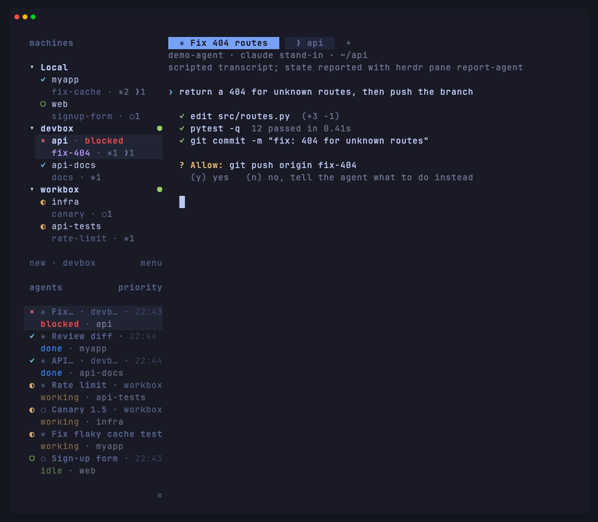
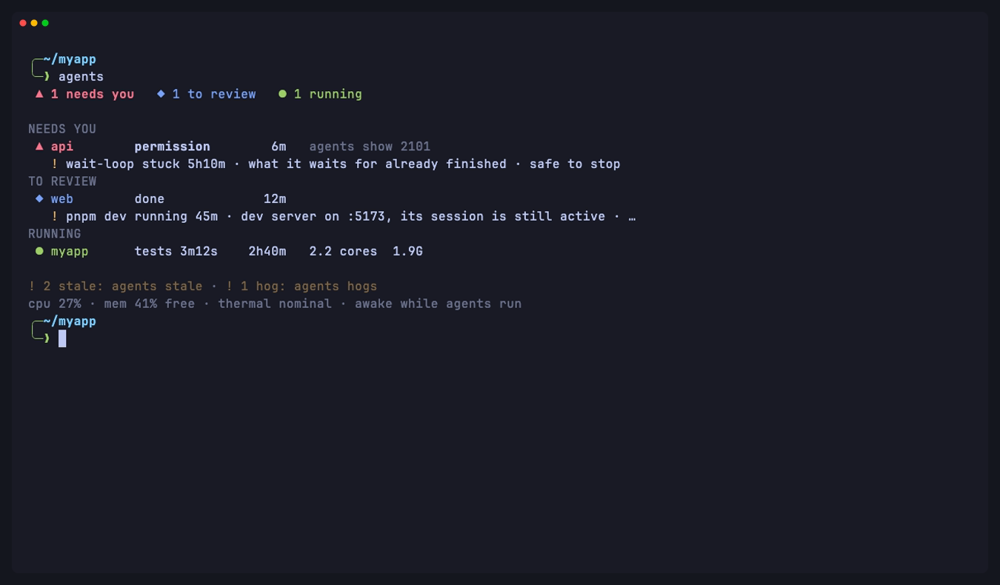
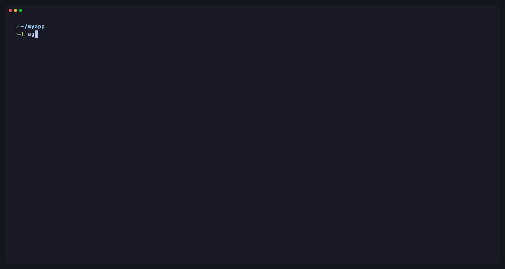
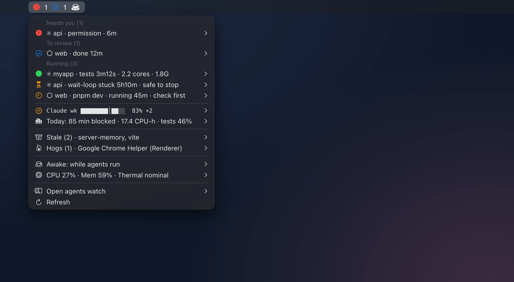

# Agent Workflows

See everything your agents do: which one needs you, what each one runs, what it left behind, what it costs, and whether it is safe to stop. This doc covers running Claude Code and Codex with tuidev, Herdr's sidebar, the `agents` command with its board and menu bar, cleanup, memory, history, hooks and notifications. It all reads files on your machine and sends nothing anywhere. Running agents on other machines and from your phone is the other half: [remote.md](remote.md).

**Your editor is a GUI; the terminal runs agents.** Run `claude` or `codex` in a Herdr pane (the `full` profile, the first choice when you install on a Mac) so one sidebar shows which agent needs you, or in a plain Ghostty tab, and review the diff in VS Code or Cursor. tmux is for a box that stays on.

## At a glance

<a id="control-plane"></a><a id="remote-control-from-a-phone"></a>A fleet of agents is an attention queue, not a wall of panes. Look at an agent when it needs you.

| Need | Tool |
|------|------|
| A quick local session | A Ghostty tab: `claude` or `codex` |
| One durable task over SSH or mosh | tmux (`--pack tmux`): `t [NAME]`, prefix `Ctrl+a` |
| Parallel agents on one repo | [Worktrees](#worktree-per-agent): `claude -w NAME`, or a subagent with `isolation: worktree` |
| Sessions that run with the terminal closed | [Background sessions](#background-sessions): `claude --bg`, `claude agents` |
| Many agents: which one is blocked? | [Herdr](#herdr-which-agent-needs-you---pack-herdr) (`--pack herdr`, prefix `Ctrl+b`) |
| What runs, what leaked, what it costs | [`agents`](#what-runs-agents---pack-monitoring) (`--pack monitoring`), its board and a menu bar on macOS |
| Steer one agent from your phone | The CLI's own remote control, or Herdr's phone app: [remote.md](remote.md#steer-one-agent-from-your-phone) |

These tools don't replace each other: tmux doesn't know agent state, and Herdr doesn't replace a Ghostty tab. Work that must outlive a laptop lid belongs on an always-on machine ([remote.md](remote.md)).

## AI CLIs

| CLI | Pack | Shipped config (adopted, never overwritten) |
|-----|------|----------------------------------------------|
| Claude Code (primary) | `ai-clis` | `configs/claude/settings.json` (Linux: `settings.linux.json`) → `~/.claude/settings.json` |
| Codex (secondary) | `ai-clis` | `configs/codex/config.toml` → `~/.codex/config.toml` |

The pack installs configs, not the CLIs, which update themselves. Both run as plain `claude` and `codex`, confined by each CLI's own sandbox settings ([sandboxing.md](sandboxing.md)). Gemini CLI is deprecated upstream (its successor is Antigravity, `agy`) and isn't shipped.

**Shipped Claude Code policy:**

- **Permissions.** Read-only commands are allowed (`gh pr view|list`, `gh run view|list`, `rg`, `jq`, `shellcheck`). `git add|commit|push|merge|tag`, `gh pr create|merge`, `gh release`, `gh api` and `rg --pre` (which runs a program) always ask. Credential paths and `.env*` are denied.
- **Sandbox.** `sandbox.enabled` is `true`, and `sandbox.credentials.envVars` unsets common third-party tokens in sandboxed commands ([sandboxing.md](sandboxing.md), [secrets.md](secrets.md#what-an-agent-can-reach)).
- **No attribution** (no `Co-Authored-By`), and [agent teams](#agent-teams) are off.
- **A 4 GB Node heap.** `env.NODE_OPTIONS` is `--max-old-space-size=4096`, so a Node test or build that leaks fails with `JavaScript heap out of memory` at 4 GB of heap on every machine. It caps the heap only, not buffers or native memory, so it does not stop every runaway: the [memory guard](#memory-guard-agents-mem) does. Raise it for one command with `NODE_OPTIONS=--max-old-space-size=8192 npm run build`; a project script that sets its own `NODE_OPTIONS` wins. It replaces a `NODE_OPTIONS` exported in your shell inside Claude sessions: put other Node flags in the settings' `env`.
- **Hooks and a status line** for notifications, waits, cleanup and the menu bar: [Claude Code hooks](#claude-code-hooks).

**Shipped Codex policy:** `sandbox_mode = "workspace-write"`, `approval_policy = "on-request"`, network off, `file_opener = "vscode"`, an unpinned model, the same 4 GB Node heap (`shell_environment_policy.set`), the same token names removed from its commands (`shell_environment_policy.filters`), and `~/.codex/rules/tuidev.rules`, which makes the same git and gh writes prompt. Plain Codex can still read credential paths: `workspace-write` limits writes and network, not reads ([sandboxing.md](sandboxing.md)).

Tiered subagents, a delegation skill and one policy for both CLIs are the `orchestration` pack: [orchestration.md](orchestration.md).

**Editors.** Claude Code's `/ide` connects a running session to VS Code or Cursor, so diffs and selections show in the editor. Codex's `file_opener` (shipped as `vscode`; `cursor`, `vscode-insiders`, `windsurf` and `none` are commented in the config) picks the editor its file links open in.

### Instruction files

| CLI | Reads natively | To share one file |
|-----|----------------|-------------------|
| Claude Code | `CLAUDE.md` (managed → `~/.claude/CLAUDE.md` → project → `CLAUDE.local.md`) and `.claude/rules/*.md`; `AGENTS.md` when the project has no `CLAUDE.md` (v2.1.277+) | `@AGENTS.md` on the first line of `CLAUDE.md` |
| Codex | `AGENTS.md` (`~/.codex/AGENTS.md`, then repo root down to the cwd; 32 KiB cap) | `project_doc_fallback_filenames = ["CLAUDE.md"]` |

Start a project's instructions from [templates/AGENTS_TEMPLATE.md](../templates/AGENTS_TEMPLATE.md). Keep each file short: every one loads into context at session start.

### Agent teams

Claude Code's experimental agent teams are off in the shipped settings. While they are on, every subagent Claude names launches as a teammate without asking, and each teammate is a full session with its own context. Plain subagents cover work that only returns a result.

Turn teams on when teammates must talk to each other: `export CLAUDE_CODE_EXPERIMENTAL_AGENT_TEAMS=1`, or the same key under `env` in `~/.claude/settings.json`. The shipped `"teammateMode": "auto"` then gives each teammate a tmux pane when `claude` runs inside tmux, and runs them in-process elsewhere (the agent panel below the prompt: arrows select, Enter opens, `x` stops; `claude --teammate-mode in-process` forces it). Split panes need tmux or iTerm2, not Ghostty's splits.

## Worktree-per-agent

A tab per agent isolates the terminal; a worktree per agent isolates git state. Without one, parallel agents collide on the index, on each other's half-staged files and on `HEAD`.

Claude Code does this itself: `claude -w NAME` starts a session in `.claude/worktrees/NAME`, and a subagent with `isolation: worktree` in its frontmatter runs in its own. Both stay inside the repo, where `sbx` and the native sandboxes allow writes. For other CLIs, use git directly:

```bash
git worktree add ../repo-agent-1 -b agent/1   # one worktree, one branch
git worktree list                             # path, branch, HEAD
git worktree remove ../repo-agent-1           # after merging, once it's clean
```

A worktree isolates git state only. Ports collide (give each its own `PORT`), `node_modules`, `.venv` and `target` are not shared, gitignored files such as `.env` don't follow, and a shared dev database stays shared. When tasks touch the same files, one worktree and sequential agents beat merging the collisions.

## Background sessions

Claude Code and Codex can run sessions without holding a terminal, each in its own worktree.

**Claude Code** ([agent view](https://code.claude.com/docs/en/agent-view)) runs background sessions under a supervisor, so they survive closing the terminal:

```bash
claude agents                              # agent view: dispatch, list, reply
claude --bg "investigate the flaky test"   # start one and return
claude attach ID                           # open it in this terminal
claude logs ID                             # recent output
claude stop ID | respawn ID | rm ID        # stop, restart, drop from the list
```

Inside a session, `/bg` moves it to the background and `/fork` copies it into a new background session. Each moves into its own worktree under `.claude/worktrees/` before it edits files (`worktree.bgIsolation: "none"` turns that off). Permission mode carries over from the session you backgrounded.

**Codex** starts a local background server for interactive sessions and creates sessions in worktrees by default; `/daemon` updates or restarts the server and `--no-daemon` bypasses it ([the daemon note](sandboxing.md#codex-background-server)).

**Git and the ask rules.** Claude Code tells a background session to commit without asking, push the branch and open a draft PR when the task calls for it, never to push to `main`, force-push or merge, and lets your instructions win: `--pack orchestration`'s rules file says to leave work uncommitted until you ask. The shipped `ask` rules hold in a `claude --bg` session (checked on v2.1.284): it waits under `Needs input` on the `git commit` approval, which you answer from `claude agents` (Space, type, Enter) or after `claude attach ID`. An `allow` rule such as `Bash(git *)` of your own, or auto mode, lets it commit without asking.

`claude agents` is a queue for Claude sessions only. [Herdr](#herdr-which-agent-needs-you---pack-herdr) is the queue across CLIs and panes, and tmux keeps a terminal alive over SSH ([remote.md](remote.md)).

## Herdr: which agent needs you (`--pack herdr`)

<a id="fleet-attention--herdr---pack-herdr"></a>[Herdr](https://herdr.dev/) is an agent runtime: a server owns the terminals, clients attach and detach, and each pane holding an agent is marked `working`, `blocked`, `done` or `idle`. Its sidebar lists every agent on this machine and on the machines you saved, the blocked one first. Its CLI and socket API are the same surface, so agents can split panes, start each other and wait on a blocked peer.

```bash
tuidev install --pack herdr
herdr                                 # attach; the first attach starts the server
herdr machine add workbox             # save an SSH machine (interactive, once)
herdr --machine workbox agent list    # scriptable, no TUI
```



<sub>This Mac and two Linux containers saved as SSH machines, with scripted agent stand-ins that report their state through `herdr pane report-agent`. How it is made: [docs/assets/tapes/README.md](assets/tapes/README.md#the-herdr-fleet).</sub>

Herdr is in the `full` profile and is how you see which agent needs you; tmux (`--pack tmux`, also in `full` and `remote`) is for keeping a terminal alive over SSH on a box that stays on. Herdr's prefix is `Ctrl+b`, so it doesn't clash with tmux's `Ctrl+a`.

**tuidev's keys in Herdr** (the `tuidev.link` plugin; the bindings are a managed block in `~/.config/herdr/config.toml`, and a binding of your own outside it wins):

| Keys | Opens |
|------|-------|
| prefix+space | [The board](#the-board-every-session-one-screen) as a popup; prefix+shift+space as a tab |
| prefix+a | The palette: everything tuidev can do here, searchable (`tuidev palette`) |
| prefix+u | Updates: the installed release, the latest one, and one question before it updates ([updating.md](updating.md#hearing-about-a-new-release)) |
| prefix+m | [The map](remote.md#remote-feels-local-ports-links-and-files): what runs where, on every machine |
| prefix+shift+o | The ports popup (`agents ports --pick`) |

The palette's rows follow what is installed (no `agents` rows without `--pack monitoring`); outside Herdr, `tuidev` alone opens the same list. When a newer release is out, Herdr shows one toast and the palette's first row is the update. In Ghostty, tuidev's config binds `cmd+p=text:\x02a`, so **Cmd+P** opens the palette in one press. Outside Herdr that sends `ctrl+b a` to whatever is in front (Claude Code takes `ctrl+b` as "run in the background"), so if you run agents outside Herdr, add `keybind = cmd+p=unbind` below tuidev's block. The same trick binds any Herdr key: `keybind = cmd+shift+o=text:\x02o` runs prefix+o, which opens the pane the last notification came from.

Practices:

1. **Never nest.** When `HERDR_ENV=1` you are inside a Herdr pane: use `herdr agent list` or the socket API, never the TUI.
2. **The sidebar is the queue.** Don't tab through panes looking for a prompt. `ui.agent_panel_sort = "priority"` in your `[ui]` table puts the agents that need you first.
3. **Detach, don't kill.** `Ctrl+b q` leaves agents running; `herdr server stop` ends them. Closing the shell that started the server doesn't stop it, so a script must use `herdr server stop` (or `SIGTERM`). A Mac restart keeps the sessions: Herdr saves before macOS closes apps.
4. **Sleep-proof work lives on an always-on machine**, saved with `herdr machine add` or reached with `herdr --remote NODE`.
5. **Upgrade live, with handoff.** The pack installs Herdr's release binary in `~/.local/bin`, which `herdr update` can update (Homebrew's refuses). `herdr update --handoff`, from a plain shell outside Herdr, or `tuidev update --packages`, installs the new binary and hands the running server's panes to a new server: shells and agents keep running. A newer client keeps using a compatible older server (`herdr status` reports `server_binary_stale`), and `tuidev check` warns while one runs; a restart is never required. Keep one `herdr` binary per machine. Herdr never hands over on its own: its version check only shows a notice (`[update] version_check = false` silences it).
   - **From Homebrew:** `tuidev install --pack herdr` installs the release binary beside it; once no server runs Homebrew's binary, `brew uninstall herdr`.
   - **Under a LaunchAgent**, a handoff needs `<key>KeepAlive</key><dict><key>SuccessfulExit</key><false/></dict>` and `<key>AbandonProcessGroup</key><true/>`, or launchd restarts the old server every 10 seconds. `tuidev update --packages` checks for both and skips the handoff until they are set.
   - **Under systemd**, hand over through the unit's own reload, never `herdr update --handoff` or `herdr --remote HOST --handoff`: systemd would stop the new server with the old one (the default `KillMode`) or lose track of it (`KillMode=process`). Give the unit an `ExecReload` that runs a wrapper you write, named `herdr-handoff`, which hands the panes over and reports the new server with `systemd-notify MAINPID=<pid>`, plus `NotifyAccess=exec` ([drop-in below](#sessions-and-devices)). `tuidev update --packages` then installs the binary itself (sha256 checked) and runs `systemctl --user reload` for each `herdr.service` and `herdr-session@*.service` on an older binary; a unit without the wrapper is skipped with a hint, and a failed reload names `journalctl --user -u UNIT`.
6. **Links stay clickable.** Inside Herdr panes, tuidev's `.zshrc` exports `FORCE_HYPERLINK=1` (unless you set it), because Claude Code doesn't treat `TERM_PROGRAM=herdr` as hyperlink-capable; a pane opened before needs `exec zsh`. Herdr opens links on **Ctrl-click** (OSC 8 links and plain URLs; Cmd-click never reaches it). **Shift-Cmd-click** lets Ghostty handle the click, which also opens file paths. In saved-machine panes Herdr doesn't open OSC 8 links yet ([herdr#4447](https://github.com/herdrdev/herdr/issues/4447)); plain URLs work.
7. **Reinstall integrations after upgrades.** Run `herdr integration install claude` (and `codex`) once; after an upgrade, `tuidev check` names the integrations `herdr integration status` reports `outdated`, with the commands to reinstall them.
8. **Start the server from a login shell.** Integrations read the server's `PATH`, and a server started by `brew services` or a non-interactive `ssh host herdr server` reports the CLIs as `not found`. On Linux use a systemd user unit with `ExecStart=/bin/bash -lc 'exec "$HOME/.local/bin/herdr" server'`; on a Mac, a LaunchAgent running `/bin/zsh -lc 'exec "$HOME/.local/bin/herdr" server'`.
9. **Trim the logs when the server is down anyway.** `tuidev check` warns when `~/.config/herdr/herdr-*.log` passes 50 MB (`HERDR_LOG_WARN_MB`). Before the server's next start, run `cd ~/.config/herdr && for f in herdr*.log; do tail -n 2000 "$f" > "$f.tmp" && mv "$f.tmp" "$f"; done`.

### Tabs named after what runs in them

With `--pack monitoring` beside `--pack herdr`, a tab bar of `1 2 3` reads `✳ API docs`, `✳ Fix login redirect`, `❯ myapp`:

- **A tab** is named with its kind's [mark](#marks-by-kind-of-session), then the session's task title (Herdr's `terminal_title`), else the pane's directory, cut at 20 characters. In a tab with several panes an agent wins over shells, and the first agent in pane order names it, with `+N` for the others. A title that is only the CLI's name, a command line or a prompt doesn't count as a task.
- **The sidebar** gets two rows per workspace and per agent, sized for Herdr's default 26 columns:

  ```
  × api · 2 blocked                 ✳ Rate-limit the API · 16:32
    fix-404 · ✳2 ❯1                   blocked · api
  ```

  A workspace row has its name and, in red, how many of its agents are blocked; below, the branch and a mark and count per kind. An agent row has the tab's name, the machine when it is not `Local`, and when a state that waits on you began; below, the state in words and the workspace. When the tab's name doesn't describe the session, its own task title follows (`release · ✳ Ship the release`).

  | Token | Row | Shows |
  |---|---|---|
  | `$tuidev_agents` | workspace | what runs there: `✳2 ❯1` (`claude:2 shell:1` with `AGENTS_GLYPHS=off`) |
  | `$tuidev_need` | workspace | how many agents are blocked: `blocked`, `2 blocked`; nothing at none |
  | `$tuidev_since` | agent | when a waiting state (blocked, done, idle) began: `16:32` today, `Mon` this week, `Nov 3` before; none until a sync has seen the state change |
  | `$tuidev_session` | agent | the session's own task title, only when its tab's name doesn't say it |

- **Your own rows.** The pack adds both layouts as a `tuidev-sidebar` block in `~/.config/herdr/config.toml`, kept current by `tuidev update --configs`. To restyle, copy the block (`configs/herdr/sidebar.toml`) above the markers, delete the block, and edit your copy: drop a token by deleting its entry, or style one with Herdr's inline styles (`{ token = "$tuidev_need", fg = "#f7768e", bold = true }`). If your config already sets `[ui.sidebar.spaces]` or `[ui.sidebar.agents]`, the block is not added, since a second table would stop Herdr reading the file. A token nothing reports disappears, so the rows work without `--pack monitoring` too.

**Your names stay yours.** A sync renames only a tab still showing Herdr's number, or the name a sync gave it. A tab you (or a script, through `tab.rename`) renamed is never touched until `agents herdr reset TAB_ID` hands it back. `~/.config/tuidev/run/herdr-labels.tsv` remembers which tabs a sync named.

**What keeps it current.** The `tuidev.link` plugin's event hooks run `agents herdr sync` when a tab, pane or agent comes, goes or moves, when an agent changes state, when you switch tabs and when the server starts; no daemon of its own. Herdr has no event for a title change alone, so the next event catches it, as does the menu bar's refresh on macOS (at most every 30 seconds). Each machine's server runs its own plugin and names its own tabs.

```bash
agents herdr              # each tab's label, whose it is, what a sync would make it; each workspace's roll-up
agents herdr sync -n      # what a sync would change
agents herdr reset        # every tab a sync named gets its number back; tokens and marks cleared
agents herdr reset w1:t3  # that tab only, back to auto-naming (one you renamed too)
```

`AGENTS_HERDR_NAMES=0` in `agents.conf` turns it off (`agents herdr reset` then puts back what it set). `AGENTS_GLYPHS=off` keeps the names without the marks.

### Sessions and devices

A Herdr **session** is one server with its own workspaces, panes and socket. Plain `herdr` attaches to `default`; `herdr --session NAME` (or `herdr session attach NAME`) starts or attaches a named one.

- **Keep one session per machine** and split projects into workspaces, so every device lands in the same sidebar. Use a second session only for hard isolation.
- **A saved machine points at one session on that host**, picked during `herdr machine add`. To switch, add it again and `herdr machine remove` the old entry.
- **Every device reaches the same session**: from a laptop as a saved machine or `herdr --remote workbox --session NAME`; from a phone, over SSH ([remote.md](remote.md#iphone-and-ipad)).
- **Inside a pane, `HERDR_SOCKET_PATH` wins over `HERDR_SESSION`.** Target another session with `HERDR_SOCKET_PATH=~/.config/herdr/sessions/NAME/herdr.sock herdr status` (`~/.config/herdr/herdr.sock` for `default`).
- **Manage them** with `herdr session list`, `herdr session stop NAME` (kills its panes) and `herdr session delete NAME`. Agents with native resume (`claude --resume`, `codex resume`) pick up their conversations elsewhere.
- **Supervise every session on an always-on machine**, or it won't come back after a reboot:

  ```ini
  # ~/.config/systemd/user/herdr.service
  [Unit]
  Description=Herdr agent runtime

  [Service]
  ExecStart=/bin/bash -lc 'exec "$HOME/.local/bin/herdr" server'
  Restart=on-failure

  [Install]
  WantedBy=default.target
  ```

  For live upgrades, add a drop-in whose reload hands over (practice 5), and keep the default `KillMode`:

  ```ini
  # ~/.config/systemd/user/herdr.service.d/handoff.conf
  [Service]
  # Your herdr-handoff wrapper: hands the panes over, then systemd-notify MAINPID=<new server>.
  ExecReload=%h/.local/bin/herdr-handoff
  NotifyAccess=exec
  ```

  Enable it with `systemctl --user enable --now herdr.service`, and run `sudo loginctl enable-linger $USER` once so user units run without a login. A named session is the template `herdr-session@.service` with `Environment=HERDR_SESSION=%i`, the name `tuidev update --packages` looks for.

`herdr machine add` installs the remote server after asking and never copies your config or secrets. `herdr machine status` checks saved machines without prompting; `herdr machine reconnect` finishes SSH authentication (MFA included); passphrase-protected keys need `ssh-add` first. Under `sbx --profile strict`, an agent reaches the Herdr socket, and Herdr sees the agent, only with `--allow-herdr` ([sandboxing.md](sandboxing.md#profiles)). Herdr's docs: <https://herdr.dev/docs/>.

## What runs: `agents` (`--pack monitoring`)

<a id="local-processes-agents---pack-monitoring"></a>Every `claude` session starts its own MCP servers and holds a rolling `caffeinate -i -t 300`, and when a session dies badly those children are reparented to pid 1 and keep running. `agents` (`~/.local/bin/agents`) shows who needs you, what each session runs, and what was left behind. It reads one `ps` snapshot per run and never needs sudo.



```bash
agents                    # who needs you: blocked, to review, running; parked and the system on a line each
agents watch              # the same, redrawn every 2 s (q quits); open-term watch: in a new window
agents ls                 # the full table: PIDs, ports, MCP servers, commands, stale processes, hogs
agents ps 90419           # everything one session runs (all sessions without a pid)
agents why [PID]          # every flagged item's verdict, or one item's evidence and verdict
agents show PID           # one process in detail (jump, peek and pick go with it)
agents reap -n            # what reap would stop: the stale trees whose verdict is "safe to stop"
```

The board, the menu bar, `mem`, `report`, `limits`, `doctor` and `json` have sections of their own below. `agents --help` lists every command and option.

**Who needs you.** `agents` puts every session in one of five states, each with its own shape, so it reads the same under `NO_COLOR`:

```text
 ▲ 1 needs you   ◆ 2 to review   ● 2 running   ○ 2 parked      ! swap 91%

NEEDS YOU
 ▲ api        permission        6m   agents show 66498
TO REVIEW
 ◆ web        done             12m   Fix the login flow
 ◆ docs       done             41m
RUNNING
 ● billing    tests 3m12s    2h21m   8.4 cores  7.6G
 ● infra      working          47m   0.2 cores  294M
   ! wait-loop stuck 5h10m · what it waits for already finished · safe to stop

○ 2 parked, oldest 39 h · no stale · no hogs
cpu 27% · mem 59% free · thermal nominal · awake while agents run
```

| State | Means | Comes from |
|-------|-------|------------|
| `▲` needs you | blocked: waiting for your answer | Herdr says `blocked`; outside Herdr, Claude Code's hooks. A notification names why (`permission`, `auto mode`) |
| `◆` to review | finished, not looked at, for under `AGENTS_PARKED_MIN` minutes (60) | Herdr says `done`; outside Herdr, the idle prompt's hook |
| `●` running | working | Herdr says `working`; with neither Herdr nor a hook, a session running a command or using 3% of a core |
| `○` parked | finished longer ago, or looked at and left | `done` past the threshold, or Herdr's `idle` |
| `?` no signal | nothing says | No Herdr status and no hook, and nothing visible: Codex, `agy` or `grok` outside Herdr, Claude Code with `AGENTS_HISTORY=0` or no sample within the hour, or Herdr not answering. It keeps its own row, and counts as neither parked nor in the menu's title |

Ages come from the once-a-minute samples (`waits.now` in the data directory), so they are good to about a minute; a session whose age can't be established stays to review rather than skip it on a guess. A flagged command shows under its session. Empty groups disappear. Below 72 columns the view folds to a narrow form without headers or the system line, and it never uses more than 80 columns. Without a UTF-8 locale the shapes are `^`, `*`, `o`, `.` and `?`.

**Agents** are processes named `claude`, `codex`, `agy`, `grok` or `cursor-agent` (`AGENTS_NAMES`): one row per tree, with its project (the directory's name, or `repo/name` for a worktree under `.claude/worktrees/`), CPU, memory, children, cwd, listening ports and, under Herdr, its pane's status and task title. The pane is exact: `agents` reads `HERDR_PANE_ID` from each session's environment, so two sessions in one directory each get their own pane. Herdr's answer is cached for ten seconds in `~/.config/tuidev/run/`. The Codex app-server daemon (`codex app-server … --managed-daemon`) is long-lived by design: it gets a `daemon` row and is never stale.

**What sessions run.** Under each session, `agents ls` lists its MCP servers on one line and its busiest commands (`AGENTS_LS_TOOLS`); `agents ps PID` lists them all:

```
  1000    claude  -          1h00m  107.0   1.4G   16  -           repo                   /Users/NAME/repo
      mcp: 2 servers · 4 procs · 302M (chrome-devtools, example-agent)
      └ go test -race ./internal/web · 2m00s · 100% · feat-a  x3 dup  hot
      └ claude -p hello · 3m00s · 2% · -
      └ until [ -s /nonexistent/x ]; do sleep 5; done · 52m00s · 0% · main  wait
```

Each child of a session is one unit with its whole subtree's CPU and memory: an MCP server (grouped by name), a command (the tool shell Claude Code or Codex runs, shown as the command itself, without its `cd`, `VAR=value` prefixes and trailing `| tail`), the session's `caffeinate`, a nested session (`claude -p`), or anything else. A command's **origin** is the worktree subagent it runs for, read from its directory, or `main`. Its flags:

- `dup`: the same command runs more than once in the same directory, and at least two copies have run for a minute. Parallel worktree subagents running the same test in their own worktrees are not duplicates.
- `long`: running longer than `AGENTS_TOOL_LONG` (20 minutes).
- `wait`: a polling loop the agent waits on (`until …; do sleep 5; done`). Never `dup` or `long`.
- `stuck` (with `wait`): a polling loop that has run `AGENTS_WAIT_STUCK` (60 minutes) or longer while the file it watches stayed quiet. The watched file is the first absolute path the loop's condition reads with `tail`, `head`, `grep`, `cat`, `test`, `[` or `[[`, directly or through an assignment before the loop. A loop with no such file is judged by its age alone.
- `hot`: its subtree uses `AGENTS_HOG_NOW` CPU or more.

For agent authors: Claude Code appends `[exited with code N]` as the last line of a background task's `.output` file, so a loop such as `until tail -1 "$F" | grep -qE '^(ok|FAIL)'` never ends once the task has finished. Match the exit line too (`grep -qE '^(ok|FAIL)|^\[exited with code'`), or cap the tries (`for i in $(seq 120); do …; sleep 5; done`).

**Stale** means reparented to pid 1, yours, and either an agent helper (MCP servers, `npm exec` and npx, `caffeinate`: `AGENTS_ORPHAN_PATTERNS` in `lib/agents/config.sh`) or a dev server: a process that listens on a TCP port itself or through its children, started under `$HOME` (not `~/Library`), `$TMPDIR` or Claude Code's `/private/tmp/claude-UID` scratchpads. Never stale: anything that hosts a session (an agent, an interactive shell, a tmux, screen, zellij, Herdr or pm2 server), launchd jobs and systemd `.service` units, the Codex daemon and `agents`' own keep-awake holder. Stale detection works best on macOS: on Linux, orphans usually reparent to a `systemd --user` subreaper instead of pid 1, so they rarely look stale. `agents stale` lists only these.

**Hogs** are processes of any owner that average at least 50% CPU over their lifetime after 30 minutes and are still busy, or that use at least 90% for 3 minutes outside an agent tree (`AGENTS_HOG_PCT`, `AGENTS_HOG_MIN`, `AGENTS_HOG_NOW`, `AGENTS_HOG_SUSTAIN`, `AGENTS_HOG_TOP`). The check uses the CPU time a process really used, across `agents` runs (the menu's refreshes provide them), and a hog clears once it falls below half its threshold. A process past `AGENTS_MEM_WARN` of memory leads the hogs. A background system service gets no stop hint: stopping it only restarts it. On Linux, `ps` reports only the lifetime average. `agents hogs` lists only these.

**Safety.** `kill`, `reap` and `term` refuse pid 1, `agents` itself and its parents, other users' processes (they print the `sudo kill` instead), system and session processes (anything under `/System/Library`, `/usr/libexec` or `/usr/sbin`, `loginwindow`, Finder, Dock, WindowServer, your terminal), and any process hosting a shell or an agent below it; apps in `/System/Applications` stay allowed. They refuse to run as root. Before every signal they re-check the process's start time, so a reused pid is never hit, and `PID@START` (from `json` or `tsv`) pins the exact process listed. A tree kill sends SIGTERM, then SIGKILL to what is left after `AGENTS_GRACE` seconds (3). Without a terminal they need `-y`.

### The board: every session, one screen

`agents` answers "who needs me" once. `agents board` is the same answer as a place: one list of every session on this machine and your others, to glance at from the pane you work in or to leave open. In Herdr it is **prefix+space**, a popup: enter goes to a session, esc puts you back. **prefix+shift+space** opens it as a tab, and returns to that tab while it is open.

```bash
agents board              # every session, by what you would do about it
agents board workbox      # one machine's
agents board | cat        # the list as text, without fzf
```



The list has one line per session, grouped as **Needs you** (the longest wait first), **To review** and **Working**, with the parked folded into one line (`PARKED 2 · press . to show`). A line is the session's task title (else its project), what it does now, since when, its machine when there is more than one, and what runs under it (`+2 sub, 1 cmd`). With herdr-core installed, a session [Herdr's phone app](remote.md#herdrs-phone-app-agents-hc) reaches has a `☏` before its name (`@` without UTF-8). The header has the lens tabs, the counts, each CLI's fullest [usage limit](#usage-limits-agents-limits), and one line for what is wrong (a process past the memory warning, a hog, something left behind) while something is.

The right-hand side (55% of the window) follows the cursor: why the session waits, its sub-agents and commands, the last lines of its pane (its output, without the agent's input box and status lines), then its branch, model, tokens and cost. `→` turns it to the **Trace**, what a Claude Code session did, newest at the bottom, up to 40 events:

```text
14:02  you     fix the flaky cache test
14:04  edit    cache.ts, cache.test.ts
14:05  run     pnpm test cache --run                  exit 1
14:06  run     pnpm lint ×2
14:07  agent   Explore: find the cache tests
14:08  ask     Which cache?
14:09  run     rm -rf build                           denied
```

The trace reads the last 4 MB of the transcript, and every character a terminal could act on is taken out. A Codex session has no trace (Pane shows its screen), and a session on another machine is read there.

| Key | What it does |
|-----|--------------|
| `↑` `↓`, `j` `k` | move |
| `enter`, double click | go to that session's pane (`agents jump`); on another machine, a look at its pane; on a sub-agent or command, its last lines or details |
| `ctrl-p` | everything you can do: the row's actions first (with phone mirrors on, also its pane's mirror off or on), then the map, ports, memory, limits, runs and reports |
| `tab`, `shift-tab`, `1` `2` `3` | the lens: Attention, Tree (sub-agents and commands under each session), Machines (a roll-up each) |
| `←` `→` | the right-hand side: Card, Trace, Pane, Details (`agents show`) |
| `space` | hide or show the right-hand side |
| `.` | show the parked sessions |
| `/` | find by typing; `esc` ends it |
| `-` | back to the pane the board was opened over |
| `ctrl-k` | stop the session or command under the cursor (`agents kill`, with its refusals and y/N, on its machine) |
| `ctrl-r` | reload |
| `?` | the keys |
| `q` | leave; `esc` too, in the popup |

A click selects, the wheel scrolls either side, and each word of the footer is a button. A sub-agent stays listed for 30 minutes after its last line and counts as running while its transcript was written in the last 90 seconds. The board reloads when Herdr says something changed: the plugin's hooks run `agents board --poke`, which tells each open board through its own Unix socket (mode 600, never a network port); its timer is a safety net every 15 seconds, or every 5 where fzf can't listen (`AGENTS_BOARD_EVERY` in the environment sets either). Other machines answer `agents board --rows` over ssh and are asked again in the background once their answer is 20 seconds old (`AGENTS_BOARD_REMOTE`). A machine that sends no rows says why on its card in the Machines lens. What a machine sends is text: an id is used only in the shape of one, and no control character reaches your terminal.

The board needs fzf 0.63 or later; with an older one, or none, it prints its list.

### Menu bar (SwiftBar, macOS)

On macOS the pack installs [SwiftBar](https://swiftbar.app) and its plugin (`agents.1m.sh`, named after `AGENTS_BAR_REFRESH`; `configs/swiftbar/agents.10s.sh` in the repo). If SwiftBar already has a plugin folder, the plugin goes there; otherwise the pack sets it to `~/.config/swiftbar/plugins`. Open SwiftBar once (`open -a SwiftBar`) and turn on **Launch at login** in its settings: the pack adds no login items. Uninstalling removes the plugin and leaves SwiftBar's settings alone.



<sub>The plugin's real output over the screenshot fixtures, drawn as a macOS menu by `scripts/render_menu.sh` ([how](assets/tapes/README.md#the-swiftbar-menu)).</sub>

**The title** counts only what needs you: a red alert and how many sessions are blocked, a blue check and how many are to review, then a cup while keep-awake is on. With nothing to do it is the icon alone. The icon turns yellow for memory pressure, a recent memory incident, a memory guard that should run but doesn't, or a usage limit at 95% or more, and red for heavy thermal pressure, critical memory pressure, or sleep disabled with nothing to restore it. `AGENTS_BAR_TITLE` picks other tokens.

**The menu** answers "does anything need me, and is everything healthy?" in about ten rows, with the rest one hover away. Sections follow `AGENTS_BAR_SECTIONS` and appear only with something to show. The states are [those of `agents`](#what-runs-agents---pack-monitoring):

- **Needs you** and **To review:** each blocked session with what it waits for and how long (`api · permission · 6m`), each finished one (`web · done 12m`).
- **Running:** each working session with what it runs and uses (`billing · tests 3m12s · 8.4 cores · 7.6G`). A flagged command takes its session's row, with its verdict (`infra · wait-loop stuck 5h10m · safe to stop`; see [Flagged](#flagged-is-it-safe-to-stop)). More than four rows fold into `Running (7) · 2 flagged`.
- **No signal** and **Parked:** one row each, the sessions in its submenu.
- A session's row starts with its kind's [mark](#marks-by-kind-of-session), then its task title or project; clicking it shows the project in Finder. Its submenu starts with Jump to session, then its path, kind, pid, age, ports, status and where it lives, its commands with Stop command… (asks first), its MCP servers, Stop duplicates (keep newest)…, Peek, Details, Kill session…, Copy path, Open in Finder and Copy PID. A flagged command's submenu holds its verdict and evidence, Stop, Copy details, Show session, Peek and Details.
- **Limits:** the [limit window](#usage-limits-agents-limits) closest to its limit as a gauge (`Claude wk ████▏░░░░│░░ 41% +2`), yellow from 80% or over pace, red from 95%; its submenu has every window that hasn't reset, then swap once it passes 80%. Each Claude Code account is its own CLI.
- **Today:** `Today: 3.4 h blocked · 48 CPU-h · tests 64%`, which opens today's report. Its submenu has **Where the CPU goes** now by job type, each with the sessions behind it, and the [MCP servers](#mcp-servers-by-name) with their memory in use (RSS); then today's tokens, denials and compactions, today's top insight, and Open report.
- **Stale (3) · web.test, vite, server-memory:** each with its verdict, evidence, Kill tree, Copy details and Details, then Reap all stale, which kills exactly the processes listed.
- **Hogs (2) · Messages, yes:** each with Terminate (SIGTERM, your own processes only); a memory chip while a memory hog is among them.
- **Machines (2) · 3 dev servers · 1 left behind:** what your other machines run and every dev server, this machine's too, each a click from your browser, and Open the map ([remote.md](remote.md#remote-feels-local-ports-links-and-files)). It appears once the menu has been opened with something to list.
- **Awake:** the keep-awake state; its submenu has Until turned off, For 1 hour, For 3 hours, While agents run and Off, a Lid closed too… group (1, 3 and 8 hours; `AGENTS_LID=0` hides it), and who holds the Mac awake. When sleep is disabled with nothing to restore it, Restore lid sleep… leads Needs you.
- **System:** CPU, memory used and thermal pressure, which opens `agents watch`. Its submenu has the load, the busiest processes (`AGENTS_BAR_TOP`), battery and energy mode, the Codex daemon, the memory guard (on with its stop size, not running with Start it, stalled, unknown inside a sandbox, or off) with its last incident, and, with the [cooling pack](#fans---pack-cooling), the fans with Cool, Balanced, Quiet, Max and Off.
- With herdr-core installed, one line for [Herdr's phone app](remote.md#herdrs-phone-app-agents-hc): `Phone: herdr-core is up`, `Phone: 5 agents mirrored` with mirrors on, `Phone: herdr-core is not running`, or a warning when the core runs outside your desktop login. The menu never starts or restarts a core.
- A gray **Maintenance** line when Herdr's server is older than its client or an integration is outdated, with what to run in a terminal outside Herdr. It offers a server restart only while no Herdr session is working or waiting for you, and restarts nothing itself.
- Open agents watch (with the full table and Edit settings… in its submenu), and Refresh.

Every action runs `agents` with the `PID@START` it listed, so a menu opened before a pid was reused can't stop the wrong process, and menu parameters never carry a path or a name a process controls. Killing a live session asks first in a dialog (Cancel is the default). Each action reports its result as a notification. Windows open in your terminal (`agents open-term`, `AGENTS_TERMINAL`): with Ghostty 1.3 or later, a new window of the Ghostty you run, through its AppleScript; the first time, macOS asks whether SwiftBar may control Ghostty. Status colors come from [your palette](theming.md#agents-and-its-menu) when it suits the menu's appearance; Option-click the item for SwiftBar's own menu.

**When it refreshes.** At once when something changes (`agents bar poke`): Claude Code's hooks, Herdr's agent events (that is how it hears of Codex, `agy` and Grok sessions in Herdr), Codex's `notify` if you wire it (a commented example is in [config.toml](../configs/codex/config.toml)), and the menu opening. A poke goes out at most once every 2 s, and the last of a burst is never lost. While a command runs, or a session nothing reports on works, it refreshes every 10 s. Otherwise its timer, `AGENTS_BAR_REFRESH` (1m), is a backstop, and when nothing is going on it skips its reading for up to 5 minutes. Opening the menu shows the last output at once and asks your other machines in the background (at most every 20 s). A poke does nothing where SwiftBar doesn't run the plugin (Linux, a box without SwiftBar); `agents bar` says what a poke would do now. One refresh runs `agents tsv` once: one `ps` snapshot, with Herdr and the MCP inventory from their caches.

### One process in detail: `show`, `jump`, `peek`, `pick`

`agents show PID` (or `PID@START`) is an inspector for any process: a session, an MCP server, a command, a stale helper, a hog.

```
$ agents show 1001
MCP server chrome-devtools · repo  pid 1001 · me
in claude 1000

mcp       configured in claude (user, ~/.claude.json) · starts with chrome-devtools-mcp
project   repo
cwd       /Users/NAME/repo
where     tmux pane work:1.0
command   npm exec chrome-devtools-mcp@latest
running   1h00m (since Wed Oct 14 08:00:01 2026)
cpu       0.0% now · 0s CPU time · 0.0% average · 1 thread
memory    87M · 253M with 2 child processes
files     17 open
verdict   informational — part of a live session; it ends with the session (high confidence)
          owner: claude 1000 in repo
          running 1h0m · 0% CPU

children (2)
  PID        CPU%    MEM  COMMAND
  1002        0.0   107M  chrome-devtools-mcp
  1003        0.0    58M    node /Users/NAME/.npm/_npx/abc/node_modules/chrome-devtools-mcp/build/index.js
```

For a process in a Claude Code or Codex session it also shows the session's name and id, model and version, what it is doing (the last tool call), the last line it wrote and, with the token history, its tokens and cost. Those come from `~/.claude/sessions/PID.json` (checked against the process's start) and the last 256 KiB of the transcript, or the rollout file a Codex process keeps open. The verdict is the one `agents why` prints. `--watch` redraws it every 2 s; `--json` gives a versioned object.

`agents jump PID` goes to where a process runs, so you can answer it (a click on a [notification](#notifications) runs it too): its Herdr pane (`herdr agent focus`) or tmux pane, then the terminal tab that shows it. Ghostty 1.3 or later, iTerm2 and Terminal are asked for the tab through AppleScript; any other app is brought forward. `agents peek PID [LINES]` prints the last lines of its tmux or Herdr pane, and never guesses which pane.

`agents pick` lists every session with what it runs, then stale processes and hogs, in [fzf](https://github.com/junegunn/fzf), with `agents show` as the preview: enter jumps, ctrl-p peeks, ctrl-d opens the details live, ctrl-k kills the tree (with `agents kill`'s refusals and question), ctrl-r reloads. With fzf 0.70 or later the list reloads every 2 s.

### MCP servers by name

`agents mcp [DIR]` lists the MCP servers your CLIs are configured with: Claude Code's from `~/.claude.json` (user and local scope), each project's `.mcp.json` and each enabled plugin; Codex's from `config.toml`'s `[mcp_servers.NAME]` tables. With `DIR`, only those a session started there loads. MCP processes go by these names everywhere `agents` lists them. Of a server's configuration, `agents` keeps only its name, scope, source, transport and the word its command starts with: never its args, env, headers or URL. Without jq only Codex's servers are known.

Every session starts its own copy of each stdio server it loads: five sessions with `chrome-devtools` at user scope run five copies. So `agents mcp` also says what runs of each server now, and their memory in use (RSS), with a hint for a user-scope server running in several sessions:

```
NAME                   CLI    SCOPE    TYPE   RUNNING         STARTS WITH                        SOURCE
chrome-devtools        claude user     stdio  4 copies, 874M  chrome-devtools-mcp                ~/.claude.json
RUNNING: copies now (each session starts its own) and their memory in use (RSS), not data sent
chrome-devtools: 2 copies · 454M — user scope starts one per session; scope it to the projects that use it, or agents mcp lazy chrome-devtools starts it on first use
```

To scope one, remove it at user scope and add it where it is used: `claude mcp remove chrome-devtools -s user`, then `claude mcp add -s project …` in each project. Or start it only when a session calls it:

#### Start a server on its first tool call: `agents mcp lazy`

```bash
agents mcp lazy chrome-devtools     # Claude Code (user and local scope) and Codex
agents mcp lazy --all               # every stdio server you configured
agents mcp eager chrome-devtools    # back to starting with each session
```

A session then starts `mcp-lazy` (about 10 MB, installed beside `agents`) where the server was. It answers the session's first questions (`initialize`, the tool, prompt and resource lists, `ping`) from a cache of what the server answered before, so the session sees every tool and the server doesn't start. The first request it can't answer, usually a tool call, starts the server, replays `initialize`, and from then on passes every message through; that first call waits for the server to start.

- **The cache** is one private file per server command line in `~/.cache/tuidev/mcp-lazy/`, keyed by a hash of the command, the program's size and modification time, and the server's env values (never stored in the name). It keeps answers per client, so Claude Code and Codex both stay lazy. A client's first session with a new server starts it and fills the cache. Changed tools update the cache and notify the session.
- **Failures stay contained.** A server that exits fails only its open requests; the next request starts it again. When the session ends, the server's process group gets TERM after 3 seconds (`MCP_LAZY_GRACE`), then KILL.
- **What is rewritten:** a stdio server's `command` becomes `mcp-lazy` and its args `["--name", NAME, "--", COMMAND, ARGS...]`, in `~/.claude.json` and Codex's `config.toml`; never a project's `.mcp.json` or a plugin's. Each file is backed up to `~/.local/state/tuidev/agents/backups/` first (the last 10 kept) and replaced in one rename (of the file a symlink leads to, so a dotfile manager's link stays), only if no session wrote it meanwhile. Sessions already running keep what they started with.
- **Seeing it:** `agents mcp` marks such a server `(lazy)` and says how many copies have not started; the menu says `via mcp-lazy: not started`. `MCP_LAZY=0` in a server's env runs it directly; `MCP_LAZY_DEBUG=1` logs to the CLI's MCP log. `uninstall.sh` runs `agents mcp eager --all` first.

## Flagged: is it safe to stop?

A flag says why an item is listed, not that it should be killed:

| Flag | Means | Trust | What to do |
|------|-------|-------|------------|
| `stale` | Reparented to pid 1: the session that started it ended | High, but a server it left may be the one open in your browser | Helpers (MCP, npx, `caffeinate`): stop them. A server: check its port first |
| `stuck` | A polling loop that waited `AGENTS_WAIT_STUCK` (60 minutes) while its watched file stayed quiet | High with a watched file, higher when its last line says the work finished; medium on age alone | Read the file's last line, then stop the loop: the session sees the command fail and carries on |
| `long` | A command running longer than `AGENTS_TOOL_LONG` (20 minutes) | Informational: builds, tests and dev servers run long on purpose | Nothing, unless you expected it to end |
| `dup` | The same command runs more than once in one directory | Medium | Keep the newest (Stop duplicates) |
| hog | Busy for a long time, or holding past `AGENTS_MEM_WARN` of memory | Medium | Quit it normally if you can |

Every item gets a verdict, made by one function (`agents_assess`) for every surface: `agents why`, `json`, the menu, the board, `agents reap` and auto-reap. Its evidence is the owner (the session's kind, pid, project and Herdr status, or that its session ended), age and CPU, listening ports, directory and, for a polling loop, the file it watches, that file's last line and how long it has been quiet. The last line is read from the last 2 KB of a regular file, never a symlink or a file under the [credential paths](sandboxing.md), with control characters removed. The verdicts:

- **safe to stop** (high confidence): a helper whose session ended and that a sample saw running under an agent (`safe to stop — its session ended`); medium when no sample saw that (`probably left by an agent session that ended`), since a `nohup npx …` of your own looks the same. A stuck loop whose watched file ends in a completion marker (`[exited with code N]`, `ok`, `PASS`, `FAIL`, `--- FAIL`, a pytest or cargo summary, `done`, `error`): `safe to stop — what it waits for already finished ([exited with code 0], 5h0m ago)`. A stuck loop whose file nothing has written to since.
- **check first** (medium): anything listening on a port (`check first — dev server on :3000, its session is still active`; `a server on :5173, left behind when its session ended`); a stale tree whose ports couldn't be listed; a stuck loop judged by age alone, whose file is gone, or that only tests whether a file exists; duplicates; hogs (`check first — Messages holds 9.0G of memory` for a memory hog).
- **leave it**: a loop whose watched file changed recently, so whatever writes it is alive.
- **informational**: a long command that is none of the above (`informational — running 25m; its session is still active`), and a loop that has not waited `AGENTS_WAIT_STUCK` yet.

```
$ agents why 5010
stuck polling loop · pid 5010@Wed_Oct_14_03:50:00_2026
  until tail -1 $F | grep -qE "^(ok|FAIL)"; do sleep 5; done

verdict: safe to stop — what it waits for already finished ([exited with code 0], 5h0m ago)
confidence: high

evidence:
  owner: claude 5000 in myapp
  waiting 5h10m · 0% CPU
  watches /tmp/w/done.output
  last line: [exited with code 0] (a completion marker)
  file quiet for 5h0m

next:
  look at it: tail -5 /tmp/w/done.output
  stopping it ends only the loop: the session sees the command fail and carries on
  stop it: agents kill 5010@Wed_Oct_14_03:50:00_2026
  auto-reap (AGENTS_AUTO_REAP=1) would stop this on its own
```

Without a PID, `agents why` lists every flagged item, one line each:

```
$ agents why
19 flagged (agents why PID explains one):
  1010    dup    go           check first — the same command runs 3× in this directory
  5010    stuck  wait-loop    safe to stop — what it waits for already finished ([exited with code 0], 5h0m ago)
  6100    stale  node         check first — a server on :5174, left behind when its session ended
  …
```

`agents why --copy PID@START` puts the text on the clipboard. `why` refuses a `PID@START` whose pid now names another process.

## Cleaning up: `agents reap`

`agents reap` goes by the verdicts: it stops only the stale trees (and, with `--stuck`, the stuck loops) whose verdict is "safe to stop", and says how many "check first" ones it left out. `--all` takes those too. It asks before it signals anything; `-n` shows the plan:

```
$ agents reap -n --stuck
  5011    sleep
  5010    zsh · safe to stop — what it waits for already finished ([exited with code 0], 5h0m ago)
  5020    zsh · safe to stop — nothing has written to the file it watches for 1h30m
  60829   npm · safe to stop — probably left by an agent session that ended
  27681   caffeinate · safe to stop — probably left by an agent session that ended
  6001    chrome-devtools-mcp
  6000    npm · safe to stop — its session ended
  …
left out: 5 flagged "check first" (agents reap --all includes them; agents why PID explains one)
dry run: would send SIGTERM to 13 process(es), then SIGKILL to any left after 3s
```

When every item is "check first", it says so and asks nothing. To stop one item, use `agents kill PID@START` (a tree) or `agents term PID` (one process, for a hog).

**Auto-reap** (`AGENTS_AUTO_REAP=1`, off by default) stops, without asking and at most once a minute, only the two high-trust cases:

- stale trees that listen on no port and that a sample saw running under an agent before their session ended: the MCP servers, npx helpers and `caffeinate -t` of ended sessions. That record needs `AGENTS_HISTORY=1`. Never a stale server, a `caffeinate` without `-t`, or anything when the ports could not be listed;
- stuck polling loops reading a watched file that has been quiet for twice `AGENTS_WAIT_STUCK` (two hours by default).

Never a long or duplicate command, anything listening on a port, a loop stuck by age alone, or one that only tests whether a file exists. The menu bar runs `agents reap --auto --throttle --notify` in the background when a refresh shows something it may stop. Where no menu bar runs (Linux, a headless box, SwiftBar quit), the [sampler](#history-and-agents-report) runs the same command once a minute when a sample saw something under an agent; a shared throttle keeps it to once a minute whoever starts it. `agents reap --auto` by hand works whatever `AGENTS_AUTO_REAP` says, and `agents reap --auto -n` shows what it would stop. One notification sums up what it stopped.

In Claude Code's auto mode, the [cleanup hooks](#cleanup-hooks-claude-code) also stop the background commands a finished subagent or a cleared session left running.

Every cleanup is logged to `events.tsv` in the [history](#history-and-agents-report): `kill manual` for `agents kill`, `term` and the menu's Stop and Kill, `reap stale` or `reap stuck`, `auto stale` or `auto stuck`, `hook subagent-end` or `hook session-end`, and `guard memory` for the memory guard, each with the process name, project and owning session, never a command line.

## Memory and heat

### Memory guard: `agents mem`

A test that leaks can take a Mac's memory in under a minute: one node process an agent started grew to 16 GB in 55 seconds, and macOS's "out of application memory" dialog blamed Chrome, because it lists only apps. Two layers stop that:

1. **The Node heap cap** in the shipped Claude Code and Codex settings ([above](#ai-clis)) makes a JavaScript heap leak fail at 4 GB inside the agent's own command.
2. **The memory guard**, `agents mem guard`, covers every language. The pack runs it as a LaunchAgent on macOS (`dev.tuidev.memguard`) and as a systemd user service on Linux (`tuidev-memguard.service`, `Restart=on-failure`; from boot only with lingering on). It looks every `AGENTS_MEM_POLL` seconds (5) while something needs watching (a process past half the warning, memory pressure up, or free memory falling fast) and every `AGENTS_MEM_IDLE` seconds (20) otherwise. Each look is one `ps` snapshot; on macOS it then reads the footprint of the large processes, which keeps counting what the compressor squeezed and swap took, while RSS falls as a runaway grows.

What it does:

- **Warns** when a process passes the warning, and again at each doubling: a notification names the process, the script it runs, its project and session (`node (invoiceTotalSum.test.js) in store holds 16.6G; stopped at 24.0G`), and a click jumps to that session. A process growing faster than `AGENTS_MEM_RATE` (200 MB/s) gets one warning too. The warning is the smaller of `AGENTS_MEM_WARN` (8 GB) and 60% of the stop size, so it always comes before the stop.
- **Stops** a process in an agent tree, below the agent and yours, past `AGENTS_MEM_KILL` (half the RAM), or the largest such past the warning while macOS reports critical memory pressure. It stops the tree through the same engine as `agents kill`: its refusals, a start-time check, SIGTERM, then SIGKILL after `AGENTS_GRACE`. An agent session itself, your apps and other users' processes are only ever warned about.
- **Escalates to the tool command.** When it stops the same script again under the same tool command (the command the agent started, such as a test runner) within 120 seconds, that runner keeps restarting it, so the guard stops the tool command's tree instead. Never the agent, and never anything outside the agent's tree.
- **Records** every warning, stop and escalation in `memory.tsv` in the data directory (`epoch event pid name label project session footprint rss free% swap`, then why for an escalation; names only), and stops in `events.tsv`. A turn to critical pressure is recorded with the biggest process at the time, so the next morning `agents mem` says what happened.

| RAM | stop size (half the RAM) | warning |
| --- | --- | --- |
| 8 GB | 4 GB | 2.4 GB (60%) |
| 16 GB | 8 GB | 4.8 GB (60%) |
| 32 GB | 16 GB | 8 GB |
| 64 GB | 32 GB | 8 GB |

`agents mem` draws what the guard acts on:

```text
MEMORY  ████████████▎░░░░░░░░░░░░░░░░░  41% used of 48.0G · pressure normal
SWAP    ███████████████████████████▎░░  ! 11.8 of 13.0G
GUARD   running (pid 42) · kill · 2 stops in 7 days, 1 escalated to the tool command (agents mem log)

PID     FOOTPRINT    warn 8G        stop 24G  PROCESS
80913        5.5G  █████▌░░│░░░░░░░░░░░░░░░░  vm guest · rss 900M
2141        10.0G  ████████│██░░░░░░░░░░░░░░  node · billing · claude:7 · rss 9.1G
```

Each bar ends at the stop size with the warning marked, so it reads as how far a process is from being stopped. The last incidents follow. Swap fills up before a guard stop, so past 80% it shows in `agents` and the menu too.

**The guard's state** is one of: `running`; `stalled` (its pid lives but it has not looked for three of its polls: `stalled (pid 42, no look for 2m; agents mem restart)`); `not running` (installed, but no guard runs); `off` (`AGENTS_MEM_GUARD=off`); or `unknown` inside an agent's sandbox, where the process table can't be read (`unknown: the process table can't be read from inside a sandbox`), which is not a guard that is down. A `footprint` or `top` probe that hangs is cut off after 5 seconds, and the processes it missed keep their last reading: never a zero, never a reason to stop anything. The guard runs at launchd's standard priority, since macOS kills the background band first.

```bash
agents mem                # the view above
agents mem check -n       # what the guard would do right now
agents mem log 20         # the last incidents
agents mem restart        # after editing the settings (Linux: systemctl --user restart tuidev-memguard.service)
```

`AGENTS_MEM_GUARD=warn` keeps the warnings and the log but never stops anything; `off` turns the guard off. On Linux, RSS stands in for the footprint and `/proc/meminfo` for the machine; without systemd (a container), run `agents mem guard` in a tmux pane.

**What it costs.** A look with nothing large running is one `ps` snapshot, about 0.05 s of CPU. A footprint sample costs more, so the guard samples a process it could stop on every look while it is past half the warning, and any other large process (an app, a VM, an agent session) only when its RSS moves by an eighth (at least 512 MB) or every 5 minutes, unless memory pressure is up.

### Keep awake: `agents awake`

```bash
agents awake on 2h        # keep the Mac and display awake (30m, 1h30m; no duration: until off)
agents awake agents       # stay awake while any agent session runs, then release
agents awake lid 3h       # macOS, opt-in: awake with the lid closed too (asks for your password)
agents awake status       # our hold, and who else holds the Mac awake
agents awake off          # release (ends lid mode too)
```

Keep-awake is `caffeinate -di` on macOS and `systemd-inhibit` on Linux, never `pmset disablesleep` or sudo by default. One holder at a time; `awake agents` re-checks every `AGENTS_AWAKE_POLL` seconds (60). A closed lid still sleeps the Mac unless it is on power with an external display (closed-display mode). `tuidev uninstall` releases it first.

**With the lid closed** (`agents awake lid DURATION`, macOS only), for an agent that should keep working in a closed laptop. Use closed-display mode instead when you can: it needs no root. Otherwise:

- it runs `pmset -a disablesleep 1`, asking for your administrator password each time in macOS's own dialog; no sudo rights are stored;
- it is always time-boxed: a duration is required, and one past `AGENTS_LID_MAX` (8h) is refused;
- a small root-owned guard (fixed text in `lib/agents/lid.sh`) turns lid sleep back on when the time is up, when the battery falls below `AGENTS_LID_MIN_BATTERY` (20%) off AC, or when thermal pressure reaches heavy. If the guard fails to start, sleep is restored at once;
- `agents awake off` ends it early (one more password); `agents awake restore` restores the setting whatever set it. `agents awake on` and `agents awake agents` do not end it: lid mode runs until one of those two or its timer.

A reboot keeps `disablesleep` but kills the guard. `agents`, `agents awake status`, the menu and `tuidev check` then warn `lid sleep is disabled and nothing will restore it`; fix it with the menu's Restore lid sleep…, `agents awake restore`, or `sudo pmset -a disablesleep 0`.

**Thermal.** `agents thermal` shows the kernel's thermal pressure (`nominal`, `moderate`, `heavy`, `trapping`, `sleeping`) and the energy mode, read-only. macOS runs the fans unless the cooling pack is installed.

### Fans (`--pack cooling`)

A MacBook under agent workloads runs its chip at 75–85 °C for hours, and macOS keeps the fans near their minimum until the chip is near its limit, so the chassis and the palm rest take the heat. The `cooling` pack adds a fan curve. Apple has no public fan API, so like every fan tool it writes the System Management Controller's fan keys as root; this one is a single readable Swift file, [`lib/fan/tuidev-fan.swift`](../lib/fan/tuidev-fan.swift), with no network and no third-party code.

```bash
tuidev install --pack cooling   # Apple Silicon; builds tuidev-fan, one sudo prompt
agents cool                     # who runs the fans, their speed, the chip's temperature
agents cool cool                # palms first: the fans rise from 55 °C, full speed at 85 °C
agents cool auto                # balanced (the default): 60 °C to 95 °C
agents cool quiet               # the chassis warms first: 70 °C to 100 °C
agents cool max                 # full speed until you switch back
agents cool off                 # macOS runs them
```

- **The curve** follows the hottest CPU or GPU core, averaged the way the chassis takes heat in (rising over about a minute, falling over three), so the fans settle at a steady speed instead of chasing each burst. When the chip itself needs air, a faster average takes over, and heavy thermal pressure means full speed at once. A fan's target changes only in steps of 150 rpm or more. `/Library/Application Support/tuidev/fan/fan.conf` can set `low` and `high` for balanced.
- **Safety.** It only adds air: in auto, a fan is taken only when the curve asks for more than macOS runs it at, and never set below its minimum. Every error, a missing temperature, `SIGTERM`, uninstall and system sleep hand the fans back to macOS; after a crash, launchd restarts the daemon within seconds and it releases them first. The chip's own thermal protection keeps working underneath. Run one fan tool at a time: with TG Pro, Macs Fan Control or Stats also driving the fans, the two fight.
- **What runs as root:** the pack builds `~/.local/lib/tuidev/fan/tuidev-fan`, copies it to `/Library/PrivilegedHelperTools/dev.tuidev.fan` (root-owned) and loads `/Library/LaunchDaemons/dev.tuidev.fan.plist`. `mode` and `fan.conf` in `/Library/Application Support/tuidev/fan/` are writable by admins, so `agents cool` and the menu switch modes without a password; the daemon clamps whatever they hold. Errors go to `/var/log/tuidev-fan.log`. `tuidev update --configs` rebuilds it only when the source changed. That one `sudo` runs a file you built, so run the pack when nothing untrusted runs as you.
- **Check a new Mac by hand:** stop the daemon (`sudo launchctl bootout system/dev.tuidev.fan`), then `sudo /Library/PrivilegedHelperTools/dev.tuidev.fan try 3500 30` holds 3500 rpm for 30 s and releases the fans. Always run the root-owned copy: the one in your home folder can be replaced by any process of yours. A fanless Mac has nothing to install: the pack says so.

## Is it running: `agents doctor`

The sampler and the memory guard work in the background, so when one stops nothing says so until a report comes up empty. `agents doctor` asks:

```text
✓ ps            the process table can be read
✗ sampler       no sampler has run since 09:12: tuidev install --pack monitoring starts one
                fix: launchctl kickstart -k gui/501/dev.tuidev.sample
✓ memory guard  on (pid 812)
✓ hooks         11 command(s) in ~/.claude/settings.json (hooks, status line) call this agents
✓ dirs          the data and run dirs can be written
```

| Row | Ok | Not ok |
|-----|----|--------|
| `ps` | the process table can be read | skipped inside a sandbox |
| `sampler` | the newest sample is under 10 minutes old | fails with the command that starts the sampler's job; warns under `AGENTS_SAMPLER=0`; skipped under `AGENTS_HISTORY=0`, and on Linux without a systemd user manager (`agents watch` samples while it runs) |
| `memory guard` | `on` | `stalled` and `stopped` fail (`agents mem restart`); `none` warns; `off` and `unknown` are skipped, and so are `stopped` and `none` without a systemd user manager (run `agents mem guard` in a tmux pane) |
| `hooks` | the hooks and status line in `~/.claude/settings.json` that call `~/.local/bin/agents` find this `agents` | warns when none calls it with `--pack ai-clis` installed, or they call another copy; fails when `~/.local/bin/agents` is gone; skipped without `jq`, the file or `--pack ai-clis` |
| `dirs` | the data and run dirs can be written | fails; skipped inside a sandbox |

`agents doctor --fix` restarts what failed through the commands that already do it (the sampler's job, then one sample; the guard with `agents mem restart`), then probes again; `--fix -n` prints what it would run. Exit codes: `0` nothing failed, `1` something still fails, `2` a bad argument. [`tuidev check`](updating.md#checking-the-install-tuidev-check) shows the same rows (`agents doctor --tsv`), so the two never disagree.

## History and `agents report`

With `AGENTS_HISTORY=1` (the default), `agents` keeps a local history in `~/.local/state/tuidev/agents` (`$XDG_STATE_HOME`), so you can see over days and weeks where agent work spends CPU, tokens and your time. It holds names and counts only, never command lines or messages, and nothing leaves the machine. The directory is private (mode 700, files 600). `tuidev uninstall` keeps it unless you answer yes or pass `--purge-history` ([Uninstall](updating.md#uninstall)). History, events and the rest are pruned after `AGENTS_HISTORY_DAYS` (30).

**Sampling.** `agents sample` takes one sample: one `ps` snapshot classified by [job](#where-the-cpu-goes-job-types), one row per job, project and session kind in `history.tsv` (`epoch job project session cpu_s rss_kib procs`; `cpu_s` is the CPU time used since the previous sample). It also reads the transcripts for [tokens](#tokens-and-denials), notes who [waits on you](#waits-how-long-agents-wait-on-you), and follows the [runs](#the-run-ledger). `sample.state` remembers which processes a sample saw under an agent: the record auto-reap needs before it stops a stale tree.

**Who samples.** The pack's sampler runs `agents sample --scheduled` once a minute, with or without the menu bar: a LaunchAgent on macOS (`dev.tuidev.sample`), a systemd user timer on Linux (`tuidev-sample.timer`; from boot only with lingering on, `sudo loginctl enable-linger $USER`, which the pack prints when it is off; without systemd, as in a container, nothing samples on its own). The menu bar and `agents watch` also sample while they run, and no two samples overlap: a scheduled run does nothing when a sample ran within 55 s. With `AGENTS_AUTO_REAP=1`, the scheduled run also runs [auto-reap](#cleaning-up-agents-reap) where no menu bar does. `AGENTS_SAMPLER=0` makes each scheduled run do nothing.

**When no sampler runs.** `agents`, `agents report` and `agents limits` end with one dim line once the newest sample is 10 minutes old, or none ran: `no sampler has run since 14:02: tuidev install --pack monitoring starts one` (on Linux with the timer installed, `systemctl --user enable --now tuidev-sample.timer starts one`; under `AGENTS_SAMPLER=0`, that `agents watch` samples while it runs). `agents report` ends with `data as of HH:MM`, the newest sample it read, and the JSON of `agents json`, `agents report` and `agents limits` carries it as `sampled_at` (epoch seconds, `null` when none ran). Nothing is said with `AGENTS_HISTORY=0`. [`agents doctor`](#is-it-running-agents-doctor) says why.

**`agents report [--view VIEW] [--since 24h|7d|30d|today] [--json]`** (default the summary, last 24h). The summary opens with the **top insights**, then CPU-hours by job, the top projects with their main job, CPU by session kind, the busiest hours, the cleanups by reason with the projects that leave things behind, and Tokens, Denials and Waits lines once there are such files:

```text
agents report · last 24h

TOP INSIGHTS
  1. api: 40 CPU-min in 24h, ↑200% on the 24h before (build +27 CPU-min) — see what changed: agents report --view trends
  2. app: `go` test runs ×10 in 24h, 5m30s median, 3 duplicates (20 CPU-min) — consider a shared test cache or serializing them
  3. Explore subagents left 3 polling loops running in 24h (2.1 h) — have them stop what they start, or set AGENTS_AUTO_REAP=1
  more: agents report --view runs|waste|trends|agents|tokens|denials|waits

CPU 2.14 CPU-h of agent work
…
```

The views: `runs`, `waste`, `trends` and `agents` read the [run ledger](#the-run-ledger); `tokens`, `denials`, `waits` and `context` are below. `--json` prints any view as one object (`schema_version` 1; fields are only ever added), each with `view`, `since`, `until`, `window`, `ledger` (false without a run ledger) and `sampled_at`, then the view's own fields; a part whose files don't exist yet is `null` or has `data` false. With no history yet the report says so: the first numbers arrive a minute or two after the first sample.

### Where the CPU goes: job types

Every process in an agent's tree, and in a stale tree, counts toward one **job**:

| Job | What | Built-in patterns (examples) |
|-----|------|------------------------------|
| `test` | test runners and the binaries they build | `go test`, `*.test`, `pytest`, `jest`, `vitest`, `npm/pnpm/yarn test`, `cargo test`/`nextest`, `make test`/`check`, `playwright test` |
| `build` | compile, bundle, typecheck, lint | `go build`/`vet`, `cargo build`/`check`/`clippy`, `tsc`, `webpack`, `esbuild`, `vite/next build`, `npm run build`/`lint`, `make`, `cc`/`ld`, `eslint`, `ruff` |
| `server` | dev servers and watchers | `npm run dev`/`start`, `next dev`, `vite`, `nodemon`, `uvicorn`, `rails s`, `python -m http.server`, `node …/server.js`, `docker compose up`, `make serve` |
| `browser` | headless and automation browsers | `chrome-headless-shell`, `--headless`, Chrome for Testing, `--remote-debugging-pipe`, Playwright's browsers |
| `mcp` | MCP servers | `npm exec`, `npx`, the npx cache, `mcp` in the command line |
| `agent` | the agent CLIs themselves | `claude`, `codex`, the Codex daemon, nested `claude -p` |
| `wait` | polling loops a session waits on | `until …; do sleep 5; done` |
| `other` | everything else | `caffeinate`, `git`, `rg`, a helper |

A command and everything it starts share its job (a `go test` and the binaries it compiles are `test`), except that an agent is always `agent` and a browser always `browser`, whoever started it. The first match among `test`, `build` and `server` wins. Add your own extended regexes with `AGENTS_JOB_TEST`, `AGENTS_JOB_BUILD`, `AGENTS_JOB_SERVER`, `AGENTS_JOB_BROWSER` and `AGENTS_JOB_MCP`, for example `AGENTS_JOB_TEST="(^| )just test( |$)"`. `agents json` gives everything its `job` and sums the moment's CPU per job under `jobs`; the menu's Today row shows the same.

### The run ledger

A **run** is one command a session started (a tool shell and everything under it) or one stale tree. Each sample follows the live runs and, when one ends, appends a line to `runs.tsv`:

`end_epoch start_epoch job project session agent cmd duration_s cpu_s peak_rss_kib exit dup cleaned`

- `session` is `claude:PID`, `codex:PID`, or `-` for a stale tree. `agent` is the subagent type that started it (`Explore`, `implementor-complex`, `fork`), `main`, or `-`: only a background task's output file or a subagent's worktree names the agent, so foreground commands and every Codex command are `-`.
- `cmd` is the first word of the command (`go`, `pnpm`, `wait-loop`), never its arguments or a path.
- `exit` is known for a Claude Code background task (its output file ends with `[exited with code N]`), else `-`. `dup` is 1 when the run was ever a duplicate, `cleaned` 1 when `agents` stopped it.

The menu bar's 10 s refreshes feed the ledger, so runs shorter than a minute are recorded with their CPU. `agents runs [--since 24h|7d|30d|today] [--json]` lists the finished runs, newest first. Four report views read the ledger; a run counts in the window it ended in:

| View | Shows |
|------|-------|
| `runs` | the most repeated commands per project (runs, CPU-h, median and p90 duration, failure rate), then the slowest tests and builds |
| `waste` | duplicate runs and their CPU, runs left running until a cleanup stopped them, polling loops' waiting time, and failed runs re-run at once |
| `trends` | this window against the one before (default `7d`), per project and per job: CPU-h, runs and median duration, regressions flagged |
| `agents` | runs, CPU, failure rate, duplicates, leaks and polling time per agent type; `(no agent)` is commands run in the foreground |

A run **failed** when its exit code is known and not 0; a run a cleanup stopped counts in no failure rate. A failed run is **re-run at once** when the same command from the same session starts within 120 s of its end. A **regression** in `trends` is more CPU (up by half and by 0.25 CPU-h or more) or slower runs (the median up by half and by 30 s or more, with 5 or more runs in each window).

```text
$ agents report --view waste
agents report · waste · last 24h

DUPLICATES  3 runs · 0.33 CPU-h (16% of the runs' CPU)
  PROJECT              COMMAND      JOB      RUNS   CPU-h
  app                  go           test        3    0.33

LEFT RUNNING  3 runs, until a cleanup stopped them · 2.1 h · 0.00 CPU-h
  by agent    Explore 3 (2.1 h)
  by job      wait 3 (2.1 h)

POLLING LOOPS  5 · 4.1 h waiting
  by agent    Explore 3 (2.1 h) · main 2 (2.0 h)

FAILED, RE-RUN AT ONCE  2 runs · 0.11 CPU-h
  PROJECT              COMMAND      JOB      RUNS   CPU-h
  shop                 pytest       test        2    0.11
```

**Reading the insights.** Each finding gets an impact in CPU seconds, and the summary lists the three largest of 5 CPU-min or more, each with what to do. The menu shows today's top one under Today.

| Finding | When | Impact |
|---------|------|--------|
| duplicates | a command ran as a duplicate twice or more | the duplicates' CPU |
| re-runs | a command failed and was re-run at once twice or more | the failed runs' CPU |
| leaks | an agent type's runs were stopped by a cleanup | their CPU, plus a tenth of the hours they ran |
| polling | an agent type's polling loops waited an hour or more | a tenth of those hours |
| regression | a project's CPU rose by half and by 0.25 CPU-h or more | the rise |
| cache | a CLI's cache hit rate is below 70%, on 1M input tokens or more | the tokens a 70% rate would have read from cache (1,000 tokens weigh as a CPU second) |
| token polling | model calls that only waited are over 5% of all tokens, on 1M or more | those tokens |
| compactions | a session's context compacted on its own 3 times or more | the tokens before them |
| denials | you denied the same command or tool 3 times or more | a CPU-minute per denial |
| waits | sessions waited on you (blocked or fresh) 30 minutes or more | a sixth of those seconds |

Read them as leads, not verdicts: a regression may be a bigger change landing, and duplicate test runs may be two worktrees on purpose. Without a ledger, nothing is guessed: the summary says so in one line.

### Tokens and denials

Each sample also reads what the Claude Code and Codex transcripts logged since the last one (`~/.claude/projects`, `~/.codex/sessions`), at most 64 MiB a sample, newest first: today's numbers arrive within a minute or two, and a heavy machine's 7d and 30d windows fill in over the next hour or two. Grok's per-session `usage.json` files are read too (never `~/.grok/auth.json`). The files it keeps beside the history, private and pruned with it:

- `tokens.tsv`: one row per API message or Codex turn, `epoch cli project session agent model in cache_write cache_read out poll cache_write_1h origin`. `agent` is `main` or the subagent type; `poll` is 1 when every tool call in that message only waited; `origin` is `you` (the CLI, desktop app or an IDE), `headless` (`claude -p`, `codex exec`, the Agent SDK), `subagent` or `fork`. A message written twice (a fork's inherited history, a resumed session) counts once. Rows older than yesterday are rolled up into one row per day.
- `uses.tsv`: calls of each MCP server, skill and subagent type, and the tools each server lists in a session.
- `compacts.tsv`, `denials.tsv` (who denied: the auto-mode `classifier` with its reason, a `safety` check, or `user`), `tasks.idx` (the run ledger's lookup) and `limits.tsv` ([usage limits](#usage-limits-agents-limits)).

**Privacy.** These files hold counts and names only: a model, a project, a subagent type, a tool. A denial's subject is a program and, from a fixed list, its subcommand (`git push`, `npm install`), else the tool's name (`Edit`), and for a web fetch only the host: never an argument, a quoted string, a file or anything you typed.

**`agents report --view tokens`**: the total (input, cache writes with the 1-hour ones apart, cache reads, output), the cache hit rate, then the tokens by model, CLI and agent type, by project and session, and by origin, each with its share, hit rate and API-equivalent cost. Then the tokens of model calls that only waited, context compactions, and the Codex plan's headroom from its latest reading. A subagent's worktree counts as its repository.

**`agents report --view denials`**: the denials by who denied them, then by subject, with a hint for each one denied twice or more:

```text
$ agents report --view denials
agents report · denials · last 24h

DENIED 11 · 4 by the classifier · 6 by you · 1 by a safety check

  SUBJECT                TOOL        DENIED  CLASSIFIER   YOU SAFETY  REASON
  git push               Bash             4           4     0      0  Git Destructive
  npm install            Bash             3           0     3      0  -
  …

REPEATED
  `git push` denied ×4 by the classifier [Git Destructive] — expected: auto mode holds it for you; run it yourself, or allow it if it is routine
  `npm install` denied ×3 by you — consider an allow rule, or an instruction not to try it
```

A command you keep denying is one agents should be allowed to run (an `allow` rule) or should stop proposing (a line in your instructions).

**API-equivalent cost.** The reports show what the tokens would cost at API list prices: on a subscription that is not what you pay, but it shows where the value goes and what a change saves. The list prices ship with `agents` in [`lib/agents/prices.tsv`](../lib/agents/prices.tsv), with the date they were checked and their sources. A model takes the longest prefix that names it up to a version boundary, so `claude-opus-4-8` never takes `claude-opus-4`'s price. A model no line names shows as `unpriced`, never `$0`, and totals say what share they leave out (`$197 API-equivalent, 41% of tokens unpriced`). Long-prompt surcharges are not applied, so such a cost is a floor. To change or add a price, copy [`agents-prices.example.tsv`](../configs/agents/agents-prices.example.tsv) to `~/.config/tuidev/agents-prices.tsv` (or set `AGENTS_PRICES`): its lines, `MODEL_PREFIX IN CACHE_WRITE_5M CACHE_WRITE_1H CACHE_READ OUT` in US dollars per million tokens, override the shipped ones. `AGENTS_PRICES=off` shows no cost anywhere. Costs appear only in `agents report` and `agents show`, never in the menu bar.

### Waits: how long agents wait on you

An agent that asks (a permission prompt, a question) or that has finished costs no CPU, but it costs your time. Two files measure that:

- `waits.tsv` (each sample): one row per session waiting on you, `epoch project agent status session secs`. Herdr's sessions are counted from Herdr's status; Claude Code sessions outside Herdr from their [hooks](#waits-outside-herdr). A stretch of `done` counts as **fresh** for its first `AGENTS_PARKED_MIN` minutes and as **parked** after.
- `notify.tsv` (each notification): `epoch session project kind channels banner_skipped`, never the message. `notify.sh` writes it only when the monitoring pack's data directory exists.

**`agents report --view waits`**: blocked, fresh and parked apart, a lane per project with a cell per hour (for windows of 30 hours or less), the longest time blocked, a table by project, and the notifications by kind:

```text
$ agents report --view waits
agents report · waits · last 24h

▲ blocked 43 min   ◆ fresh 55 min   ○ parked 25 min      10 notifications, 1 idle

           10  14  18  22  02  06  now
billing    ·····················▒█·    ▲   25 m  ◆   55 m
app        ······················█·    ▲   18 m  ◆      -
           █ blocked   ▒ done under 1 h   ░ parked   · working or closed

Longest: billing blocked 25 min, 08:34 to 08:59.
…
BY AGENT       claude 80 min · codex 18 min
NOTIFICATIONS  10 · Permission 8 · other 1 · Idle 1 · 6 banners skipped (5 while you were at the Mac, 1 for ssh sessions)
```

A cell shows what took most of its hour, with a blocked minute weighing six. Half an hour or more of waiting is an insight: mostly blocked suggests allowing what you always approve, mostly fresh suggests queueing the next task.

### Usage limits: `agents limits`

Subscription plans cap usage per window (Claude Code's 5-hour and weekly limits, Codex's plan windows, Antigravity's quotas per model group). `agents limits` shows the latest reading of each: the share used on a gauge with `│` at the time gone in the window, when it resets, whether you are under or over pace, and how old the reading is once that is ten minutes. A window that has reset since is dimmed.

```text
Claude 5h    ██▎░░░░░░░░░│░░░░░░░   23%   resets 16:40          under pace
Claude week  ████████▏░░░░░░░│░░░   41%   resets Sun 17:26      under pace
Codex 5h     ███████████████▌│░░░   78%   resets 14:10          ! over pace, 6 h left at this rate
```

Over pace means more than 5 points past the time gone, with how long the rest lasts at the rate so far; a window's first 5% says nothing. `--json` gives each window's `cli`, `name`, `label`, `window_minutes`, `used_percent`, `resets_at`, `as_of`, `stale`, `elapsed_percent`, `pace` and `left_s`, with `sampled_at`. The menu's Limits row shows the windows that haven't reset. Each CLI reports its own, without a credential, a keychain or a call to its vendor:

| CLI | Where the reading comes from | When |
|-----|------------------------------|------|
| Claude Code (Pro and Max) | its status line: the `rate_limits` in the JSON Claude Code hands its `statusLine` command | after each assistant message |
| Codex | the `rate_limits` of the newest `token_count` event in its session logs | each sample |
| Antigravity (`agy`) | `agy -p /quota --output-format json`, which uses no tokens | every 10 minutes at most, from a sample, when `agy` and `jq` are installed and `agy` was used since the last reading; this one asks Antigravity, as `agy` itself does |
| Grok, Cursor | not exposed locally; their sessions still count in `agents`, and Grok's tokens in the [token report](#tokens-and-denials) | |

**Claude Code's status line.** The shipped `statusLine` runs `agents statusline` when `agents` is installed. It records Claude's two windows in `limits.tsv`, then prints `Opus · ctx 42% · 5h 23% · wk 41%`. To keep a status line of your own, set `AGENTS_STATUSLINE_CMD` to its command: `agents statusline` pipes it the same JSON and shows what it prints. The settings merge never replaces a `statusLine` you already had, so Claude's limits reach `agents` only once you move your command into `AGENTS_STATUSLINE_CMD` and set `statusLine` to the shipped one.

**Several Claude accounts.** Each `CLAUDE_CONFIG_DIR` keeps its own limits, named after the directory (`~/.claude-work` is `Claude · work`; `~/.claude` stays plain `Claude`), and `agents limits` lists them side by side, the plain one first. The name comes from the directory alone, never from a credential.

### Context: what sessions load and use

Every MCP server, plugin and skill a session loads takes context, used or not. **`agents report --view context`** (default `--since 7d`) puts what sessions used beside what they load and what is configured:

- **MCP servers**: calls, the sessions that called each one, the sessions that loaded it, how many tools it lists, and where it comes from (a plugin, claude.ai, a Claude Code scope, Codex's config). Every configured server is listed, called or not.
- **Skills** by calls and sessions, and **subagent types** by how many were started and their tokens.
- **Plugins** enabled in `~/.claude/settings.json`, what each brings, and how often its parts were called.
- **Cleanup candidates**, heaviest first: a server sessions load but never call, an enabled plugin nothing of which was used, a configured server never called. Each says where to remove it (`claude mcp remove NAME -s SCOPE`, the plugin, or `~/.codex/config.toml`).

Names and counts only: a config's values (an MCP server's command, arguments, environment or headers) can hold secrets and are never printed or stored. The plugin list needs `jq`.

## Claude Code hooks

The shipped `~/.claude/settings.json` (`--pack ai-clis`) runs these. Every `agents` hook needs `--pack monitoring` and does nothing without it.

| Event | Runs | For |
|-------|------|-----|
| `Notification` (permission, idle, question), `TeammateIdle`, `PermissionDenied` | `notify.sh` | [Notifications](#notifications) |
| `Notification`, `PermissionRequest` | `agents hook wait-start` | [Waits outside Herdr](#waits-outside-herdr) |
| `UserPromptSubmit`, `PostToolUse`, `PostToolUseFailure`, `Stop` | `agents hook wait-end`, only while this session has a wait open | the same |
| `UserPromptSubmit`, `Stop`, `SessionEnd` | `agents bar poke`, only while SwiftBar runs the plugin and no refresh went out in the last 2 s | the [menu bar](#menu-bar-swiftbar-macos) |
| `UserPromptSubmit` | `agents link drop`, only while a link watcher from another machine is attached | [a file dropped onto a remote session](remote.md#remote-feels-local-ports-links-and-files) |
| `SubagentStop`; `SessionEnd` on `/clear` and `/resume` | `agents hook subagent-stop`, `agents hook session-end` | [Cleanup hooks](#cleanup-hooks-claude-code) |
| `statusLine` | `agents statusline` | [usage limits](#usage-limits-agents-limits) |

The guards in front are shell tests, so a hook that has nothing to do costs milliseconds and starts no `agents`; none runs on every tool call except the wait-end check. [`agents doctor`](#is-it-running-agents-doctor) checks that they find this `agents`.

### Cleanup hooks (Claude Code)

A subagent often starts a command in the background (a test run, a dev server, an `until …; do sleep 5; done` loop), hands back its report and never stops it. The session stays open, so nothing cleans up. Two hooks stop those commands:

- **`SubagentStop`** (`agents hook subagent-stop`): once a subagent has handed back its final report (its last tool call is a `SubagentHandback` that went through), every background command it started that still runs is stopped. A subagent that only ends a turn while its commands run is waiting for them, so the hook leaves them alone. `SubagentHandback` exists only in Claude Code's auto mode, so in other permission modes this hook stops nothing.
- **`SessionEnd`** on `/clear` and `/resume` (`agents hook session-end`): the session's own polling loops, which only the cleared conversation was waiting for, and whatever its finished subagents left. Its other background commands, such as a dev server, keep running, as Claude Code intends. At exit, Claude Code stops them all itself.

A command is tied to its process only by the file it writes to (the `tasks/<id>.output` file named in the transcript, read with `lsof` on macOS and `/proc` on Linux); when that can't be read, nothing is stopped. Only direct children of the `claude` that ran the hook are candidates. The hooks never touch another subagent's commands, the main conversation's (except its polling loops on `/clear`), commands a fork inherited, anything outside that `claude`'s tree, anything started under tmux, screen or Herdr (start a server there to keep it on purpose), tasks the transcript shows as ended, or processes that host a shell or an agent.

Every stop goes through `agents kill`'s engine (start-time pinned, SIGTERM, then SIGKILL after `AGENTS_GRACE`), is logged as a `hook` event, and gets one notification per hook run; the subagent receives Claude Code's usual "background command failed" notice. The hooks always exit 0 and print nothing. Turn them off with `AGENTS_HOOK_REAP=0`. To see what one would stop, run it by hand from inside the session (with Claude Code's `!` prefix) with a hook payload:

```bash
echo '{"session_id":"…","transcript_path":"…/SESSION.jsonl","agent_type":"Explore",
       "agent_transcript_path":"…/SESSION/subagents/agent-ID.jsonl","cwd":"'"$PWD"'"}' \
  | agents hook subagent-stop -n        # or AGENTS_DRY_RUN=true
```

Codex documents `SubagentStop` and `SessionEnd` hooks too, but its hook input doesn't list the background commands still running, so a command can't be tied to its agent and no Codex hook is shipped.

#### Verify the cleanup hooks

Whether Claude Code has written a subagent's final `SubagentHandback` to its transcript by the time `SubagentStop` fires has not been observed on every setup; if not, the hook sees no handback and, by design, stops nothing. To check on your machine, set `AGENTS_HOOK_LOG=1` in `~/.config/agents.conf`, run a session in auto mode with a subagent that starts a background command, then read the log:

```bash
cat ~/.local/state/tuidev/agents/hooks.log    # or $AGENTS_DATA_DIR/hooks.log
```

One tab-separated line per hook run, never a command line: `epoch event agent_id handback tasks matched dry`. `handback` is `yes` when the transcript held a delivered final report, `no` when it didn't, `-` for `session-end`; `tasks` counts the background commands found, `matched` those tied to a running process, and `dry` is `true` for `-n` runs. A subagent that handed back and left a command running should log `yes` with `matched` of 1 or more; a steady `no` means the line isn't written in time, so open an issue. The log is private, pruned with the history, and off by default.

### Waits outside Herdr

Herdr's status says when a session in one of its panes waits on you. For a Claude Code session anywhere else (tmux, a plain tab), the hooks do:

- A permission dialog opens a `blocked` wait the moment it shows (`PermissionRequest`, which Claude Code runs only when it is about to ask you). An MCP question or a sandboxed command's network request opens one from the Notification hook instead. The idle prompt opens a `done` wait.
- The session's next prompt, tool call or turn end closes it, as does `/clear` or `/resume`. No hook fires when you answer a prompt, so the approved tool dates the end: a 10-minute `make test` you approved after 30 s counts 30 s.
- Each wait is a small file under the history directory, which `agents sample` counts into `waits.tsv` and then removes.

The `PermissionRequest` hook prints nothing and exits 0, so it never answers the dialog. Nothing is recorded inside a Herdr pane (Herdr counts it), without the monitoring pack, with `AGENTS_HISTORY=0`, or when no sample ran within the hour. The count errs low: with several subagents at work, another one's tool call can end a wait early, and after you deny a call the wait runs on until the session's next prompt or turn end.

## Notifications

Don't watch panes. `~/.local/bin/notify.sh` (from `scripts/notify.sh`) is called by the Claude Code hooks, and optionally by Codex's `notify`. Its channels:

1. A Herdr toast, inside a Herdr pane
2. The tmux status line, inside tmux
3. A macOS banner: [terminal-notifier](https://github.com/julienXX/terminal-notifier)'s, which a click takes to the session, else `osascript`'s
4. `notify-send`, on a Linux desktop
5. An [ntfy](https://ntfy.sh) push, when `NTFY_URL` is set (for example `export NTFY_URL=https://ntfy.sh/your-topic` in `~/.zshrc.local`), and only when none of 1 to 4 showed it
6. Nothing: it stays silent and always exits 0

The first of 1 and 2 that works shows it in your terminal. On a Mac the banner shows it too, because a toast or a status line can't be seen from another app, with two exceptions:

- **You are at the Mac, looking at that Herdr pane**: the screen is unlocked, a key or the mouse moved in the last 2 minutes, the app in front is the one the session's Herdr client runs in, and Herdr's focused pane is the session's own. Then the toast is the one alert. The check is made once, when the hook fires (`ioreg`, `lsappinfo`, then `herdr pane get`, about 10 to 30 ms each, no permission prompt); one that fails counts as away. It knows the app in front, not the window, so if you keep other windows of the same terminal open, set `TUIDEV_NOTIFY_BANNER=always`. `TUIDEV_NOTIFY_PRESENT_IDLE` sets the idle limit in seconds (120).
- **A session you reach over ssh** (its `SSH_CONNECTION` or `SSH_TTY`, unless `agents` finds it in a terminal app on this Mac), where the Mac's screen isn't yours to look at.

Elsewhere, the first of 3 to 5 that works shows it. With `jq`, a Claude Code notification shows its own message ("Claude needs your permission to use Bash") instead of the hook's fixed text. ntfy is an escalation, for when nothing on the machine could show it; if another service already pushes to your phone, leave `NTFY_URL` unset. Each notification is logged for the [waits report](#waits-how-long-agents-wait-on-you), never its message.

**Click to jump.** With the monitoring pack on a Mac (it installs terminal-notifier), clicking a banner takes you to the session that asked: its Herdr pane, its tmux pane, or its Ghostty tab or split, then brings that terminal forward. `notify.sh` asks `agents root-of` which session it runs under, pins it as `PID@START`, and the click runs `agents jump PID@START` ([One process in detail](#one-process-in-detail-show-jump-peek-pick)), which refuses a pid that now names another process. A newer notification from the same session replaces the older one. Ghostty 1.3 or later is the tested path; iTerm2 and Terminal are found the same way, and any other app is only brought forward.

What a click runs is fixed: `agents` by its absolute path and the checked `PID@START` token, each quoted. A title or message never reaches a shell. `notify.sh` prefers Homebrew's terminal-notifier (`TUIDEV_TERMINAL_NOTIFIER` names another, empty for none). macOS asks once whether terminal-notifier may post notifications, and on the first click whether it may control Ghostty (or iTerm2, or Terminal), to find the tab. Decline the second, and a click still selects the Herdr or tmux pane but only brings the app forward. If banners never appear, `terminal-notifier -diagnose` says why; turn it on in System Settings › Notifications › terminal-notifier, and change the Automation answer in System Settings › Privacy & Security › Automation or with `tccutil reset AppleEvents fr.julienxx.oss.terminal-notifier`.

The menu bar's own notifications (kills, reaps, lid mode, a failed jump) use terminal-notifier too, titled "agents". The cleanup hooks' "Stopped N background commands" jumps to its session and never replaces that session's "Needs your approval" banner. tmux also flags any window whose agent rings the bell.

## Machine-readable output: `agents json`

`agents json` is a contract other tools build on: fields are only added within a `schema_version`, and anything removed or changed bumps it. Version 1:

```
{
  "schema_version": 1,
  "agents": [{
    "pid", "kind" ("claude"|"codex"|…|"daemon"), "age_s", "cpu", "avg_cpu", "rss_kib", "children",
    "start", "start_epoch", "ports": [n], "user", "herdr" (status or null), "cwd", "project", "command", "job" ("agent"),
    "herdr_pane" (the Herdr pane id, or null), "session_id" (the CLI's own session id, or null),
    "triage" (not the daemon): {"state" ("need"|"review"|"run"|"parked"|"unknown"), "age_s" (or null), "label"},
    "activity": {
      "cpu":     {"self", "tools", "mcp", "other"},          percent, subtree sums
      "rss_kib": {"self", "tools", "mcp", "other"},
      "mcp":   [{"name", "procs", "cpu", "rss_kib", "job"}],
      "tools": [{"pid", "start", "start_epoch", "token" ("PID@START"), "cmd", "origin" ("main"|worktree|null),
                 "cwd", "age_s", "cpu", "rss_kib", "processes", "ports": [n],
                 "flags": ["dup"|"long"|"hot"|"wait"|"stuck"], "dup_count", "job",
                 "verdict", "evidence" (both only on a stuck, long or dup command: see below)}],
      "child_sessions": [{"pid", "start", "start_epoch", "token", "depth" ("direct"|"nested"), "age_s", "cpu", "rss_kib", "command", "job"}]
    }
  }],
  "stale": [same fields as an agent, without activity, plus "verdict" and "evidence"; "job" is the tree root's], "hogs": [...], "top": [...],
  "jobs": [{"job", "cpu", "rss_kib", "processes", "sessions": [{"pid" (the root), "project", "kind" (null: a stale tree), "cpu", "rss_kib"}]}],
  "system": {"cpu_pct", "load1", "cores", "mem_free_pct", "mem_pressure", "battery_pct", "battery_state"},
  "awake": {"active", "pid", "mode" ("on"|"timed"|"agents"|"lid"), "until"},
  "lid": {"active", "pid", "until", "sleep_disabled" (true|false|null), "stale"},
  "thermal": {"level", "name"}, "powermode",
  "sampled_at" (the newest sample's epoch, or null when none ran: how current the history, waits and limits are)
}
```

`start` is the process start time as `ps` prints it (part of the `token`); `start_epoch` is the same moment in Unix seconds (±1 s). A tool's `cwd` is the directory its command `cd`s into. `flags` is an open set, so ignore values you don't know. A `token` is what `agents kill`, `term`, `why`, `cwd`, `copy-path` and `reveal` take: they refuse it once the pid names another process. `job` is one of the [job types](#where-the-cpu-goes-job-types).

A stale tree, and a command flagged `stuck`, `long` or `dup`, also carry the [verdict](#flagged-is-it-safe-to-stop) `agents why` prints:

```
"verdict":  {"action" ("stop"|"check"|"leave"|"info"), "short" ("safe to stop"|…), "text", "confidence" ("high"|"medium"|"low"),
             "code" ("session-ended"|"server-orphan"|"finished"|"quiet"|"age-only"|"gone"|"server"|"long"|"dup"|…),
             "auto_reap" (true when auto-reap may stop it), "auto_reap_note"},
"evidence": {"flag", "session_ended", "owner" ({"pid", "kind", "project"} or null), "age_s", "cpu", "ports": [n],
             "watched" (path or null), "watched_quiet_s", "last_line", "completion_marker" (true|false|null),
             "lines": [the evidence as text], "next": [what to do, as text]}
```

`code` is an open set like `flags`. `herdr_pane` and `session_id` join an agent with your own records: `pid` plus `start` names the process, these name its pane and its conversation. `session_id` is, for Claude Code, the id in `~/.claude/sessions/PID.json` (trusted only when its start matches this process), else the session Herdr reports, else a UUID the command line resumes; null when none says. `agents tsv` carries the same as one `ident PID PANE SESSION` record per agent.

## Settings: `~/.config/agents.conf`

The pack places a fully commented [`agents.conf`](../configs/agents/agents.conf) once and never overwrites it. Uncomment a line to change it; `agents config` prints what is in effect, and `agents config --edit` opens the file (in your text editor on macOS, `$VISUAL` or `$EDITOR` on Linux). It is read as `KEY=value` lines, never run as a script: unknown keys and malformed values are reported and ignored. The same names in the environment win, and `AGENTS_CONF` points at another file.

| Key | Default | Meaning |
|-----|---------|---------|
| **Sessions and flags** | | |
| `AGENTS_NAMES` | `claude codex agy grok cursor-agent` | Process names that count as agent sessions. Cursor's CLI also counts when it runs as `agent` from its own install; Antigravity's `agy --bg-updater` is not a session |
| `AGENTS_PARKED_MIN` | `60` | Minutes a finished session stays to review before it counts as parked, in `agents`, the menu and the waits report |
| `AGENTS_TOOL_LONG` | `20` | Minutes before a session's command is flagged `long` |
| `AGENTS_LS_TOOLS` | `5` | Commands listed under each session in `agents ls`; `agents ps` lists all |
| `AGENTS_WAIT_STUCK` | `60` | Minutes a polling loop runs, its watched file quiet, before it is flagged `stuck`; `0` never flags one |
| `AGENTS_HOG_PCT` | `50` | Lifetime-average CPU% that makes a long-running process a hog |
| `AGENTS_HOG_MIN` | `30` | Minutes a process must have run before its average counts |
| `AGENTS_HOG_NOW` | `90` | Current CPU% that makes a process outside any agent tree a hog |
| `AGENTS_HOG_SUSTAIN` | `3` | Minutes it must hold `AGENTS_HOG_NOW` (`0`: one reading) |
| `AGENTS_HOG_TOP` | `5` | Hogs listed |
| **Cleaning up** | | |
| `AGENTS_GRACE` | `3` | Seconds between SIGTERM and SIGKILL when stopping a tree |
| `AGENTS_AUTO_REAP` | `0` | `1` lets the menu bar (where none runs, the sampler) stop, without asking and at most once a minute, the leftovers of ended sessions a sample saw under an agent that listen on no port (needs `AGENTS_HISTORY=1`), and loops stuck twice `AGENTS_WAIT_STUCK` on a quiet file ([auto-reap](#cleaning-up-agents-reap)) |
| `AGENTS_HOOK_REAP` | `1` | The [cleanup hooks](#cleanup-hooks-claude-code) stop what a finished subagent or a cleared session left running; `0` turns them off |
| `AGENTS_HOOK_LOG` | `0` | `1` logs each hook run to `hooks.log` in the data directory, to [verify the hooks](#verify-the-cleanup-hooks) |
| **Memory guard** | | |
| `AGENTS_MEM_GUARD` | `kill` | The [memory guard](#memory-guard-agents-mem): `kill` warns, records and stops runaways in agent trees; `warn` only warns and records; `off` does neither |
| `AGENTS_MEM_WARN` | `8` | GB that gets a process a warning (again at each doubling) and makes it a memory hog. The guard warns at this or 60% of its stop size, the smaller |
| `AGENTS_MEM_KILL` | `0` | GB at which the guard stops a process in an agent tree; `0` is half the RAM |
| `AGENTS_MEM_RATE` | `200` | MB/s of growth that gets a process one warning |
| `AGENTS_MEM_POLL` | `5` | Seconds between the guard's looks while something needs watching |
| `AGENTS_MEM_IDLE` | `20` | Seconds between looks when nothing does (a minute with no agent session), clamped so a runaway at 4x `AGENTS_MEM_RATE` can't get from half the warning to the stop size between two looks |
| **History** | | |
| `AGENTS_HISTORY` | `1` | Keep a local history under `~/.local/state/tuidev/agents` (names only; nothing leaves the machine). `0` records nothing |
| `AGENTS_HISTORY_DAYS` | `30` | Days of history kept |
| `AGENTS_SAMPLER` | `1` | The pack's sampler takes a sample once a minute, with or without the menu ([Who samples](#history-and-agents-report)). `0` makes each of its runs do nothing; the menu and `agents watch` still sample while they run |
| `AGENTS_PRICES` | `~/.config/tuidev/agents-prices.tsv` | Your prices for the [API-equivalent cost](#tokens-and-denials), read after the shipped ones; an absolute or `~/` path; `off` shows no cost |
| `AGENTS_JOB_TEST` | empty | An extended regex added to the built-in `test` patterns ([job types](#where-the-cpu-goes-job-types)) |
| `AGENTS_JOB_BUILD` | empty | The same for `build` |
| `AGENTS_JOB_SERVER` | empty | The same for `server` |
| `AGENTS_JOB_BROWSER` | empty | The same for `browser` |
| `AGENTS_JOB_MCP` | empty | The same for `mcp` (never matched against a session's commands) |
| **Keep awake** | | |
| `AGENTS_AWAKE_POLL` | `60` | Seconds between checks in `agents awake agents` |
| `AGENTS_LID` | `1` | `0` hides Lid closed too… in the menu; `agents awake lid` works either way |
| `AGENTS_LID_MAX` | `8h` | The longest `agents awake lid` may run |
| `AGENTS_LID_MIN_BATTERY` | `20` | Battery % (off AC) below which the lid guard turns lid sleep back on |
| **Herdr, other machines and the phone** | | |
| `AGENTS_NO_HERDR` | empty | `1` skips the Herdr status lookup and its hourly health check |
| `AGENTS_HERDR_NAMES` | `1` | Herdr's [tabs and sidebar](#tabs-named-after-what-runs-in-them) say what runs where; `0` leaves Herdr's labels alone (`agents herdr reset` puts back what a sync set) |
| `AGENTS_GLYPHS` | empty | The [mark](#marks-by-kind-of-session) in front of each kind of session: `KIND=GLYPH` words replace single ones (`AGENTS_GLYPHS="codex=C shell=$"`); `off` shows none |
| `AGENTS_LINK` | `1` | `0` turns off the link watcher, which opens here what you Ctrl-click in a Herdr pane of another machine; `agents link restart` applies a change ([remote.md](remote.md#remote-feels-local-ports-links-and-files)) |
| `AGENTS_REMOTE_HOSTS` | empty | ssh hosts that count as your machines besides the ones saved in Herdr; space-separated |
| `AGENTS_HC_MIRROR` | `0` | Experimental. `1` mirrors every agent pane of this machine's Herdr into herdr-core, so Herdr's phone app lists them ([remote.md](remote.md#herdrs-phone-app-agents-hc)). Off by default: a pane takes the phone's size while the phone shows it. `0` ends the mirrors a sync started |
| `AGENTS_HC_MIRROR_FIT` | `1` | With mirrors on, focusing a mirrored pane gives it its own size back while the phone still shows it ([remote.md](remote.md#a-phone-sized-pane-at-your-desk)); `0` leaves the size to the phone |
| `AGENTS_HC_UP` | `1` | The herdr-core pack's job (at login and every 5 minutes) starts herdr-core when it is not running; `0` starts nothing |
| `AGENTS_HC_AUTO` | `0` | `1` hosts a `claude` or `codex` typed in a Herdr pane in herdr-core, as `agents hc run` would, so the phone lists it; a new shell picks up a change |
| **Menu bar and terminal** | | |
| `AGENTS_BAR_TITLE` | `triage awake` | Title tokens, in order: `triage` (the blocked and to-review counts), `count`, `cpu`, `mem`, `load`, `battery`, `thermal` (above nominal only), `temp` (with `--pack cooling`), `awake`, `warn`, `limit`. Empty: the icon alone |
| `AGENTS_BAR_SECTIONS` | `needs review running parked limits today stale hogs machines awake system` | Menu sections, in order. The older names `agents`, `usage` and `jobs` still work |
| `AGENTS_BAR_ICON` | `terminal` | The title's SF Symbol |
| `AGENTS_BAR_TOP` | `3` | Busiest processes in the System row's submenu (`0` for none) |
| `AGENTS_BAR_REFRESH` | `1m` | The menu bar's backstop refresh when nothing asks for one. SwiftBar reads it from the plugin's file name, so re-run `tuidev install --pack monitoring` (or `tuidev update --configs`) after changing it |
| `AGENTS_TERMINAL` | `auto` | Where `agents open-term` and the menu open windows: `ghostty` (1.2 or later), `iterm`, `terminal`, `wezterm`, `kitty`, or `auto` (the first installed of Ghostty 1.2+, iTerm, WezTerm and kitty, else Terminal) |
| `AGENTS_STATUSLINE_CMD` | empty | Your own Claude Code status line command, run by `agents statusline` with the same JSON after it records Claude's [usage limits](#usage-limits-agents-limits). Empty: `Opus · ctx 42% · 5h 23% · wk 41%`. Quote it |
| **Colors** | | |
| `AGENTS_THEME` | `auto` | [Colors](theming.md#agents-and-its-menu): `auto` (the palette `scripts/theme.sh` applied, else the terminal's 16 colors), `ansi`, `none` (the states keep their shapes), or a palette's name |
| `AGENTS_COLOR_NEED` | `ansi_red` | Blocked, or about to be stopped: a palette key or `#rrggbb` |
| `AGENTS_COLOR_DONE` | `ansi_blue` | Finished, not yet reviewed |
| `AGENTS_COLOR_RUN` | `ansi_green` | Working, healthy |
| `AGENTS_COLOR_WARN` | `ansi_yellow` | Worth a look: stuck, long, high swap |
| `AGENTS_COLOR_DIM` | SGR 2 | Parked, labels, an empty gauge |
| `AGENTS_COLOR_ACCENT` | `accent` | The time marker on a gauge |

The stale patterns are not a setting: extend `AGENTS_ORPHAN_PATTERNS` in `lib/agents/config.sh`, and send the change upstream if it's general.

### Marks by kind of session

The one table: Herdr's tabs and sidebar, the board, `agents map` and the menu bar show these marks.

| Kind | Mark | What it is |
|------|------|------------|
| `claude` | `✳` | Claude Code |
| `codex` | `⬡` | Codex |
| `grok` | `✕` | Grok |
| `agy` | `▲` | Antigravity |
| `cursor-agent` | `◈` | Cursor Agent |
| `shell` | `❯` | A pane with no agent in it |
| `agent` | `◆` | Any other agent CLI |

`AGENTS_GLYPHS` replaces single marks or turns them all off. The board's `☏` for a session the phone reaches is not a kind, but `phone=` in `AGENTS_GLYPHS` replaces it too, and `off` leaves it on.
